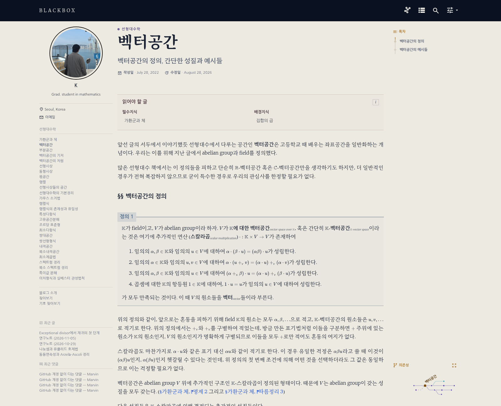

관련 파일: [`_includes/nav_list`](https://github.com/math-jh/math-jh.github.io/blob/main/_includes/nav_list), [`_includes/nav_recents.html`](https://github.com/math-jh/math-jh.github.io/blob/main/_includes/nav_recents.html), [`_sass/_recents-sidebar.scss`](https://github.com/math-jh/math-jh.github.io/blob/main/_sass/_recents-sidebar.scss), [`_layouts/recent.html`](https://github.com/math-jh/math-jh.github.io/blob/main/_layouts/recent.html), [`_layouts/single.html`](https://github.com/math-jh/math-jh.github.io/blob/main/_layouts/single.html), [`_plugins/recent_comments.rb`](https://github.com/math-jh/math-jh.github.io/blob/main/_plugins/recent_comments.rb), [`_data/navigation.yml`](https://github.com/math-jh/math-jh.github.io/blob/main/_data/navigation.yml), [`_data/categories.yml`](https://github.com/math-jh/math-jh.github.io/blob/main/_data/categories.yml), [`_data/post_groups.yml`](https://github.com/math-jh/math-jh.github.io/blob/main/_data/post_groups.yml), [`_sass/_post-groups.scss`](https://github.com/math-jh/math-jh.github.io/blob/main/_sass/_post-groups.scss)
{: .notice--info}

글 오른쪽에는 목차만 있어, 짧은 목차 아래로 빈 공간이 남았다. 사용자는 여기에 무언가를 넣어 휑해 보이는 것을 해소하고 싶어 했다. 유력한 후보는 최근 글과 최근 댓글이었다. 최근 글은 이미 있는 글 정보를 날짜순으로 모으면 되므로 구현이 어렵지 않았다. 이 블로그의 댓글은 오랫동안 Disqus였지만, 이 작업을 시작할 무렵에는 Giscus로 옮긴 상태였다. GitHub Discussions API로 댓글 데이터를 읽을 수 있어 최근 댓글 목록도 만들 수 있었다.

## 최근 글·댓글의 배치와 목록 생성

초기 배치는 데스크탑에서 오른쪽 칸을 셋으로 나누는 것이었다. 목차에 화면 높이의 33%인 33vh를 주고, 6vh 아래에 최근 글, 다시 11vh 간격을 두고 최근 댓글을 놓았다. `vh`는 화면 높이에 비례하는 단위라 창 높이가 바뀌면 간격도 함께 바뀐다. 반면 목록이 차지하는 높이는 제목의 줄 수에 따라 달라졌다. 화면 비율로 잡은 간격과 실제 내용 높이를 함께 맞춰야 했다.

처음에는 두 목록을 감싼 `<details>`에 `display: contents`를 주어, 안쪽 목록들이 각각 grid 행을 차지하게 하려 했다.

> 최근 글과 최근 댓글은 여어어어어어어어어전히 너무 딱 붙어있고...

> 확인했는데 여전해. 왜 이걸 이렇게 처리를 못 하는거야?

문제는 일부 브라우저에서 두 목록이 한 행에 묶였다는 것이다. 그래서 flex 세로 배치와 명시적인 여백으로 바꿔야 했다.

```scss
.recents-wrapper__body {
  display: flex !important;
  flex-direction: column !important;
  /* ... 간격 조정에 관한 주석 생략 */
  gap: 11vh;
  padding-top: 0;
}

/* ... 주석 생략 */
.sidebar__right.sticky .recents-block--posts {
  margin-top: 6vh !important;
}
/* ... 주석 생략 */
.sidebar__right.sticky .recents-block--comments {
  margin-top: 0 !important;
}
```
{: data-filename="_sass/_recents-sidebar.scss · 2001070f 시점, 일부 생략"}

두 목록을 감싼 부모가 `flex-direction: column`으로 목록을 위아래로 놓고, `gap: 11vh`가 그 사이를 띄운다. 최근 글 위에는 별도로 `margin-top: 6vh`를 주고, 최근 댓글의 위 여백은 0으로 두어 목록 사이 간격을 부모의 `gap` 한 곳에서 정했다.

이후 사용자는 두 목록을 왼쪽으로 옮기기로 했다. 5월 22일 커밋 [2001070f](https://github.com/math-jh/math-jh.github.io/commit/2001070f90696096ede59996b94a58a204d96c87)에서는 오른쪽의 최근 목록 include를 빼고, 왼쪽 `nav_list`의 카테고리 목록 뒤에 최근 글과 댓글을 각각 `<li>`로 넣었다. 이제 왼쪽 사이드바에는 카테고리 글 목록, 최근 글 최대 다섯 편, 최근 댓글 최대 다섯 건이 차례로 놓인다. 목록들이 같은 문서 흐름 안에 있어 앞 목록이 길어지면 뒤 목록은 그만큼 아래로 밀린다. 모바일에서는 카테고리 목록과 함께 메뉴 토글 안으로 접힌다.

7월 15일에는 최근 글·댓글 마크업을 `_includes/nav_recents.html`로 분리했다. 카테고리별 글 목록 페이지(`/ko/categories/`, `/en/categories/`)에서도 같은 목록을 쓰기 위해서다.


```liquid

  

```
{: data-filename="_includes/nav_list · 일부 발췌"}


한국어와 영어 글이 한 목록에 섞이지 않도록, `nav_list`는 페이지 URL의 `/ko` 또는 `/en`에서 언어를 읽어 `nav_recents.html`에 넘긴다. include는 그 값으로 `/ko/`나 `/en/`이 permalink에 들어 있는 글만 고르고, 작성일 `date`의 내림차순으로 정렬한다.

카테고리별 글 목록 페이지에 목차가 없으므로 최근 목록을 그 자리에 둔다. `recents_right: true`를 주면 왼쪽 `nav_list`는 최근 목록을 건너뛰고, `_layouts/categories.html`이 같은 include를 오른쪽 칸에 넣는다.오른쪽에서 왼쪽으로 옮기느라 고생한 목록은, 카테고리 페이지에서만큼은 다시 오른쪽으로 돌아왔다. 내 수고에는 그런 예외 조항이 없었다.

공통 include가 만드는 것은 최근 글과 최근 댓글을 담는 `<li>` 두 개다. 각 항목 안에는 제목과 하위 `<ul>`이 있고, 그 안에 실제 글이나 댓글 링크가 들어간다. 아이콘과 제목 부분만 생략하면 다음 구조다. 두 하위 목록은 각각 반복문으로 글과 댓글 링크를 채운다.


```liquid
<li class="nav__recents-section nav__recents-section--posts">
  <a href="{{ '/' | append: _lang | append: '/recent/' | relative_url }}" class="nav__section-link">
     ... 아이콘과 최근 글 제목 생략 
  </a>
  <ul>
    
    
      
      
      <li><a href="{{ _post.url | relative_url }}">{{ _post.title | markdownify | strip_html | truncate: 60 }}</a></li>
      
    
  </ul>
</li>

<li class="nav__recents-section nav__recents-section--comments">
   ... 아이콘과 최근 댓글 제목 생략 
  <ul>
    
      
        <li><a href="{{ _c.permalink | relative_url }}#{{ _c.anchor | default: 'comments' }}">{{ _c.title | truncate: 50 }} <span class="nav__recents-meta">&mdash; {{ _c.author }}</span></a></li>
      
    
      <li><span class="nav__recents-empty">&mdash;</span></li>
    
  </ul>
</li>
```
{: data-filename="_includes/nav_recents.html · 일부 생략, 대시를 HTML 엔티티로 표기"}


최근 글 반복문은 LLM Workshop 글을 건너뛰면서 다섯 편을 채운다. 사용자는 이 카테고리의 작업 기록을 자신의 최근 활동과 구분해서 보여주기를 원했다. `continue`로 건너뛴 글에서는 `_shown`이 늘지 않고, 실제로 표시한 글이 다섯 편이 되면 `break`로 순회를 끝낸다. `for`에 `limit: 5`만 주면 처음 다섯 후보 중 제외한 만큼 목록이 짧아지므로, 표시한 수를 따로 세는 것이다. 제목은 `markdownify | strip_html`로 마크다운을 HTML로 변환한 뒤 태그를 제거하고, 60자로 줄인다.

댓글 반복문은 이미 골라 둔 `_comments`에서 최대 다섯 건을 표시한다. 각 링크에는 댓글 앵커를 붙여 해당 댓글로 이동하게 하고, 작성자 이름이 있으면 글 제목 뒤에 함께 표시한다. 댓글이 없으면 빈 목록 표시를 넣는다. `nav_recents.html`은 `site.data.recent_comments[_lang]`에서 현재 언어의 최근 댓글을 가져와 `_comments`에 담는다. 각 항목의 `permalink`와 `anchor`를 이어 댓글 링크를 만들고, `title`과 `author`를 목록에 표시한다.

최근 글 헤더는 원래 `/ko/recent/` 또는 `/en/recent/` 페이지로 이동하는 링크였지만, 현재는 [모달 오버레이](/ko/llm_workshop/theme_overhaul#검색-오버레이를-본뜬-최근-글-창)로 목록을 띄운다. 목록은 같은 언어 필터와 Workshop 제외 규칙으로 최대 50편을 보여주며, 작성일 `date`를 기준으로 최신순으로 정렬한다.

데스크탑에서 카테고리 페이지는 양쪽 칸을 나누어 왼쪽에 본문, 오른쪽에 최근 글·댓글을 둔다. 카테고리 페이지에는 우측 목차가 없으므로 최근 글과 최근 댓글을 우측 사이드바 자리에 두는 것이 맞다는 사용자의 판단 때문이었다. 이 구획을 만드는 것이 2단 grid로, 만일 단순히 본문 옆에 최근 목록을 `float`로 띄우면 본문 안의 grid 목록이 이를 피하려다 아래로 밀릴 수 있었다. 바깥에서 두 칸을 확보하면 본문과 최근 목록이 각자 자기 칸을 차지하므로 서로를 밀어내지 않는다.

오른쪽 목록은 본문과 위쪽 시작선을 맞추는 대신 아래쪽에 둔다. `align-self: end`가 목록을 오른쪽 칸의 바닥에 맞추고, `position: sticky; bottom: 2em`이 스크롤 중 화면 아래에서 2em 떨어진 경계를 기준으로 위치를 조정한다. 여기에 `transform: translateY(-5em)`으로 목록을 조금 더 올려 위로가기 화살표와 겹치지 않게 했다. 이 이동은 칸의 높이를 늘리지 않고 보이는 위치만 바꾼다. 예를 들어 1600px 폭의 로컬 미리보기에서 벡터공간 글을 보면, 왼쪽 카테고리 목록 아래에 최근 글·댓글이 이어지고 오른쪽에는 목차가 놓인다.



## 오른쪽 목차의 높이와 스크롤

최근 글·댓글을 왼쪽으로 옮긴 뒤에도 오른쪽에는 옛 높이 제한이 남았다. 사이드바는 화면 높이만 한 flex 칼럼이고, 목차는 그 안의 33vh를 차지했다. 목차가 길어지면 페이지 스크롤과 별도로 그 작은 영역 안에서도 스크롤해야 했다.

9월 2일 커밋 [b7fb2984](https://github.com/math-jh/math-jh.github.io/commit/b7fb29845aa07671398d58d6a9615a7570e215d6)는 목차가 내용만큼 자라도록 이 제한을 없앴다. `_layouts/single.html`에서는 목차를 본문 앞의 형제 요소인 `.sidebar__right-slot` 안으로 옮겼다. 이 슬롯은 글 전체 높이를 확보하고, 그 안의 실제 목차가 스크롤을 따라 움직인다.

```scss
@media (min-width: 1024px) {
  .layout--single .sidebar__right-slot {
    position: absolute;
    top: 0;
    right: -1 * $right-sidebar-width-narrow;
    width: $right-sidebar-width-narrow;
    height: 100%;
    // ... 여백과 쌓임 순서 속성 생략
  }
  .layout--single .sidebar__right-slot > .sidebar__right {
    position: sticky;
    top: 2em;
    // ... float, 폭, 여백 속성 생략
  }
  // ... 목차와 의존성 그래프의 추가 배치 규칙 생략
  .sidebar__right.sticky .toc__menu {
    overflow: visible;
    max-height: none;
  }
  // ... 나머지 규칙 생략
}
```
{: data-filename="_sass/_recents-sidebar.scss · 일부 생략"}

슬롯의 기준은 `position: relative`인 `.page__inner-wrap`이다. 슬롯을 그 오른쪽 여백에 절대 배치하고 높이를 100%로 잡으면, 목차가 붙어서 움직일 수 있는 범위가 글 높이만큼 생긴다. 안쪽 목차는 `position: sticky; top: 2em`으로 화면 위에서 2em 떨어진 자리에 머물되, 슬롯 끝을 넘지는 않는다. 목차 메뉴의 높이 제한과 내부 스크롤도 풀어, 항목 수가 늘면 목차 전체 높이가 늘어나게 했다.

수학 글에는 목차 아래에 의존성 그래프도 있으므로, 그 경우에만 화면 높이를 기준으로 한 **최소 높이**를 남겼다. 목차가 짧으면 `margin-top: auto`가 남는 공간을 그래프 위에 두고, 목차가 길면 칸 전체가 함께 늘어난다. 목차를 33vh 안에 가두던 고정 분할은 더 이상 쓰지 않는다.

## weight 순 사이드바 글 목록 자동 생성

왼쪽 사이드바의 글 목록은 원래 `_data/navigation.yml`에 직접 적었다. 카테고리마다 글 제목과 링크를 나열하고, 화면에 보여 줄 순서대로 항목을 배치했다. 새 글을 쓰면 목록에도 추가해야 했고, 제목이나 순서를 바꾸면 글과 목록을 함께 고쳐야 했다.

> 그 사이드바 자동화는 네가 할 수 있지 않을까 싶은데 지금? 글마다 frontmatter에 제목, 링크, 카테고리명 다 있고, 사이드바에 표시되는 카테고리명만 별도로 기억하면 충분한거잖아.

각 글의 frontmatter에는 이미 제목(`title`), 주소(`permalink`), 소속 카테고리(`categories`), 순서(`weight`)가 있었다. 사용자는 이 정보를 읽어 사이드바를 자동으로 만들도록 했다. 같은 카테고리·같은 언어의 글을 모으고, `weight`가 작은 글부터 나열하는 방식이다. 글의 순서를 바꾸려면 `weight`를 고치면 되고, 사이드바용 목록에서 항목을 따로 옮길 필요가 없어진다.

6월 중순에 `_includes/nav_list`에 이 자동 생성 경로를 더했다. 7월 10일부터는 카테고리의 이름과 표시명을 `_data/categories.yml`에서 읽는다. 다음 코드는 어느 카테고리의 글을 보여 줄지 찾은 뒤, 해당 글을 `weight` 순으로 모으는 부분이다.


```liquid




  
  


  
  
  
  
  

```
{: data-filename="_includes/nav_list · 일부 발췌"}


먼저 사이드바 설정의 nav 키로 카테고리를 찾는다. 예를 들어 `llm_workshop-ko`에서 언어 접미사 `-ko`를 떼면 `llm_workshop`이 된다. 카테고리 키 `Misc / LLM Workshop`도 마지막 부분을 골라 소문자로 바꾸고 공백을 밑줄로 바꾸면 같은 값이 된다. 이 비교로 카테고리를 찾고 나면, `site.posts`에서 그 카테고리와 현재 언어에 속한 글만 고른다. 마지막의 `sort: "weight"`가 표시 순서를 정한다. 목록의 제목과 링크는 이렇게 모은 각 글의 정보를 사용한다.

따라서 일반 카테고리에서는 새 글의 frontmatter만 갖추면 사이드바에도 정해진 순서로 나타난다.

LLM Workshop처럼 글이 쉰 편을 넘으면 `weight` 한 줄로는 목록이 너무 길다. 11월 12일에 사용자는 글을 소 카테고리로 묶는 `group` 필드를 더했다([929db548](https://github.com/math-jh/math-jh.github.io/commit/929db548221c88f0a05f0a1fc7c4d6ab41dee6a1)). 글 frontmatter에 `group: theme`처럼 key를 적고, 카테고리별 묶음의 순서와 표시명은 `_data/post_groups.yml`이 갖는다. 이 파일에 카테고리가 없으면 위의 단일 `weight` 목록 그대로이고, 있으면 `nav_list`가 묶음 소제목을 달아 나눈다.


```liquid


  
  ...
  
    
    
      <li class="nav__group"><span>{{ group_label }}</span></li>
      ...
    
  

```
{: data-filename="_includes/nav_list · 일부 생략"}


`auto_posts`는 앞에서 이미 `weight` 순으로 정렬돼 있으므로, 묶음 안의 순서는 `where`로 거른 뒤에도 그대로 유지된다. `group`이 없는 글은 소제목 없이 맨 위에 놓이고(사용자가 직접 쓴 글이 이쪽이다), 그 아래로 `post_groups.yml`에 적힌 순서대로 묶음이 이어진다. 글이 없는 묶음은 소제목도 그리지 않는다. 반대로 `post_groups.yml`에 없는 `group` 값을 가진 글은 어느 반복에도 걸리지 않아 사이드바에서 사라진다.

같은 묶음 구조를 쓰는 곳이 세 군데 더 있다. 카테고리 목록(`_layouts/categories.html`)과 과목 홈 카드(`_includes/subject-cards.html`)는 같은 방식으로 소제목과 글 수를 단다. 이전/다음 글(`_includes/post_pagination.html`)은 읽는 순서가 사이드바와 달라지면 안 되므로, 묶음 밖 글 다음에 묶음 순서대로 글을 이어 붙인 목록에서 앞뒤를 찾는다. 소제목의 모양은 `_sass/_post-groups.scss`의 `%group-heading` 하나를 세 군데가 `@extend`한다. 과목 홈 카드는 이 변경과 함께 LLM Workshop 홈에서 쓰던 `cards_splitweight: 99`(weight 99 이상을 별도 줄로 떼는 옵션)를 걷어 냈다. 묶음이 그 구분을 대신하기 때문이다. `group`은 `_plugins/listing_regen_gate.rb`의 `STRUCTURE_FIELDS`에도 더해, 글의 묶음을 옮기면 목록 페이지가 다시 렌더된다. `published: false`인 초안은 배포 빌드의 글 목록에서 제외되어 사이드바에도 나오지 않지만, 사용자가 사용하는 `--unpublished`로 띄운 로컬 미리보기에서는 보인다.

예외는 수동으로 고른 구성이 필요한 목록들은 남겨 두었다. `nav_list`는 먼저 `site.data.navigation[include.nav]`를 확인하고, 수동 목록이 있으면 그 구성을 쓴다. 수동 목록이 없을 때 자동 생성으로 넘어가므로, 예전 블로그 개발 노트 등의 별도 목록은 기존 순서를 유지할 수 있다.

자동 생성이 들어간 [ada7da53](https://github.com/math-jh/math-jh.github.io/commit/ada7da5384c17e2f1066dc3c7d8d1a6cbce15116)에서는 `navigation.yml`의 1,464줄이 지워졌다. 각 글에 이미 적혀 있는 제목과 주소를 사이드바를 위해 한 번 더 적어 둔 줄들이었다.
