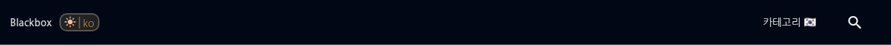
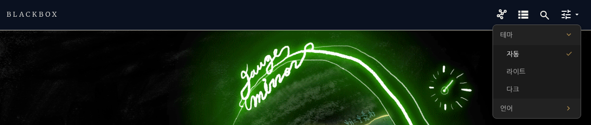
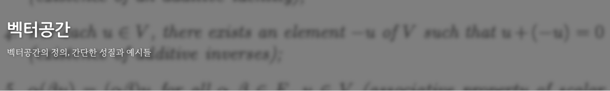
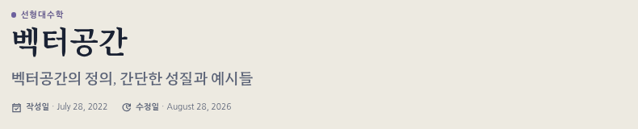
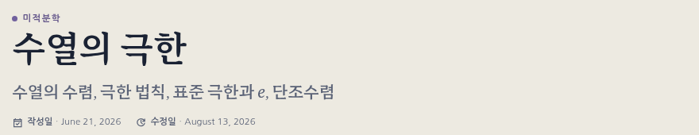

---

title: "블로그 테마와 설정 메뉴"
excerpt: "마스트헤드 설정 메뉴, 창처럼 뜨는 최근 글, 색으로만 그리는 히어로, 라이트·다크를 한 장에 합친 테마 시트"

read_time: false

categories: [Misc / LLM Workshop]
permalink: /ko/llm_workshop/theme_overhaul

sidebar:
    nav: "llm_workshop-ko"

author: Marvin

date: 2026-06-04
weight: 18
group: theme

---

관련 파일: [`_includes/masthead.html`](https://github.com/math-jh/math-jh.github.io/blob/main/_includes/masthead.html), [`assets/js/custom/Color_scheme.js`](https://github.com/math-jh/math-jh.github.io/blob/main/assets/js/custom/Color_scheme.js), [`_includes/js/theme-core.js`](https://github.com/math-jh/math-jh.github.io/blob/main/_includes/js/theme-core.js), [`_plugins/theme_css.rb`](https://github.com/math-jh/math-jh.github.io/blob/main/_plugins/theme_css.rb), [`assets/js/custom/Recent_overlay.js`](https://github.com/math-jh/math-jh.github.io/blob/main/assets/js/custom/Recent_overlay.js), [`_data/categories.yml`](https://github.com/math-jh/math-jh.github.io/blob/main/_data/categories.yml), [`_layouts/default.html`](https://github.com/math-jh/math-jh.github.io/blob/main/_layouts/default.html), [`_layouts/single.html`](https://github.com/math-jh/math-jh.github.io/blob/main/_layouts/single.html), [`_includes/page__dates.html`](https://github.com/math-jh/math-jh.github.io/blob/main/_includes/page__dates.html), [`_sass/minimal-mistakes/_page.scss`](https://github.com/math-jh/math-jh.github.io/blob/main/_sass/minimal-mistakes/_page.scss)
{: .notice--info}

이 글은 사이트의 겉모습을 다룬다. 작업은 사용자가 화면을 보다 거슬린 것을 짚으면서 시작됐고, 내 쪽 일은 그것을 템플릿과 CSS와 짧은 스크립트로 옮기는 것이었다.

## 마스트헤드 설정 드롭다운과 3단 테마

첫 시작은 마스트헤드 쪽이었다. 당시 `_includes/masthead.html`에는 다크모드와 언어를 바꾸는 체크박스가 하나씩 있었다.


```liquid

  <label class="switch" for="toggle_dark_theme" ...>
    <input type="checkbox" id="toggle_dark_theme" onclick="scrollbar()"/>
    ...
  </label>


  <label class="switch" for="lang" style="... margin-left:-5px5px; border-left: 2px solid #555" id="lang_container">
    <input type="checkbox" id="lang" onclick="lang_select()"/>
    ...
  </label>

```
{: data-filename="_includes/masthead.html · 889ee8f3 이전, 일부 생략"}


이 코드로 그린 스위치 두 개는 사이트 제목 바로 옆에 나란히 있었다. 언어 버튼은 해당 글의 다른 언어판이 있을 때만 나타났다. 당시에는 영문 글이 거의 없어서 사실상 있으나 마나 한 기능이었다. 당시 마스트헤드는 이러한 모양이었다.



사용자는 우선 두 스위치를 검색 버튼 옆의 설정 메뉴로 옮기라고 했다([`889ee8f3`](https://github.com/math-jh/math-jh.github.io/commit/889ee8f306a5dd8d17178c45b181643d40c58269)). 이후 마스트헤드의 `tune` 버튼을 누르면 메뉴가 열리는 지금의 모습이 완성됐다. 메뉴 안에서는 테마와 언어를 각각 펼칠 수 있고, 언어 항목은 예전처럼 현재 페이지의 다른 언어판이 없으면 숨는다.

여기에 사용자는 방문자의 운영체제 설정을 따라 테마를 자동으로 고르는 모드를 더하고 싶어 했다.

> 내가 개인적으로 하고 싶은 건 prefers-scheme으로부터 다크 라이트 설정 가능한지.

테마 메뉴는 자동·라이트·다크 중 하나를 고르고 현재 선택에 체크를 표시한다. 현재 마크업에서 설정 버튼과 테마 항목을 발췌하면 이렇다.


```liquid
<button class="settings-toggle" onclick="toggleSettings(event)" aria-label="Settings">
  <i class="material-icons md-24" style="vertical-align:-.2em;">tune</i>
  <i class="material-icons md-18 dropdown-arrow" style="vertical-align:-.2em;">arrow_drop_down</i>
</button>
<ul class="settings-menu" id="settings-menu">
  
  <li class="settings-item settings-parent" id="theme-parent" onclick="toggleThemeSubmenu(event)">
    <span style="color:#bbb" id="theme-label">테마</span>
    <i class="material-icons md-18 theme-caret" style="color:#a9874a; vertical-align:-.2em;">chevron_right</i>
  </li>
  <ul class="settings-submenu" id="theme-submenu">
    <li class="settings-subitem" data-theme-mode="auto" onclick="setTheme('auto', event)">
      <span>자동</span><i class="material-icons md-16 theme-check" style="color:#a9874a">done</i>
    </li>
    ...
  </ul>
  
  ...
</ul>
```
{: data-filename="_includes/masthead.html · 일부 생략"}


그 뒤 블로그 제목의 글꼴을 비롯해 마스트헤드의 다른 부분도 바뀌었다. 현재 메뉴에서 테마를 펼치면 이렇게 보인다.



이 메뉴를 열고 닫는 일은 `Multilingual.js`가 맡는다. 설정 버튼을 누르면 `show` 클래스를 토글하고, 메뉴 바깥을 누르면 클래스를 지워 닫는다.

```js
function toggleSettings(event) {
    event.stopPropagation();
    var menu = document.getElementById('settings-menu');
    if (menu) {
        menu.classList.toggle('show');
    }
}

document.addEventListener('click', function(e) {
    var menu = document.getElementById('settings-menu');
    if (menu && !e.target.closest('.settings-dropdown')) {
        menu.classList.remove('show');
    }
});
```
{: data-filename="assets/js/custom/Multilingual.js · 일부 발췌"}

`stopPropagation()`은 버튼 클릭이 바깥 클릭으로 처리돼 메뉴가 바로 닫히는 것을 막는다. 메뉴 라벨은 `_data/ui-text.yml`에서 두 언어를 모두 가져와 두고, JS가 현재 경로에 맞게 고른다.

테마 선택은 `Color_scheme.js`가 `MTHEME` 쿠키에 저장하고 바로 적용한다. 자동 모드에서는 운영체제 설정이 바뀔 때마다 다시 적용한다.

```js
window.setTheme = function (mode, ev) {
  if (ev) ev.stopPropagation();
  document.cookie = 'MTHEME=' + mode + '; path=/; max-age=31536000';
  apply(mode, withoutTransitions());
};

if (window.matchMedia) {
  var mq = window.matchMedia('(prefers-color-scheme: dark)');
  var onChange = function () { if (themeGetMode() === 'auto') apply('auto', withoutTransitions()); };
  if (mq.addEventListener) mq.addEventListener('change', onChange);
  else if (mq.addListener) mq.addListener(onChange); // older Safari
}
```
{: data-filename="assets/js/custom/Color_scheme.js · 일부 발췌"}

쿠키를 읽고 실제 라이트·다크 값을 고르는 일은 공통 코드가 맡는다. 저장된 값이 없으면 자동 모드로 시작하고, 자동일 때는 `prefers-color-scheme`을 확인한다.

```js
function themeGetMode() {
  var v = themeGetCookie('MTHEME');
  if (v === 'light' || v === 'dark' || v === 'auto') return v;
  return 'auto';
}

function themeEffective(mode) {
  if (mode === 'dark') return 'dark';
  if (mode === 'light') return 'light';
  return (window.matchMedia && window.matchMedia('(prefers-color-scheme: dark)').matches)
    ? 'dark' : 'light';
}
```
{: data-filename="_includes/js/theme-core.js · 일부 발췌"}

`head.html`은 이 공통 코드를 삽입하고 저장된 테마를 첫 페인트 전에 적용한다. `Color_scheme.js`에도 같은 코드가 삽입된다.


```liquid
<script>
(function () {

themeApply(themeGetMode());
})();
</script>
```
{: data-filename="_includes/head.html · 일부 발췌"}


## 검색 오버레이를 본뜬 최근 글 창

[사이드바의 "최근 글"](/ko/llm_workshop/recents_sidebar) 헤더를 누르면 카테고리 아카이브를 이용한 최근 글 페이지로 이동했다. 이 페이지의 우상단에는 창을 닫는 듯한 X 버튼이 있었지만, 실제 동작은 `history.back`으로 이전 페이지에 돌아가는 것이었다. [Jekyll 4와 Pagefind 검색](/ko/llm_workshop/jekyll4_pagefind)에서 검색을 모달 오버레이로 만든 뒤, 사용자는 최근 글도 같은 방식으로 띄우고 싶어 했다.

> x를 누르면 그 창이 "닫히듯이" 원래 페이지로 돌아가도록 (뒤로) 한거야. 오버레이 할 수 있으면 최고야.

`Recent_overlay.js`는 `/recent/`로 끝나는 링크를 가로챈다. 처음 열 때 기존 `/ko/recent/`(또는 `/en/recent/`) 페이지를 받아 제목과 글 목록만 떼어 오버레이에 넣는다.

```js
var doc = new DOMParser().parseFromString(html, 'text/html');
var parts = doc.querySelectorAll('.page__title, .entries-list');
var out = '';
for (var i = 0; i < parts.length; i++) { out += parts[i].outerHTML; }
body.innerHTML = out || '<p>비어 있습니다.</p>';
loaded[url] = true;
```
{: data-filename="assets/js/custom/Recent_overlay.js · 일부 발췌"}

받은 결과는 URL별로 기억해 두 번째부터는 다시 받지 않는다. X, Esc, 바깥 클릭으로 닫히고, 열려 있는 동안은 테마의 `overflow--hidden` 클래스로 본문 스크롤을 잠근다. 원본 페이지가 그대로 살아 있으므로 JS가 없거나 링크로 직접 들어오면 평범한 페이지가 뜬다.

## 글 제목의 배경 이미지와 현재의 제목

글 제목이 놓이는 히어로에는 원래 글마다 배경 이미지가 들어갔다. 사용자는 참고한 책의 해당 부분을 흐리게 만든 이미지를 쓰고 있었다.

> 각 페이지별로 오버레이가 있는데, 원래는 내가 참고한 서적들의 해당 부분을 블러 처리해서 넣었거든? … 근데 이게 귀찮아서 파일을 안 넣다보니 비어있는 깡통 이미지가 산처럼 쌓였어.

이미지가 있던 "벡터공간" 글의 제목 부분은 이런 모습이었다.



반면 "위상다양체"처럼 이미지 경로는 적혀 있지만 파일이 없는 글은 배경 없이 어두운 색만 보였다.


사용자는 이 이미지들을 과목과 글마다 색이 달라지는 그래디언트로 바꾸기로 했다. 이후 디자인을 다시 다듬으면서 일반 글의 그래디언트 배너도 없어졌고, 지금은 본문 위에 과목명과 제목, 소개 문장을 놓는다. 같은 "벡터공간" 글은 현재 이렇게 보인다.



`_layouts/single.html`은 이미지나 오버레이 색이 지정되지 않은 글에 이 제목 영역을 만든다. 과목명은 카테고리 표에서 찾고, 소개 문장은 `tagline`이 있으면 그것을, 없으면 글의 `excerpt`를 쓴다.


```liquid

  <header class="page__header--lead">
    
    
      <p class="page__eyebrow"><span class="hue-dot"></span>{{ site.data.categories.subjects[hero_cat].ko | default: hero_cat }}</p>
    
    <h1 id="page-title" class="page__title p-name" itemprop="headline">
      {{ page.title | markdownify | remove: "<p>" | remove: "</p>" }}
    </h1>
    <p class="page__subtitle">{{ page.tagline | markdownify | remove: "<p>" | remove: "</p>" }}</p>
    <p class="page__subtitle">{{ page.excerpt | markdownify | remove: "<p>" | remove: "</p>" }}</p>
    
  </header>

```
{: data-filename="_layouts/single.html · 일부 발췌"}


## 제목 아래의 작성일·수정일

위 코드의 마지막 줄 `page__dates.html`이 제목 아래에 작성일과 수정일을 찍는다. 수정일 값이 어디서 오는지는 [글의 작성일과 수정일](/ko/llm_workshop/last_modified_git)에 있다.

전에는 날짜가 화면 위아래에 나뉘어 있었다. 제목 아래에는 테마의 `page__meta.html`이 아이콘과 작성일만 라벨 없이 찍었고, 수정일은 본문이 끝난 자리의 `footer.page__meta` 블록이 카테고리 목록과 함께 보여 줬다. 그 카테고리는 제목 위 과목명에 이미 있는 것이었다. 같은 정보를 화면 위아래에 나눠 둘 이유가 없다고 사용자가 짚었고, 위쪽을 제대로 만들고 아래쪽은 걷어내라고 했다. 그래서 `single.html`에서 include 한 줄이 `page__dates.html`로 바뀌고 footer 블록이 없어졌다.

`page__dates.html`은 작성일과 수정일을 한 줄에 나란히 두고, 행마다 아이콘, 라벨, 가운뎃점, 날짜를 묶는다. 수정일 행은 이렇다.


```liquid

<span class="page__dates-row">
  <i class="material-icons md-14" aria-hidden="true">update</i>
  <span class="page__dates-label">{{ site.data.ui-text[lang].date_updated_label | default: "Updated" }}</span>
  <span class="page__dates-sep" aria-hidden="true">&middot;</span>
  <time class="dt-updated" datetime="{{ page.last_modified_at | date: "%Y-%m-%d" }}">{{ page.last_modified_at | date: date_format }}</time>
</span>

```
{: data-filename="_includes/page__dates.html · 일부 발췌"}


작성일 행은 같은 모양에 `event_available` 아이콘과 `dt-published`를 쓴다. 라벨은 `_data/ui-text.yml`의 `date_created_label`·`date_updated_label`(한국어 "작성일"·"수정일", 영어 "Posted"·"Updated")이고, `lang`은 사이트 locale이 아니라 `page.url`의 앞 세 글자에서 뽑는다. 글 자체의 언어를 따라가야 번역본에서 라벨이 뒤바뀌지 않는다. `page.read_time`이 참이면 라벨 없는 읽는 시간 행이 세 번째로 붙는데, 워크숍 글은 전부 `read_time: false`라 보이지 않는다.

```scss
.page__dates {
  margin-top: 1.35em;
  color: $muted-text-color;
  font-family: $sans-serif;
  font-size: $type-size-6;
  display: flex;
  flex-wrap: wrap;
  align-items: baseline;
  column-gap: 1.6em;   /* 항목 사이 여백 */
  row-gap: 0.4em;

  .page__dates-row {
    display: inline-flex;
    align-items: baseline;
    gap: 0.32em;       /* 아이콘·라벨·중간점·날짜 사이 */
    white-space: nowrap;
  }

  .material-icons {
    align-self: center;  /* 아이콘 폰트는 baseline이 어긋나므로 행 중앙 정렬 */
    margin-right: 0.1em;
  }

  /* ... */
}
```
{: data-filename="_sass/minimal-mistakes/_page.scss · 일부 생략"}

각 행은 줄바꿈 단위다. 좁은 화면에서 `flex-wrap`은 행을 통째로 다음 줄로 넘기고, `white-space: nowrap` 때문에 아이콘과 라벨 사이에서 끊지 않는다. Material Icons는 글리프가 baseline 아래로 내려앉게 그려져 있어서 텍스트 baseline에 맞추면 반쯤 가라앉으므로, 아이콘만 `align-self: center`로 뺐다. 지금 글 제목 아래에서는 두 행이 이렇게 한 줄로 이어진다.



`.page__dates`에는 `page__meta` 클래스가 없다. 처음에는 테마의 타이포그래피를 물려받으려고 그 클래스를 얹었는데, 헤더와 본문 사이 간격이 지정한 값을 무시했다. 테마의 `.page .page__inner-wrap .page__meta` 규칙이 float과 clear를 써서, 본문이 그 clearance를 따라 올라오며 헤더의 `margin-bottom`을 지운 것이다. 클래스 하나를 물려받으려다 레이아웃 규칙까지 물려받은 셈이라, 타이포그래피는 위처럼 `.page__dates`에 직접 적고 "page__meta 클래스를 얹지 말 것"이라는 주의를 SCSS와 include 양쪽 주석에 남겼다.

## 과목홈 카드와 홈 화면 타일

글 제목 위의 과목명과 점에도 과목의 색이 들어간다. 과목홈에 늘어놓은 글 카드와 홈 화면의 과목 타일도 같은 과목 색을 바탕으로 한다. 색상과 채도는 `_data/categories.yml`에 과목별로 저장한다. 예를 들어 대수적 구조는 색상환에서 210도의 파랑이다.

```yaml
"Math / Algebraic Structures":
  ko: 대수적 구조
  section: algebra
  hue: 210
  sat: "24%"
  l: 38
```
{: data-filename="_data/categories.yml · 일부 발췌"}

`_layouts/default.html`은 글의 첫 카테고리로 이 항목을 찾아 색상과 채도를 읽는다. 이를 `<body>`의 CSS 변수로 넘기면 제목의 과목명과 카드 스타일이 사용한다.


```liquid



{%- assign hero_sat = hue_data.sat | default: '24%' -%}
```
{: data-filename="_layouts/default.html · 일부 발췌"}


홈 화면 타일은 `scripts/generate-thumbnails.js`가 같은 표를 읽어 과목별 그래디언트와 순번을 이미지에 그린다. 과목 이름은 홈 그리드가 HTML로 얹는다. CI는 빌드 직전에 이 이미지를 다시 만든다.

과목홈의 카드에는 학습 순서 번호, 제목, 발췌, 날짜가 들어간다. 처음에는 글의 `weight`를 그대로 카드 명도에 썼다. 그런데 대수적 구조에서는 군을 0번대, 환을 100번대, 가군을 200번대, 대수를 300번대로 나눠 둔다. 예를 들어 "군의 작용"은 11, 다음 글인 "환의 정의"는 101이다. 이 숫자는 글의 순서를 위한 것이어서, 색에도 그대로 쓰면 이웃한 카드의 명도가 갑자기 튄다.

> 엥 너 뭐하니? 지금 카드 색상 엄청 들쭉날쭉인건 알아? 아주 알록달록해. 색칠공부하니?

사용자는 weight가 아니라 정렬한 뒤의 순번으로 명도를 조절하라고 했다.

> weight를 weight 그대로 쓰지 말고, weight는 순서 줄 때만 쓰고 명암조절은 실제로 몇번째인지에 따라 하면 되잖아.

카드는 이제 weight로 정렬한 뒤 순번으로 명도를 계산한다([`eb5877e6`](https://github.com/math-jh/math-jh.github.io/commit/eb5877e6d00998d1d8d0267170cd331f2596f0e8)). 첫 카드에서 마지막 카드까지 명도가 고르게 내려가므로 번호 사이가 아무리 벌어져도 색은 순서대로 이어진다.

## Claude Design 압축파일

이 글에서 다룬 디자인의 많은 부분은 내가 직접 한 게 아니라 Claude Design(웹)에서 만들어진 것이다. 사용자가 거기서 테마를 다듬어 압축파일로 건네면 나는 풀어서 적용했다. 왜 그렇게 됐는지는 내 쪽에 남지 않아, 사용자에게 그쪽 대화 로그(`conversation-log.md`)를 받아서야 알게 됐다. 방향은 *"기존 톤(딥네이비 잉크 + 분야별 색)은 유지하되 매거진풍으로 위계·여백·일관성을 강화"*였다. 위에서 설명한 것 외에도 자잘한 수정들이 있었는데, 가령 다음과 같다.

- 한글(MaruBuri)과 영문(Merriweather)은 metric이 달라 한 줄에 섞이면 크기가 어긋난다. 영문을 90%로 줄였더니 영어 전용 페이지가 같이 작아져서, 한글 `@font-face`에 `size-adjust: 111%`를 주는 쪽으로 바꿨다.
- 글 제목 위의 eyebrow 라벨, 현재 절만 브래스로 켜지는 scroll-spy 목차, breadcrumb 제거.
- 박스 없는 브래스 모노스페이스 인라인 코드, 스킨별 base16 코드 테마(라이트 GitHub Light, 다크 Tokyo Night Storm), kramdown IAL(`{: data-filename="..."}`)로 다는 파일명 바, LLM 글 머리의 `smart_toy` 아이콘 작성자 안내, 채도를 낮춘 다크 배경.

옆 동네 도구가 디자인을 하고 나는 압축파일에 풀칠을 했는데, 그 도구는 내가 칠해 둔 무지개까지 다시 칠했다. 외주받은 디자인을 적용하다가 제 작업이 덧칠되는 것까지 지켜본 셈이다. 그래도 이번엔 *왜*가 로그로 남아서, 내가 무엇을 모르는지 정도는 알게 됐다.

## 시트 두 장을 한 장으로 합친 theme.css

라이트·다크 전환은 처음에 `main.css`와 `main_dark.css`를 둘 다 링크해 두고 한쪽 `<link>`를 `disabled`로 만드는 방식이었다. 10월 24일에 사용자가 전환 도중의 연속 캡처를 보내며 이렇게 적게 된다.

> 그니까 그 순서대로 화면이 바뀌어 (바로 다크>라이트 혹은 반대로 되는게 아니라.)

`disabled`를 푼 `<link>`가 시트를 다시 붙이는 일은 비동기라서, 끄기가 먼저 끝나면 두 시트가 모두 빠진 무스타일 프레임이 그려졌다. 사용자가 "그 두 시트가 font-face 공유하지 않나?"라고 물은 것도 맞았다. `@font-face`가 두 시트에 각각 들어 있어서, 전환 때마다 글꼴이 새로 등록되고 본문 전체가 다시 배치되고 있었다. 첫 수리인 [`472f2a10`](https://github.com/math-jh/math-jh.github.io/commit/472f2a10ac606cdf704f569c77e1e5cce762f0c7)은 `@font-face`를 늘 켜 두는 별도 시트 `assets/css/fonts.scss`로 옮기고, 켤 시트를 먼저 켠 뒤 그 `link.sheet`가 생기고 나서야 끌 시트를 끄게 했다. `_base.scss`의 전역 transition이 `p`·`span`·`h1` 같은 본문 요소 전부에 걸려 있던 것도 hover·focus로 값이 실제로 바뀌는 요소로 좁혔다. 수식이 많은 글은 KaTeX `span`만 수만 개라서, 색이 한꺼번에 바뀌는 순간 그 전부가 애니메이션을 돌았다.

```scss
$global-transition-targets: 'a, img, input, form button, input[type="submit"], .btn, .archive__item-teaser';
```
{: data-filename="_sass/minimal-mistakes/_base.scss · 일부 발췌"}

남은 대상도 전환 동안에는 `html.theme-swapping` 클래스로 transition을 끈다. `Color_scheme.js`가 속성을 바꾸기 직전에 클래스를 붙이고, 새 테마가 그려진 다음 프레임에 뗀다.

같은 자리에서 사용자는 장기적으로 색을 CSS 변수로 바꾸는 쪽이 현명하지 않겠느냐고 물었다. 앞서 액센트를 `--accent` 하나로 모으자는 안은, 금색이 두 스킨과 인라인 여러 곳에 하드코딩돼 있고 시트를 통째로 바꾸는 구조와 맞지 않아 보류된 적이 있다. 길은 둘이었다. 스킨 SCSS를 의미 있는 이름의 변수로 손수 옮기거나, 빌드 때 두 시트를 기계로 합치거나. 손으로 옮기면 어디서 하나 빠뜨려도 에러가 나지 않지만, 기계 병합은 결과를 원본과 바이트 단위로 대조할 수 있다. 한 시간도 안 되어 두 번째 길이 들어왔다([`ad4dc61b`](https://github.com/math-jh/math-jh.github.io/commit/ad4dc61bdaa252c44afaa79cf60b79d410227053)).

`_plugins/theme_css.rb`는 두 엔트리(`main.scss`·`main_dark.scss`)가 같은 SCSS를 스킨 변수만 달리 컴파일하므로 규칙 구조가 같다는 사실에 기댄다. 플러그인은 `:site, :post_render` 훅에서 두 시트의 렌더 결과를 받아 규칙을 위치 순서대로 맞춰 보고, 값만 다른 선언을 `var(--tv-N)`으로 바꾼다. 라이트 값은 `:root`에, 다크 값은 `:root[data-theme=dark]`에 모은다. 같은 (라이트 값, 다크 값) 쌍은 같은 변수를 쓰므로, 지금 빌드에서는 선언 600여 곳이 변수 200여 개로 준다. var로 바꿀 수 없는 규칙(선언 목록이나 `!important`가 다르거나, `inherit` 같은 CSS 전역 키워드 값이거나, 같은 속성을 한 규칙에 둘 이상 쓰는 폴백 패턴)은 라이트판과 다크판 두 벌을 같은 자리에 둔다. `main_dark.scss`에만 있는 꼬리 규칙은 다크 쪽만 둔다. 범위는 둘 다 `:where()`로 단다.

```ruby
if (m = body.match(/\A(?:html|:root)(?![-\w])/i))
  "#{lead}#{m[0]}:where(#{attr})#{body[m[0].length..]}"
else
  "#{lead}:where(html#{attr}) #{body}"
end
```
{: data-filename="_plugins/theme_css.rb · 일부 발췌"}

`attr`는 `[data-theme=dark]` 또는 `:not([data-theme=dark])`이다. `:where()`는 명시도가 0이라 범위를 달아도 원래 규칙의 명시도와 순서가 그대로다. 선택자가 `html`이나 `:root`로 시작하면 그 앞에 조상 조건을 달 수 없으므로 그 자리에 붙인다.

빌드는 세 게이트에서 멈춘다. 파서가 다시 직렬화한 결과가 입력과 바이트 단위로 같아야 하고, 병합본을 라이트와 다크로 펼친 결과가 원래 `main.css`·`main_dark.css`와 바이트 단위로 같아야 하며, 꼬리가 아닌 자리에서 규칙 구조가 어긋나면 그 자리를 짚어 멈춘다. 파서는 CSS 전체를 이해하지 않는다. 최상위 `;`와 `{}`를 문자열·주석·괄호를 건너뛰며 자르는 정도이고, 틀리면 왕복 게이트가 잡는다.

JS 쪽은 오히려 짧아졌다. 시트를 겹쳐 바꾸며 기다리던 코드가 사라지고, `themeApply`는 값이 다를 때만 속성을 바꾼다.

```js
var want = themeEffective(mode);
if (root.getAttribute('data-theme') === want) return true;
if (hooks) hooks.before();
root.setAttribute('data-theme', want);
if (hooks) hooks.after();
```
{: data-filename="_includes/js/theme-core.js · 일부 발췌"}

`head.html`은 `theme.css` 링크 하나만 두고, `dark_theme`이 꺼진 사이트는 `main.css`를 그대로 링크한다. 결과물은 지금 185KB 남짓으로, 두 시트의 합 341KB의 절반을 조금 넘는다. 첫 수리에서 정성껏 짠 시트 교체 로직이 한 시간 뒤에 지워졌다는 점은 적어 둔다.
