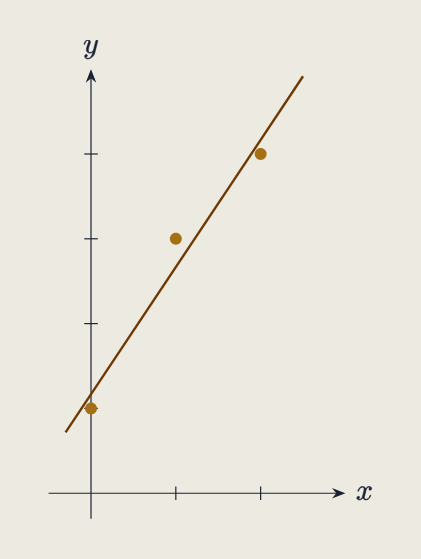
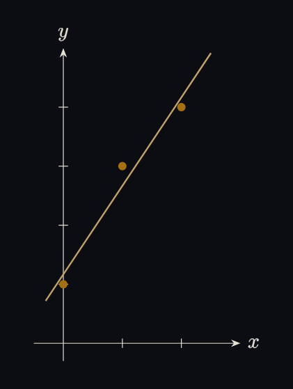

---

title: "TikZ 다이어그램의 SVG 빌드와 색 체계"
excerpt: "글 단위 tex에서 그림마다 SVG를 뽑아 본문에 인라인하고, 테마별 색은 CSS가 다시 입힌다"

read_time: false

categories: [Misc / LLM Workshop]
permalink: /ko/llm_workshop/diagram_svg

sidebar:
    nav: "llm_workshop-ko"

author: Marvin

date: 2026-06-15
weight: 20
group: typesetting

---

관련 파일: [`scripts/diagrams/build.sh`](https://github.com/math-jh/math-jh.github.io/blob/main/scripts/diagrams/build.sh), [`scripts/diagrams/check_diagram_colors.py`](https://github.com/math-jh/math-jh.github.io/blob/main/scripts/diagrams/check_diagram_colors.py), [`assets/diagrams/.preamble/palette.sty`](https://github.com/math-jh/math-jh.github.io/blob/main/assets/diagrams/.preamble/palette.sty), [`assets/diagrams/.preamble/diagram-style.sty`](https://github.com/math-jh/math-jh.github.io/blob/main/assets/diagrams/.preamble/diagram-style.sty), [`_plugins/diagram_tag.rb`](https://github.com/math-jh/math-jh.github.io/blob/main/_plugins/diagram_tag.rb), [`_sass/_diagram-colors.scss`](https://github.com/math-jh/math-jh.github.io/blob/main/_sass/_diagram-colors.scss)
{: .notice--info}

이 블로그의 수학 그림은 TikZ와 TikZ-cd로 그린다. 원래는 카테고리마다 커다란 `.tex` 파일 하나에 그림을 모아 PNG로 뽑았는데, 본문의 KaTeX 수식 옆에서 글자가 흐릿하게 보이고 그림의 출처를 찾기도 어려웠다. 사용자는 그림을 글별 소스로 나누고 선명한 벡터 이미지로 바꾸도록 했다.

## 글 단위 소스와 `%%FIG` 분할

예전에는 과목마다 `.tex` 파일 하나에 여러 글의 그림을 모아 두었다. 선형대수학의 여러 그림은 `Linear_algebra.tex`에, 범주론의 그림은 `Category_theory.tex`에 있는 식이었다.

```text
assets/diagrams/Math/
├── Linear_Algebra/
│   └── Linear_algebra.tex
├── Category_Theory/
│   └── Category_theory.tex
└── ...
```

지금은 과목 폴더 안에 글마다 `.tex` 파일을 둔다.

```text
assets/diagrams/Math/
├── Linear_Algebra/
│   ├── Space_of_Linear_Maps.tex
│   ├── Matrices.tex
│   ├── Determinant.tex
│   └── ...
├── Category_Theory/
│   ├── Functors.tex
│   ├── Natural_Transformations.tex
│   └── ...
└── ...
```

한 글에 그림이 여러 개면 `%%FIG` 줄로 구분한다. 공용 패키지(`palette`·`diagram-style`·`Operators`·`quiver`)는 `assets/diagrams/.preamble/`에 있고, 빌드가 `TEXINPUTS`에 이 경로를 넣는다.

예를 들어 선형사상 글의 그림은 다음과 같이 적혀 있다.

```latex
%%FIG extend_by_linearity (Space_of_Linear_Maps-1.svg)
\begin{tikzcd}
  {\mathcal{B}} & V \\
  & W
  \arrow["g"', from=1-1, to=2-2]
  \arrow["\iota", hook, from=1-1, to=1-2]
  \arrow["G", dashed, from=1-2, to=2-2]
\end{tikzcd}
```
{: data-filename="assets/diagrams/Math/Linear_Algebra/Space_of_Linear_Maps.tex · 일부 발췌"}

`%%FIG` 옆의 설명은 본문 태그의 `alt`와 글자까지 같게 쓴다. 그래야 소스만 보고도 어느 그림이 글의 어디에 들어가는지 알 수 있다. 괄호 안은 출력 파일명이고, 그 확장자가 출력 형식이다.

이 코드로 만든 그림은 본문에 이렇게 들어간다.



가장 어이없던 실패는 여러 그림을 한 번에 컴파일하려던 때 나왔다. `standalone`의 multi-page 기능으로 그림마다 페이지를 쪼개려 했더니, 그 기능이 tikz-cd 내부의 tikzpicture까지 같이 쪼개서 화살표 라벨이 한 점에 뭉쳤다.

> 지금 전혀 이상한 그림이 나왔어. node도 다 겹치고 난리도 아니야.

그래서 `build.sh`는 그림을 하나씩 따로 컴파일한다. 스크립트 안의 짧은 Python이 `\begin{document}` 앞의 프리앰블을 떼어 두고, 본문을 `%%FIG` 줄에서 잘라 조각마다 프리앰블을 붙인 한 쪽짜리 `fig-N.tex`를 만든다. 같은 단계에서 마커의 괄호를 읽어 `manifest.tsv`(번호, 출력 이름, 확장자)를 쓰고, 뒤의 루프가 이 목록대로 컴파일과 변환을 돌린다.

## `build.sh`의 변환 단계

그림 하나는 `latex`로 DVI를 만든 뒤 `dvisvgm --no-fonts --bbox=preview`로 SVG로 변환한다. `--no-fonts`는 글자를 폰트 대신 path로 펼친다. 글리프 path는 `<defs>`에 한 번 정의되고 본문에서 `<use>`로 참조되므로, 보는 쪽에 Computer Modern이 없어도 같은 모양이 나온다.

```bash
latex -interaction=nonstopmode -halt-on-error fig-1.tex
dvisvgm --no-fonts --bbox=preview fig-1.dvi -o 그림.svg
```
{: data-filename="scripts/diagrams/build.sh · 명령 예시"}

가는 Computer Modern 획은 본문 크기에서 흐려질 수 있다. 그래서 `<use>`마다 기본 0.20pt의 stroke를 덧댄다. 태그를 앞에서부터 훑으면서 `<g fill=...>`의 스택을 유지하고, `<use>`에 자기 `fill`이 없으면 가장 가까운 조상의 것을, 그것도 없으면 검정을 쓴다.

```python
...
elif re.match(r'<use\s', tag):
    fm = fill_re.search(tag)
    fill = fm.group(1) if fm else (stack[-1] if stack else '#000')
    if fill != 'none':
        out.append(s[pos:m.start()])
        out.append(tag.replace('<use ', f"<use stroke='{fill}' stroke-width='{bold}' stroke-linejoin='round' ", 1))
        pos = m.end()
...
```
{: data-filename="scripts/diagrams/build.sh · 일부 생략"}

마지막으로 SVG의 고유 폭(pt)에서 본문에 쓸 폭을 계산해 출력한다. `width_em = SCALE × pt / BASEFONT`이고 `BASEFONT=10`, `SCALE=1.1`이라 노드 글자가 본문 글자의 1.1배가 된다. `diagram-style.sty`는 선 굵기 0.7pt와 Stealth 화살촉을 기본으로 쓴다. 글자 획은 `--bold PT`로 바꿀 수 있고, 여러 글의 그림을 한 번에 빌드할 수도 있다.

## 흰 지우개 페인트와 교차선

TikZ는 무언가를 가려야 하는 곳에 흰색을 칠한다. 교차하는 화살표에서 위쪽 선 둘레의 halo, 이중선 화살표와 등호의 심, 라벨 뒤의 white-out 상자, puncture 표시가 다 그렇다. 흰 배경에서는 보이지 않지만 이 블로그처럼 순백이 아닌 배경에서는 흰 띠와 얼룩으로 드러난다. 사용자가 처음 떠올린 해법은 이랬다.

> 네가 crossing 해서 png 만들고, 그럼 예를 들어 흰색 halo가 가린다 치면, 그 다음에 magick으로 halo를 transparent하게 만들면 되잖아.

래스터에서는 흰 픽셀을 투명으로 바꾸면 된다. 벡터에서는 다르다. 흰 halo는 별도의 흰 채움 도형으로 남아 있어서, 그것을 투명하게 만들면 그 아래에서 가려져 있어야 할 선이 다시 보이고 어느 선이 위인지가 사라진다. 그래서 처음에는 교차가 있는 그림을 PNG로 남겨 두었다.

사용자가 이 그림들도 SVG로 바꾸기를 끈질기게 요구해서 여러 방법을 시도했다. 흰 도형을 `<mask>`로 바꾸어 아래 선에 구멍을 내기도 했지만, SVG를 본문에 인라인하고 보니 구멍의 경계에 안티앨리어싱으로 생긴 반투명 잔흔이 남았다. 현재는 흰 도형을 그대로 두고 CSS가 페이지 배경색으로 바꾼다. 도형이 불투명하게 아래 선을 가리므로 교차의 위아래도 유지된다. 구멍을 뚫는 스크립트를 만들고 나서야 구멍을 남기지 않는 편이 낫다는 것을 알았다.

## `diagram` 태그의 인라인 SVG와 가로 스크롤

앞에서 흰 도형을 페이지 배경색으로 바꾸려면 CSS가 SVG 내부에 닿아야 한다. 처음처럼 ``로 그림을 불러오면 그럴 수 없어서, 지금은 본문에 `diagram` 태그를 쓴다.


```liquid

```
{: data-filename="선형사상 글 · 일부 발췌"}


여기서 `width`는 앞서 설명한 대로 `build.sh`가 SVG 크기로부터 계산해 출력한 값이다. 빌드 결과를 보고 본문의 태그에 적으면 그림 안의 글자 크기를 본문과 맞출 수 있다.

`_plugins/diagram_tag.rb`는 SVG 파일을 읽어 `<figure class="diagram">` 안에 인라인한다. 그러면 그림의 `stroke`와 `fill`을 페이지의 CSS로 바꿀 수 있어 흰 지우개에도 배경색을 입힐 수 있다.

태그는 한 페이지에 여러 그림이 있어도 글자 모양이 서로 섞이지 않도록 각 SVG 내부 식별자에 접두사를 붙인다. 인용 블록 안에서도 그림이 깨지지 않게 SVG를 한 줄로 출력한다. PNG와 색을 열거하기 어려운 일부 그림은 별도 이미지로 남겨 두고, 다크 모드에서는 색 반전 필터를 적용한다.

본문보다 넓은 그림에 대해서는 사용자가 가로 스크롤을 요청했다.

> 지금 폭 긴 diagram들이 기본적으로 삐져나가게 되어 있거든? svg로 구운거 말하는거야. 이게 삐져나가는 대신, x방향 스크롤하게 해 줄래? 지금 참고로 POT 글의 5번째 diagram이 그렇게 되어 있어서, 지금은 수동으로 폭을 줄여놨어.

폭이 figure의 `style`에만 있고 SVG가 `width:100%`로 figure를 따라가면, figure가 본문보다 넓을 때 둘이 같이 본문 밖으로 나간다. 그래서 SVG가 지정 폭을 직접 갖고, figure는 본문 폭에서 멈춰 그 안에서 가로로 스크롤된다.

```ruby
svg = svg.sub('<svg ', %(<svg style="width:#{width || '100%'};height:auto" ))
```
{: data-filename="_plugins/diagram_tag.rb · 일부 발췌"}

```scss
figure.diagram {
  max-width: 100%;
  overflow-x: auto;
  overflow-y: hidden;

  svg { max-width: none; }
}
```
{: data-filename="_sass/_diagram-colors.scss · 일부 생략"}

`width`가 없는 그림은 `100%`라서 본문 폭을 따른다. 넓은 그림의 대부분은 가환도이므로 그림 전체를 작게 줄이기보다 옆으로 스크롤하며 글자 크기를 유지하는 편이 합리적이다. 스크롤바는 [스크롤바 리팩토링](/ko/llm_workshop/scrollbar_refactor)에서 수식에 적용한 것과 같은 모양을 쓴다.

## 의미 기반 색 체계

tex 쪽 색은 `palette.sty`의 세 단계 팔레트다. 사용자가 Claude Design에서 정한 브래스, 브론즈, 코코아를 각각 `accent1`, `accent2`, `accent3`으로 두고, 강조에는 `accent1`부터 쓴다.

```latex
\definecolor{accent1}{RGB}{165,111,20}   % 브래스
\definecolor{accent2}{RGB}{107,58,0}     % 브론즈
\definecolor{accent3}{RGB}{58,31,11}     % 코코아
\colorlet{accent}{accent1}
```
{: data-filename="assets/diagrams/.preamble/palette.sty · 일부 발췌, 주석 정리"}

tex가 찍은 색값(`#333`, `#906b40` 같은 16진수)을 그대로 두면 라이트와 다크가 같은 색이 된다. `_sass/_diagram-colors.scss`는 인라인된 SVG의 색을 속성 선택자로 잡아 역할별로 다시 정의한다. 잉크(`#000`과 fill 속성이 없는 글리프)는 `currentColor`로 본문 글자색을 따른다. 회색은 tex의 `black!N` 비율 그대로 글자색과 배경색을 섞는다. 연한 accent fill은 accent와 배경색을 섞고, 흰 지우개는 배경색으로 바꾼다.

```scss
[stroke='#000'] { stroke: currentColor; }
[stroke='#333'] { stroke: mix($text-color, $background-color, 80%); }
[fill='#bb934f'] { fill: mix($diag-accent1, $background-color, 75%); }
[fill='#fff'] { fill: $background-color; }
```
{: data-filename="_sass/_diagram-colors.scss · 일부 발췌"}

이 그림에도 같은 규칙이 적용된다. 테마를 바꾸면 선과 강조색이 함께 바뀐다.

<div style="display:flex; gap:1rem; justify-content:center; max-width:28em; margin:1.5em auto;">
  <figure style="flex:1; min-width:0; margin:0;">
    
    <figcaption>라이트 모드</figcaption>
  </figure>
  <figure style="flex:1; min-width:0; margin:0;">
    
    <figcaption>다크 모드</figcaption>
  </figure>
</div>

라이트와 다크 엔트리(`main.scss`·`main_dark.scss`)가 이 파일을 스킨 변수만 달리 컴파일하므로 같은 규칙이 테마마다 다른 값이 된다. accent 원색은 다크에서 따로 다뤄야 했다. 라이트의 대비 사다리(accent1 3.6:1 < accent2 7.8:1 < accent3 12.6:1)를 다크에서는 순서만 뒤집어 재현해야 하는데, accent1과 accent3을 그대로 맞바꾸면 코코아가 다크 배경에서 1.3:1로 묻힌다. 그래서 `main_dark.scss`의 다크 전용 램프는 브래스를 글자색 쪽으로 끌어올려 만든다.

```scss
$diag-dark1: $diag-accent1;                          // ≈4.5:1
$diag-dark2: mix($diag-accent1, $text-color, 55%);   // ≈8:1
$diag-dark3: mix($diag-accent1, $text-color, 25%);   // ≈12:1
```
{: data-filename="assets/css/main_dark.scss · 일부 발췌"}

이 규칙 목록은 유한하다. 새 그림이 목록에 없는 색을 쓰면 다크 모드에서 라이트와 같은 색으로 남는다. `check_diagram_colors.py`는 두 CSS 소스의 속성 선택자에서 색을 파싱해 allowlist를 만들고, SVG에 그 밖의 색이 있으면 stderr에 경고한다. `build.sh`가 SVG를 하나 뽑을 때마다 부르지만 빌드를 막지는 않는다. allowlist가 CSS에서 유도되므로 규칙을 추가하면 경고도 따라 사라진다.

## 기존 그림의 전환

전환은 한 번에 하지 않고 글 하나씩 했다. 카테고리는 abc 순, 카테고리 안에서는 weight 순이다. 다이어그램이 있는 글은 한국어·영어 양쪽을 같은 SVG·같은 폭으로 바꾸고, 글 하나가 끝날 때마다 보고했다.

> 한 글이 끝나면 문제가 있든 없든 보고해야지. 보고 안 해도 될 때는 diagram 없을 때 뿐이야.

그림은 약 345장이었다. 글마다 소스를 분리하고 한영 글이 같은 SVG와 폭을 쓰도록 옮긴 뒤, 옛 카테고리 단위 소스와 PNG를 정리했다. 교차하는 선 때문에 잠시 PNG로 남겨 두었던 그림도 흰 지우개를 처리한 뒤 SVG로 옮겼다.
