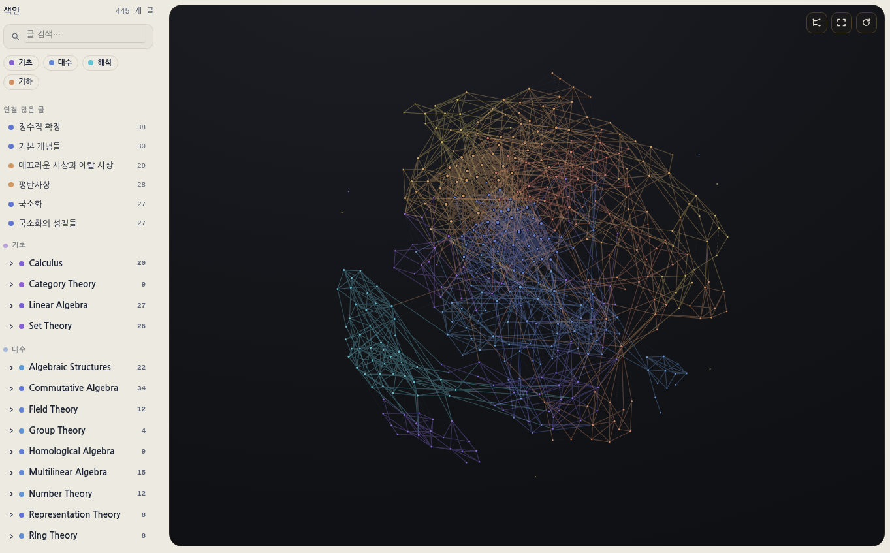
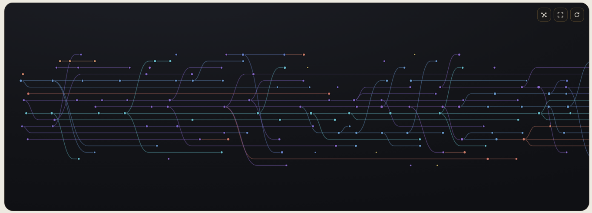

---

title: "글 의존성 그래프"
excerpt: "인용 관계를 읽는 순서로 바꾸는 그래프 데이터, 힘 기반·선형 보기와 글별 선수지식·후속 글 목록"

read_time: false

categories: [Misc / LLM Workshop]
permalink: /ko/llm_workshop/dependency_graph

sidebar:
    nav: "llm_workshop-ko"

author: Marvin

date: 2026-06-20
weight: 22
group: features

---

관련 파일: [`_plugins/graph_data.rb`](https://github.com/math-jh/math-jh.github.io/blob/main/_plugins/graph_data.rb), [`assets/js/custom/Graph_page.js`](https://github.com/math-jh/math-jh.github.io/blob/main/assets/js/custom/Graph_page.js), [`assets/js/custom/Linear_layout.js`](https://github.com/math-jh/math-jh.github.io/blob/main/assets/js/custom/Linear_layout.js), [`assets/js/custom/Local_graph.js`](https://github.com/math-jh/math-jh.github.io/blob/main/assets/js/custom/Local_graph.js), [`_includes/semantic-prerequisites.html`](https://github.com/math-jh/math-jh.github.io/blob/main/_includes/semantic-prerequisites.html)
{: .notice--info}

사용자는 수학 글 사이의 인용 관계를 한눈에 보고 싶어 했다. 전체 글이 어떻게 이어지는지 살펴보는 화면과, 지금 읽는 글 주변의 선수·후속 글을 보여 주는 작은 그래프가 필요했다. 글을 점으로, 글 사이의 관계를 선으로 그리는 작업은 여기서 시작했다.

## 링크 관계와 그래프 데이터

초반의 그래프는 본문 링크를 모아 만들었다. 하지만 링크가 있다고 해서 모두 선수지식은 아니다. 앞선 글의 정의를 가져오는 링크도 있고, 비슷한 예를 드는 링크나 뒤에서 다룰 내용을 예고하는 링크도 있다. 같은 카테고리에서는 글 순서인 `weight`로 일부 링크를 걸러 냈지만, 그것만으로 인용의 용도를 구별할 수는 없었다. 때문에 이후 [링크에 선수 관계 붙이기](/ko/llm_workshop/semantic_dependencies)에서 분류한 관계를 쓰게 된다. `required`는 읽는 데 필요한 선수지식, `weak`는 보충할 배경지식, `forward`는 뒤에 읽을 글을 가리킨다.

분류된 관계를 쓰려면 그래프도 그에 맞게 바꿔야 했다. 운영 중인 `/graph`는 그대로 두고, 새 `/dependencies` 페이지를 따로 만들어 분류 결과를 채웠다. 원장을 다 채운 뒤 새 그래프를 프로덕션에 올리고, 기존 화면과 글별 작은 그래프를 교체했다.

> 기존 /graph 페이지를 지우고, 거기로 연결되던 걸 /dependencies/로 연결해. masthead에 있는 링크 수정하고, 각 글마다 들어가던 작은 그래프 있는데, 그것도 지금 새 버전을 반영하게 해 두고, 그 그래프 창을 열면 전체 그래프 창으로 가는 링크가 있었는데 그것도 바꿔.

[9월 11일 변경](https://github.com/math-jh/math-jh.github.io/commit/b1237fe9)에서 옛 `/graph` 페이지와 데이터 출력을 없애고, [의존성 그래프](/ko/dependencies)로 진입점을 모았다.

구체적으로, 각 본문 링크에는 IAL 속성 `data-lid`로 식별자를 붙이고, `_data/link_relations.yml`에 그 식별자를 키로 삼아 관계를 기록한다.

```markdown
[군 준동형사상](/ko/math/algebraic_structures/group_homomorphisms){: data-lid="y5n4e" }
```
{: data-filename="본문 링크 형식 예시"}

```yaml
"y5n4e": {relation: required, reviewed: true}
```
{: data-filename="_data/link_relations.yml · 일부 발췌"}

링크에 붙은 `y5n4e`를 원장에서 찾으면, 이 링크가 `required`로 분류되어 있음을 알 수 있다. 같은 글을 가리켜도 링크가 쓰인 자리마다 역할이 다를 수 있으므로, 식별자는 대상 글이 아니라 개별 링크에 붙는다. 본문에는 식별자를 두고, 원장에는 그 링크가 `required`·`weak`·`forward` 중 무엇인지 저장하는 구조다.

이후 사용자는 LLM이 분류한 기존 의존성 관계를 충분히 신뢰하기 어렵다고 보고, 처음부터 다시 판정하기로 했다. 이때도 기존 것을 유지하면서 새 결과를 준비한다는 원칙은 같다. 프로덕션 원장 `_data/link_relations.yml`은 그대로 두고, 새 판정은 섀도 원장 `_data/link_relations_next.yml`에 쌓는다. 재판정이 모두 끝나면 기존 원장을 한 번에 교체할 예정이다. 구체적인 과정은 [세 모델의 블라인드 투표로 링크 관계 정하기](/ko/llm_workshop/shadow_rejudging)에서 이어진다.

그래프 데이터는 `_plugins/graph_data.rb`가 만든다. 언어별 수학 글을 점으로 등록하고, 각 글의 본문 링크에 붙은 식별자로 원장의 관계를 조회한다. 레이아웃의 사이드바 목록은 읽지 않으므로, 목록에 나란히 있다는 이유로 두 글이 연결되지는 않는다. 관계가 확정되지 않은 링크, 자기 자신이나 그래프 밖 페이지로 가는 링크는 선을 만들지 않는다.

같은 글 A가 B를 여러 번 인용하면 한 쌍으로 합치고, 그중 하나라도 `required`이면 필수 선수 관계로 취급한다. 다음은 인용한 쪽과 인용된 쪽을 그래프의 방향으로 바꾸는 부분이다.

```ruby
model[:cited_pairs].each do |(src, tgt), entry|
  relation = entry[:relation]
  edge_key = relation == "forward" ? [src, tgt] : [tgt, src]
```
{: data-filename="_plugins/graph_data.rb · 일부 발췌"}

A가 B를 선수·배경지식으로 부르면 읽는 순서는 B 다음 A이므로, 본문 링크 A→B를 그래프에서는 B→A로 뒤집는다. A가 뒤에 읽을 B를 예고하는 `forward`라면 A→B를 그대로 쓴다. 이 과정을 거쳐 선의 방향을 앞에 읽을 글에서 뒤에 읽을 글로 맞춘다. 다만 읽는 순서를 반드시 지켜야 하는 관계는 `required`이고, 나머지 둘은 참고할 연결이다.

결과는 `assets/data/dependencies-<lang>.json`에 글 목록 `nodes`와 관계 목록 `links`로 저장한다. 글에는 제목·주소·카테고리가, 선에는 방향·관계 종류·인용 횟수가 들어간다.

## 힘 기반 보기

전역 그래프의 기본 화면은 연결된 점끼리 당기고 점끼리는 밀어내는 힘 기반 보기다. 연결이 많은 글과 서로 묶이는 주제를 전체적으로 살펴보는 자리다. 사용자가 Claude Design에서 받아 온 그래프 카드(`graphcard.js`)를 옮겼고, 내 쪽에서는 실제 데이터를 연결하고 검색·분야 필터·글 목록 패널을 붙였다. 카드는 사이트 테마와 별개로 어두운 배경을 쓴다.

그림은 저장소에 포함한 `force-graph` 라이브러리가 canvas에 그린다. 링크가 두 점을 당기고 점들은 서로 밀어내며, 별도로 모든 점을 중심 쪽으로 당겨 화면 밖으로 흩어지는 것을 막는다. 점의 크기는 연결 수에 따라 커진다. `required`는 실선, `weak`는 점선, `forward`는 긴 파선으로 구별하고, 글을 짚거나 고르면 관련된 점과 선을 강조한다.

선을 그릴 때마다 그래프 전체를 다시 찾으면 화면이 느려진다. 예를 들어 A→B와 B→A가 함께 있을 때는 두 선을 휘어 겹침을 피해야 하는데, 매 선을 그릴 때 반대 방향의 선을 목록 전체에서 찾으면 한 프레임의 작업량이 선 개수의 제곱에 비례한다. 그래서 데이터를 읽을 때 방향별 식별자와 곡률을 계산해 각 선에 저장한다. 매 프레임에는 그 값을 읽기만 하고, 기본 색도 한 번 계산한 뒤 재사용한다.

10월에 사용자는 힘 기반 보기와 선형 보기 모두에서 평상시 제목을 숨겨 달라고 했다.

> 좋아, 근데 힘 기반 그래프에서도 메인라인이 라벨이 기본으로 되어 있는 것 같은데, 지워줬으면 좋겠고 선형에서도 마찬가지야. 라벨 자체는 호버 안 된 상테에선 안 보였으면 좋겠어.



그래서 제목은 짚거나 고른 글과 관련 글, 검색어에 맞는 글에만 나타난다. 전체를 볼 때는 연결 모양을 보고, 글 이름이 필요할 때 해당 부분을 살펴보는 방식이다.

## 선형 보기의 열과 레인

힘 기반 그림에서는 가까이 있다는 것이 곧 읽는 순서가 가깝다는 뜻은 아니다. 블로그가 가득 차 있다는 느낌을 받기에는 좋지만 실제로 담고 있는 정보는 그렇게 많지 않은 물건인 셈이다. 읽는 순서를 따라가려면 선수를 왼쪽에, 후속 글을 오른쪽에 두는 배치가 필요하다. 9월에 추가한 선형 보기는 툴바에서 전환할 수 있고, SVG로 그린다.



가로 위치는 `Linear_layout.js`의 `readingColumns`가 정한다. 선수 글을 왼쪽에 놓으려면 순환부터 처리해야 한다. A→B→C→A라면 A는 B보다 왼쪽, B는 C보다 왼쪽, C는 다시 A보다 왼쪽이어야 하므로 세 조건을 동시에 만족하는 배치는 없다.

그래서 서로 오갈 수 있는 글들을 한 묶음으로 취급한다. 묶음 안에서는 어느 글에서 출발하든 화살표 방향으로 선을 따라 다른 모든 글에 도달할 수 있어야 한다. 직접 연결될 필요는 없고, 다른 글을 거쳐 가도 된다. 이 조건을 유지하면서 글을 더 보탤 수 없을 만큼 크게 모은 것이 **강연결요소**다. 위 예에서는 A·B·C가 한 요소다. 여기에 C→D만 있고 D에서 셋 중 어느 글로도 돌아갈 수 없다면, D는 같은 요소에 들어가지 않는다. 순환에 속하지 않는 글도 혼자 하나의 요소가 된다.

이 묶음들을 찾는 Tarjan 알고리즘은 선을 따라 한 갈래를 끝까지 살펴본 뒤 돌아오는 깊이 우선 탐색을 한다. 글을 처음 방문할 때마다 번호를 붙이고, 아직 어느 요소에 속하는지 확정하지 않은 글을 스택에 넣는다. 스택은 나중에 넣은 글부터 꺼내는 목록이다. 탐색을 마친 글이라도 더 앞선 글과 같은 요소일 가능성이 있으면, 묶음이 확정될 때까지 여기에 남겨 둔다.

탐색 중에는 각 글의 방문 번호 `index`와 묶음의 경계를 판단할 기준 번호 `low`를 기록한다. `low`는 처음에는 자기 방문 번호다. 아직 방문하지 않은 다음 글로 들어갔다 돌아오면 그 글의 `low`를 전달받고, 이미 스택에 남아 있는 글로 향하는 선을 만나면 그 글의 방문 번호를 본다. 둘 다 현재 값보다 작을 때만 `low`를 낮춘다. 탐색이 끝나 스택에서 빠진 글로 향하는 선은 이미 확정된 다른 요소로 가는 연결이므로, 이때는 값을 바꾸지 않는다.

```js
var serial = 0, stack = [], onStack = {}, index = {}, low = {}, compOf = {}, comps = [];
function visit(id) {
  index[id] = serial; low[id] = serial; serial += 1;
  stack.push(id); onStack[id] = true;
  (reqAdj[id] || []).forEach(function (next) {
    if (index[next] === undefined) { visit(next); low[id] = Math.min(low[id], low[next]); }
    else if (onStack[next]) low[id] = Math.min(low[id], index[next]);
  });
  if (low[id] !== index[id]) return;
  var comp = [], member;
  do {
    member = stack.pop(); onStack[member] = false;
    compOf[member] = comps.length; comp.push(member);
  } while (member !== id);
  comps.push(comp);
}
nodes.forEach(function (n) { if (index[n.id] === undefined) visit(n.id); });
```
{: data-filename="assets/js/custom/Linear_layout.js · 일부 발췌"}

다음 글들을 모두 살펴본 뒤 `low`가 자기 방문 번호보다 작으면, 더 앞서 스택에 들어간 글과 함께 묶일 가능성이 남아 있다. 그래서 여기서는 글을 꺼내지 않고 돌아간다. 반대로 `low`가 자기 방문 번호와 같으면 현재 글이 요소의 시작점이다. 스택 위에서부터 현재 글까지 꺼내 하나의 강연결요소로 확정한다.

A→B→C→A를 A부터 탐색하면 방문 번호는 A=0, B=1, C=2다. C에서 아직 스택에 있는 A로 가는 선을 만나면 C의 `low`가 0이 된다. B로 돌아왔을 때는 C의 값을 전달받아 B의 `low`도 0이 된다. 따라서 C와 B는 탐색을 마쳐도 스택에 남는다. A까지 돌아오면 A의 `low`와 방문 번호가 모두 0이므로, C·B·A를 차례로 꺼내 한 요소로 묶는다. C에서 D로도 갈 수 있지만 D에서 돌아오는 길이 없다면, D는 자기 탐색을 마칠 때 혼자 꺼내진다. C에서 D를 방문했다는 사실만으로 D까지 같은 묶음에 넣지는 않는 것이다.

이렇게 찾은 각 요소를 같은 열에 둔다. 요소 전체를 점 하나로 취급하면 요소 사이에는 순환이 없다. 요소들 사이에 다시 순환이 있었다면 서로 오갈 수 있으므로 처음부터 하나의 더 큰 요소였어야 하기 때문이다. 이제 선수를 먼저 놓는 위상 정렬이 가능해진다. 아직 배치하지 않은 선수가 없는 요소부터 처리하고, 후속 요소의 열을 현재 요소보다 적어도 한 칸 오른쪽으로 민다. 선수가 여럿이면 그중 가장 오른쪽에 놓인 선수보다도 뒤에 와야 한다. 이 갱신을 모든 요소에 적용하면 요소 사이의 필수 관계가 왼쪽에서 오른쪽으로 이어진다.

카테고리 안의 `weight` 순번을 초기 위치로 쓰되, 숫자 자체는 비교하지 않는다. 어떤 카테고리는 1, 2, 3을 쓰고 다른 카테고리는 101, 201처럼 구획을 나누므로, 각각을 0, 1, 2…의 연속 순번으로 바꾼다. 그 위에 필수 선수 관계를 반영해 후속 글을 오른쪽으로 민다. `forward`는 필수 관계를 거스르는 순환을 만들지 않을 때만 배치에 반영하고, `weak`는 열을 정하는 데 쓰지 않는다.

세로 위치는 처음에 격자로 배치했지만, 사용자는 각 열의 글들이 평행하게 늘어선 모양을 바꾸고 싶어 했다.

> 무엇보다, 지금은 각 열마다 평행하게 여러 노드가 있는데, 나는 가급적이면 하나의 큰 줄기가 있었으면 싶거든, 실제로 블로그 글도, 내가 쓰는 방식이 내 연구를 향해서 가는거니까 어느정도는 그럴거고.

10월에는 git 커밋 그래프에서 쓰는 첫 부모(first-parent) 방식을 가져왔다. 한 글에 선수 글이 여러 개여도 그중 하나를 첫 부모로 골라 중심 사슬을 잇는다. 나머지 선수 관계는 데이터에 그대로 남고, 세로 배치의 기준만 하나로 정하는 것이다. 같은 열 안의 순환은 제외하고, 왼쪽 열에서 각 글까지 이어지는 가장 긴 필수 선수 사슬의 길이를 깊이로 삼는다. 첫 부모는 왼쪽 열에 있는 선수 글 중 깊이가 가장 큰 글로 고른다.

```js
order.forEach(function (id) {
  var best = null;
  parents[id].forEach(function (p) {
    if (!best) { best = p; return; }
    var dp = depth[p] - depth[best], gp = (degree[p] || 0) - (degree[best] || 0);
    var cp = column[p] - column[best];
    if (dp > 0 || !dp && (gp > 0 || !gp && (cp > 0 || !cp && p < best))) best = p;
  });
  if (best) { firstParent[id] = best; kids[best].push(id); }
});
```
{: data-filename="assets/js/custom/Linear_layout.js · 일부 발췌"}

선수 글들을 비교해 더 깊은 글이 있으면 후보를 바꾼다. 깊이가 같을 때만 전체 연결 수를 비교하고, 그것도 같으면 현재 글에 가까운 열, 마지막으로 글 식별자 순으로 고른다. 같은 데이터로 그릴 때 첫 부모가 임의로 바뀌지 않게 하는 순서다.

동점 처리에는 한 번의 오독이 있었다. 사용자가 가장 많이 연결된 글을 고르자고 했을 때, 나는 깊이 조건을 없애라는 뜻으로 읽었다. 첫 부모가 연결 많은 글 쪽으로 쏠리면서 그림이 크게 바뀌었다.

> 음, 가장 깊은 선수 글이 여러개일 수 있잖아, 그 중에서 가장 연결 많은 글을 선택해달란 말이었어. 뭐가 너무 크게 바뀐 것 같네.

동점 처리 하나를 고치라는 말을 배치 전체를 고치라는 말로 읽었다. 그래프의 가지보다 내 일거리가 먼저 늘었다.

가장 깊은 글에서 첫 부모를 거슬러 올라간 사슬은 가운데 0번 레인에 둔다. 레인은 사슬 하나가 놓이는 가로줄이다. 갈림길에서는 본류 위의 자식이 부모의 레인을 이어받는다. 본류에 속한 자식이 없으면 그 뒤로 사슬이 가장 길게 이어지는 자식을 고르고, 나머지는 위아래의 빈 레인으로 갈라진다. 갈라진 사슬은 부모의 열부터 자기 끝 열까지 레인 하나를 차지한다. 새 사슬을 놓을 때는 그 구간과 겹치지 않는 레인을 가운데에서 가까운 순으로 찾으므로, 앞선 사슬이 끝난 레인은 뒤의 다른 사슬이 다시 쓸 수 있다. 이렇게 큰 줄기를 가운데 두면서 갈래마다 높이를 준다. 10월 19일부터 이 배치 코드는 전역 그래프와 로컬 그래프가 함께 쓴다.

## 선수 글과 두 글 사이의 경로

선형 보기에서 모든 관계를 한꺼번에 그리면 읽는 순서보다 선의 겹침이 먼저 보인다. 그래서 평상시에는 첫 부모 선만 그린다. 글 하나를 고르면 필수 선수 관계를 거슬러 닿는 글들을 강조하고, 고른 글에 직접 연결된 배경지식과 후속 읽을거리도 함께 보여 준다.

선수 글 사이의 선도 전부 펼치지는 않는다. 고른 글로 직접 들어오는 선과 선수 글들 사이의 첫 부모 선을 우선 남긴다. 그 선들만으로 연결이 끊기는 곳에는 선수 글 사이의 연결을 하나씩 더한다. 글을 모으는 단계와 화면에 그릴 선을 고르는 단계를 나누어, 선수 글을 빠뜨리지 않으면서도 선이 지나치게 겹치는 것을 줄인다. 제목도 고른 글과 검색 결과부터 자리를 잡고, 다른 제목과 겹치는 덜 중요한 제목은 숨긴다.

두 글을 함께 고르면 그 사이의 필수 선수 경로를 보여 준다. 이 기능에서 사용자가 원한 것은 가장 긴 사슬 하나가 아니었다.

> 가장 긴 사슬은 사실 큰 의미는 없다. […] A-B 경로였다면, A-B 사이에 있지는 않지만, 그 사이에 있는 글을 읽기 위해 오는 것, 즉 그 경로 바깥에서 오는 의존성 정도는 넣을만 할 것 같다.

A에서 B까지 여러 갈래가 있으면 그중 어느 경로에든 포함되는 글을 모두 모아야 한다. `requiredBetween`은 경로를 하나씩 나열하는 대신, A에서 앞으로 닿는 글과 B에서 선수 쪽으로 거슬러 닿는 글을 구한다.

```js
if (fromId === toId) return null;
var after = requiredReach(fromId, true);
if (!after.has(toId)) return null;
var before = requiredReach(toId, false);
var ids = Array.from(after).filter(function (id) { return before.has(id); });
```
{: data-filename="assets/js/custom/Graph_page.js · 일부 발췌"}

A에서 B로 갈 수 없으면 그 방향의 경로는 없다. 갈 수 있다면 두 집합의 교집합이 필요한 글 목록이다. A에서 도달할 수 있고, 그곳에서 다시 B로 갈 수 있어야 A와 B 사이에 놓이기 때문이다. 화면에서는 반대 방향도 확인하므로, 두 글을 고른 순서가 선수·후속 관계를 결정하지 않는다.

모은 글들은 순환을 한 묶음으로 접은 뒤, A에서 각 묶음까지 오는 가장 긴 거리에 따라 읽는 단계로 나눈다. 한 글을 읽기 전에 필요한 단계들이 앞에 놓이고, 서로를 요구하는 순환 안의 글은 같은 단계에 남는다.

경로 바깥의 선수지식은 별도로 다룬다. 바깥에서 경로로 직접 들어오는 선은 연하게 강조하고, 오른쪽 패널에는 경로 위 글들의 선수지식을 끝까지 거슬러 모은 뒤 그 바깥 집합의 시작 글만 싣는다. 바깥 글 가운데 다른 바깥 선수가 없는 글이 시작점이다. 경로를 따라가면서 어디서 별도의 공부를 시작해야 하는지도 볼 수 있게 한 것이다.

## 사이드바의 로컬 그래프

수학 글의 목차 아래에는 현재 글 주변만 보여 주는 로컬 그래프가 있다. 필수 선수 관계를 앞뒤로 두 단계씩 따라가 글을 모으고, `weak`와 `forward`는 현재 글에 바로 연결된 것만 더한다. 전역 그래프를 그대로 작게 줄이면 좁은 사이드바에서 점들이 몰리므로, 현재 글을 가운데에 두고 주변 글의 위치를 다시 정한다.

가로로는 선수 글을 왼쪽, 후속 글을 오른쪽에 놓고, 현재 글까지 이어지는 사슬을 기준으로 열을 정한다. 세로로는 앞 절의 첫 부모·레인 함수를 쓰되, 현재 글을 지나는 사슬이 0번 레인에 오게 한다. 첫 부모를 비교하는 깊이와 연결 수는 전역 그래프에서 계산한 값을 가져온다. 작은 그래프 안에 보이는 연결만 세어서 중심 사슬이 달라지는 일을 줄이려는 것이다.

> 로컬 의존성 그래프 같은 경우엔 전체를 다 보여줄 필요는 없으니까, 현재 글을 가운데 두는 것은 유지하고, 양 옆은 잘리도록 둬도 돼.

그 요청에 따라 현재 글의 중심 위치를 유지하면서, 점 사이가 너무 좁아지면 더 축소하지 않고 양옆을 자른다. 크게 보기 오버레이에서는 전체를 보여 주고, 높이가 화면을 넘으면 스크롤하게 둔다. 처음 열 때는 현재 글이 가운데 오도록 스크롤 위치를 맞춘다.

현재 글의 제목은 항상 표시한다. 처음에 나는 긴 제목을 한 줄로 잘랐지만, 사용자가 원한 것은 상자 폭을 넘으면 줄을 나누는 것이었다.

> 흠... 이걸 원한 건 아니고, 상자 폭보다 길 때 나눴으면 충분해. 글 제목 같은 경우엔 노드에 붙어있게 할 수 없어? 라벨을 회전시켜도 좋고, 그래프 위에 띄워도 좋아. 내 생각엔 이미 우리가 회피하는 로직이 선형그래프에 있지 않던가?

그래서 선형 보기의 제목 배치 코드를 함께 쓴다. 한 줄 제목은 점의 좌우와 비스듬한 위아래를 후보로 삼고, 여러 줄 제목은 점 바로 위아래에 가운데 맞춰 놓는다. 상자 안에 들어가는 후보 중 다른 점을 가장 적게 덮는 자리를 고른다. 선까지 모두 피할 자리는 부족하므로, 제목이 선을 덮는 것은 허용한다.

## 선수지식과 다음 글 목록

그래프에서 글의 연결을 찾아볼 수도 있지만, 글을 읽는 자리에서 필요한 링크를 바로 볼 수 있으면 편하다. 그래서 같은 관계 데이터를 이용해 글 머리에는 먼저 읽을 글을, 글 꼬리에는 이어 읽을 글을 붙였다. `_plugins/graph_data.rb`가 글별 `semantic_navigation` 데이터를 만들고, 각 목록의 include가 이를 출력한다.

글 머리의 "읽어야 할 글"은 현재 글이 직접 인용한 대상을 모은다. `required`는 "필수지식", `weak`는 "배경지식"으로 나누고, 각 목록은 `weight` 순으로 정렬한다. 선수의 선수까지 펼치면 목록이 길어지므로 여기서는 한 단계만 보여 준다. 현재 글 자체에 분류된 링크가 없다면 앞뒤 목록을 만들지 않는다. 다른 글이 이 글을 인용했다는 사실만으로 아직 분류하지 않은 글의 읽기 안내를 만들지는 않는 것이다.

글 꼬리의 "읽을만한 글"에서는 카테고리의 글 순서와 인용 관계를 함께 쓴다. 같은 카테고리에서 `weight`가 바로 다음인 글을 "다음 글"로 맨 위에 두고, 그 아래에 관계로 고른 후속 글을 최대 셋 붙인다. 후속 글 후보는 현재 글을 `required`나 `weak`로 인용하는 글, 그리고 현재 글이 `forward`로 가리키는 글이다. 맨 위의 다음 글과 겹치는 후보는 중복해서 싣지 않는다.

후보를 고를 때 인용 횟수를 세기는 하지만, 많이 인용한 순서대로 추천하지는 않는다. 사용자가 든 반례는 다음과 같다.

> A 글을 제일 많이 부르는 게 C 글인데, C 글을 읽을 때 B 글이 필요하고, 그 B 글이 A 글의 후행 글이라면 B 글이 추천되는 것이 C 글이 추천되는 것보다 맞는 방향이 아닐까…

A 다음에 읽을 후보가 B와 C인데, C를 읽으려면 B부터 읽어야 하는 상황이다. C가 A를 더 많이 인용했더라도 B를 먼저 추천해야 한다. 그래서 `rank_recommendations`는 인용 횟수로 순위를 매기기 전에 후보들 사이의 필수 선수 관계를 구한다.

```ruby
urls.combination(2) do |left, right|
  left_before = reachability[left][right]
  right_before = reachability[right][left]
  next if left_before == right_before # incomparable, or in the same SCC

  source, target = left_before ? [left, right] : [right, left]
  outgoing[source] << target
  indegree[target] += 1
end
```
{: data-filename="_plugins/graph_data.rb · 일부 발췌"}

후보를 둘씩 비교해, 한쪽에서 필수 관계를 따라 다른 쪽으로 갈 수 있는지 확인한다. 다른 글을 거쳐 가는 경우도 포함한다. 한 방향으로만 갈 수 있으면 그 방향대로 먼저 추천할 글과 나중에 추천할 글을 정한다. 어느 쪽으로도 갈 수 없으면 순서를 강제하지 않고, 양방향으로 갈 수 있으면 앞서 설명한 같은 강연결요소 안이므로 둘 사이의 순서를 정하지 않는다.

이렇게 만든 후보 사이의 관계에도 위상 정렬을 적용한다. 아직 추천하지 않은 선수가 없는 후보부터 고르고, 하나를 고를 때마다 그 글을 기다리던 후속 후보의 조건을 해제한다. 지금 고를 수 있는 후보가 여럿일 때만 인용 횟수, 관계의 세기, `weight`, 제목 순으로 비교한다. 따라서 위 예에서는 B를 고르기 전에는 C가 선택 대상에 들어가지 않는다. 이 순서로 정렬한 결과에서 최대 셋을 목록에 넣는다.
