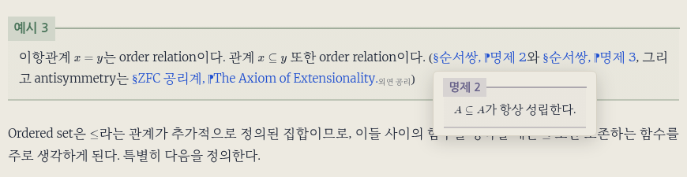

---

title: "상호참조 호버 미리보기"
excerpt: "정의·정리 링크의 대상 박스를 읽던 자리에서 확인하는 미리보기와 수식·SVG 복제 처리"

read_time: false

categories: [Misc / LLM Workshop]
permalink: /ko/llm_workshop/xref_preview

sidebar:
    nav: "llm_workshop-ko"

author: Marvin

date: 2026-06-21
weight: 23
group: features

---

관련 파일: [`assets/js/custom/Xref_preview.js`](https://github.com/math-jh/math-jh.github.io/blob/main/assets/js/custom/Xref_preview.js), [`_sass/minimal-mistakes/_notices.scss`](https://github.com/math-jh/math-jh.github.io/blob/main/_sass/minimal-mistakes/_notices.scss)
{: .notice--info}

이 블로그의 글들은 서로를 자주 참조하므로 글을 읽다 보면 앞선 정의나 명제를 확인할 일이 자주 생긴다. 링크를 누르면 해당 위치로 갈 수 있지만 그를 위해서는 내용을 확인하고 읽던 자리로 돌아와야 하며, 다른 글의 정리라면 페이지까지 바뀐다. 때문에 사용자가 추가할만한 기능이 있는지 조언을 구했을 때 가장 위에 있던 기능이 바로 참조 오버레이였다. `assets/js/custom/Xref_preview.js`는 링크가 가리키는 박스를 복제해 작은 카드로 띄운다. 본문에 있는 정의·정리·증명 등을 그대로 보여 주는 기능이다.



## 대상 박스와 수식 렌더링

먼저 링크가 미리보기를 띄울 대상인지 확인한다. 본문 링크 중 `#prop3`처럼 앵커가 있고, 현재 사이트 안으로 연결되는 링크만 처리한다. 앵커는 문서 안의 특정 위치를 가리키는 식별자다. 그 식별자를 가진 요소를 찾은 다음, 그 요소 자신부터 바깥으로 올라가며 가장 가까운 정의·명제·증명 박스를 찾는다. 절 제목처럼 해당 박스 안에 있지 않은 앵커에는 카드를 띄우지 않는다.

대상 박스의 종류는 글을 만드는 쪽과 미리보기가 같은 목록을 써야 한다. 처음에는 박스 클래스 목록을 스크립트에 직접 적었지만, 이렇게 흩어진 설정은 망가지기 쉽다는 사용자의 지적에 따라 `_data/theorem_vocab.yml`을 공통 원본으로 삼게 된다. ([흩어진 목록을 한 곳으로](/ko/llm_workshop/single_source)) 흐름은 이렇다. 사이트를 빌드할 때 `_plugins/fenced_theorem_blocks.rb`가 이 공통 파일에서 일반 박스와 접기 박스의 HTML 클래스 이름을 읽는다. `head.html`은 그 목록을 각 페이지의 JavaScript 변수 `window.THEOREM_KINDS`에 넣는다. 그럼 미리보기 스크립트는 여기서 `definition`·`proposition`·`proof` 같은 클래스 이름을 가져와 검색 조건을 만들고, 링크의 앵커를 포함하는 박스를 찾는 데 쓴다. 새 박스 종류를 추가할 때 미리보기의 목록만 빠지는 일을 줄이는 구조다.

대상이 같은 글에 있으면 현재 문서에서 바로 찾는다. 이미 브라우저가 만든 HTML 요소와 렌더된 수식이 있으므로, 박스를 그대로 복제하면 된다. 다른 글에 있으면 그 페이지의 HTML을 받아 와야 한다.

```js
function fetchDoc(path) {
  if (!docCache[path]) {
    docCache[path] = fetch(path)
      .then(function (r) { return r.ok ? r.text() : null; })
      .then(function (t) {
        return t ? new DOMParser().parseFromString(t, 'text/html') : null;
      })
      .catch(function () { return null; });
  }
  return docCache[path];
}
```
{: data-filename="assets/js/custom/Xref_preview.js · 일부 발췌"}

처음 요청한 경로라면 `fetch`로 HTML을 받고, `DOMParser`로 요소를 검색할 수 있는 문서 구조로 바꾼다. 다운로드와 파싱이 끝난 문서만 저장하는 대신, 이 작업을 진행 중인 Promise부터 경로별로 저장한다. 같은 페이지의 다른 정리에 연달아 마우스를 올려도 진행 중인 요청을 함께 기다리므로, 페이지를 중복해서 받지 않는다. 요청에 실패하면 `null`을 남기고 미리보기를 띄우지 않는다.

다른 글에서 가져온 HTML은 그 페이지를 브라우저로 열어 실행한 결과가 아니다. 따라서 문서 구조를 파싱하는 것만으로는 수식 렌더링이 실행되지 않는다. 대상 박스를 카드에 넣은 다음 그 안에 KaTeX를 적용해야 한다. 이때 본문과 같은 수식 구분자와 매크로를 쓰도록 `window.KATEX_DELIMITERS`와 `window.KATEX_MACROS`를 읽는다. 두 설정의 원본은 `assets/js/katex-macros.js`이고, 미리보기 스크립트보다 먼저 로드한다. 이 또한 같은 수식이 본문과 카드에서 다르게 해석되지 않게 하는 것이다.

## 카드 표시와 배치

링크에 마우스가 들어오자마자 카드를 띄우면, 본문을 가로질러 움직일 때마다 카드가 나타난다. 그래서 140ms 동안 머물렀을 때만 표시한다. 링크를 벗어나면 바로 없애지 않고 180ms 뒤에 숨긴다. 그 사이 카드 안으로 마우스를 옮기면 숨기기를 취소하므로, 카드 안의 긴 내용을 읽거나 스크롤할 수 있다. 카드는 `body`에 하나만 만들고, 다른 링크를 짚으면 내용을 바꿔 쓴다.

위치는 링크 바로 아래를 기본으로 삼는다. 오른쪽 끝을 넘으면 왼쪽으로 당기고, 아래 공간이 부족하면서 위쪽에는 들어갈 자리가 있으면 링크 위로 옮긴다.

```js
var r = link.getBoundingClientRect();
var cw = c.offsetWidth;
var ch = c.offsetHeight;
var left = Math.max(8, Math.min(r.left, window.innerWidth - cw - 12));
var top = r.bottom + 8;
if (top + ch > window.innerHeight - 8 && r.top - ch - 8 > 0) {
  top = r.top - ch - 8; // 아래 공간이 부족하면 위로
}
c.style.left = left + 'px';
c.style.top = Math.max(8, top) + 'px';
```
{: data-filename="assets/js/custom/Xref_preview.js · 일부 발췌"}

`getBoundingClientRect()`로 링크가 화면에서 차지하는 영역을 구하고, 카드의 실제 폭과 높이를 비교한다. 위아래 어느 쪽에도 카드 전체가 들어가지 않으면 기본 위치를 유지하며, 카드 자체의 스크롤로 내용을 읽게 한다. CSS는 카드 높이를 화면 높이의 55%로 제한하고 `overflow: auto`를 적용한다. `overscroll-behavior: contain`은 카드 끝까지 스크롤한 뒤 뒤쪽 본문까지 함께 움직이는 것을 막는다.

링크를 누르는 동작은 그대로 남아 있다. 대상 내용을 길게 읽거나 원래 문맥을 확인하려면 링크로 이동하면 된다. HTML을 가져오지 못하거나 미리보기를 쓸 수 없는 경우에도 링크는 해당 위치로 연결된다.

## 복제본의 식별자와 SVG 도식

박스를 복제하면 그 안의 `id`도 따라온다. 원본의 정리 앵커와 복제본이 같은 식별자를 가지면 링크의 대상이 중복되므로, 카드에 넣은 복제본에서는 `id`를 지운다. 그런데 [도식을 인라인 SVG로 넣게 된](/ko/llm_workshop/diagram_svg) 뒤에는 이 처리가 그림까지 지워 버리는 문제가 생겼다.

SVG는 `<defs>` 안에 글자 모양 등을 정의하고, `<use xlink:href="#…">`로 그 식별자를 참조해 그림을 구성할 수 있다. 이 식별자를 지우면 참조할 모양을 찾지 못한다. 문서의 이동 위치를 표시하는 앵커와 그림 내부의 참조를 같은 방식으로 지운 것이 원인이었다.

중복을 없애려다가 내용도 없앴다. 정리 작업은 이런 식으로 예상보다 철저해지곤 한다.

[도식 미리보기 수정](https://github.com/math-jh/math-jh.github.io/commit/367af0e5a)에서는 SVG 안의 요소는 `id`를 지우는 대상에서 제외했다. 박스를 카드에 복제한 직후 실행하는 코드는 다음과 같다.

```js
c.querySelectorAll('[id]').forEach(function (e) {
  if (e.closest('svg')) return;
  e.removeAttribute('id');
});
if (needRender) renderMath(c);
```
{: data-filename="assets/js/custom/Xref_preview.js · 일부 발췌"}

복제본에서 식별자를 가진 요소를 찾되, SVG 안에 있으면 그대로 두고 다음 요소로 넘어간다. 나머지 요소의 `id`만 지운다. 따라서 카드 속 정리 앵커는 제거하면서 도식이 사용하는 내부 참조는 보존한다. 이 코드는 SVG의 식별자를 새 이름으로 바꾸는 처리는 하지 않으므로, 같은 글의 도식을 복제하면 SVG 내부 식별자는 원본과 중복될 수 있다. 현재 구현은 그 참조를 유지해 도식을 표시하는 방식이다.
