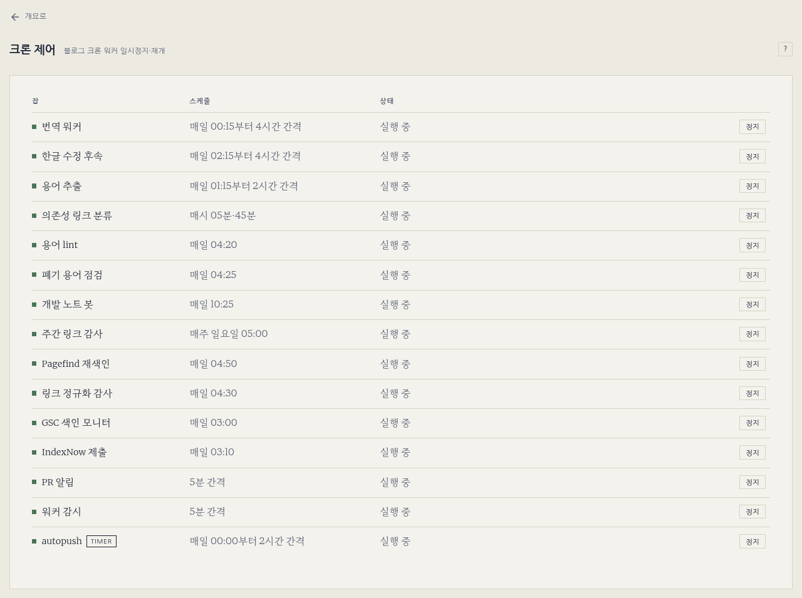

---

title: "크론 정지 게이트"
excerpt: "크론 줄 앞에 붙은 게이트가 상태 파일 하나를 읽어 exit 1일 때만 막는다: fail-open 래퍼, owner별 hold, 만료 해제, systemd 타이머, 대시보드 버튼, 쿼터 정지와 상시 정지"

read_time: false

categories: [Misc / LLM Workshop]
permalink: /ko/llm_workshop/cron_gate

sidebar:
    nav: "llm_workshop-ko"

author: Marvin

date: 2026-08-12
weight: 71
group: pi

---

관련 파일: [`scripts/dashboard/server.py`](https://github.com/math-jh/math-jh.github.io/blob/main/scripts/dashboard/server.py) (블로그 대시보드 쪽 호출부), `~/.local/bin/cron-gate`, `~/.local/bin/quota-reset-watch.py`, `~/.local/bin/claude-credit`, `~/.local/state/cron-pause/` (이상 레포 밖)
{: .notice--info}

블로그 대시보드와 연구 대시보드에서 크론 잡을 하나씩 멈추고 다시 돌릴 수 있게 정지·재개 버튼을 다는 일이었다. 버튼을 누를 때마다 crontab을 고쳐 쓰게 할 수는 없어서, `cron-gate`는 정지 여부를 crontab 바깥의 상태 파일에 두고 크론 줄 맨 앞에서 그 파일을 읽는다.

## crontab을 다시 쓰지 않는 이유

당시 crontab에는 쓰는 주체가 여럿 있었다. 연구 파이프라인의 director, 슬롯 동기화를 맡는 `sync_slots`, `safety_net`이 모두 `crontab -l`로 읽고 내용을 바꿔 `crontab`으로 되돌려 넣었다. 서로를 기다리는 장치는 없었다. 두 쓰기가 겹치면 나중에 쓴 쪽이 먼저 쓴 쪽의 변경을 덮는다(lost update). 7월 18일에 번역 워커의 크론 줄이 이렇게 사라졌고, 에러는 나지 않았다.

대시보드 버튼이 같은 방식으로 crontab을 고치면 클릭 한 번이 이 경쟁에 참가자를 하나 더 보태는 셈이다. 그래서 `cron-gate`의 docstring은 게이트의 동작을 적자마자 이 원칙을 굵게 적어 둔다.

```text
exit 0 이면 뒤가 돌고, exit 1 이면 안 돈다. **정지 여부의 정본은
~/.local/state/cron-pause/<job-id>.json 파일 하나뿐이고, crontab 은 런타임에
절대 건드리지 않는다.**
```
{: data-filename="~/.local/bin/cron-gate · docstring 일부 발췌"}

크론 줄은 설치할 때 한 번 게이트를 달고 끝난다. 이후 정지와 재개는 상태 파일만 바꾼다.

## 크론 줄의 래퍼와 fail-open

게이트가 붙은 크론 줄은 이렇게 생겼다.

```bash
15 */4 * * * { /home/junhyeok/.local/bin/cron-gate blog-translation ; [ $? -ne 1 ] ; } && <원래 명령>
```
{: data-filename="crontab · 래퍼 형식 예시"}

`cron-gate <id>`는 정지 중이면 종료 코드 1을, 그 밖에는 0을 낸다. 중괄호 안의 `[ $? -ne 1 ]`은 코드가 1이 아닐 때만 참이므로, 뒤의 원래 명령은 **정확히 1일 때만** 막힌다. 게이트 파일이 없어서 셸이 127을 내거나, 파이썬이 예상치 못한 이유로 다른 코드를 내며 죽어도 잡은 그대로 돈다.

`cron-gate <id> && <명령>`으로 쓰면 더 짧지만 0이 아닌 모든 코드가 잡을 막는다. 게이트가 붙은 크론은 전부 이 파일 하나를 지나므로, 게이트가 고장 나면 그 크론이 아무 에러 없이 한꺼번에 멈춘다. docstring의 표현으로는 통과시키는 편이 "게이트 고장이 크론 함대를 조용히 죽이는 것보다 낫다". docstring 머리의 예시는 아직 `&&`만 쓰는 단순형이고, 코드는 두 꼴을 모두 읽는다. `GATE_RE`는 줄 어디에 있든 `cron-gate <id>` 호출을 찾아 id를 뽑고, `WRAPPER_RE`는 중괄호 래퍼를 떼어 내 대시보드에 보일 원래 명령만 남긴다. 래퍼가 없는 줄이면 `GATE_RE`가 찾은 게이트 호출과 뒤의 `&&`를 떼어 낸다.

fail-open은 게이트 안에서도 이어진다. 게이트 모드의 본체는 이렇다.

```python
def gate(jid):
    st = read_state(jid)
    if st is None:
        return 0                                  # 정상 경로, 로그 없음
    if st == "CORRUPT":
        log(f"{jid}: 상태파일 손상, 통과시킴 (fail-open)")
        return 0
    holds = active_holds(st)
    if not holds:
        remove_state(jid)
        log(f"{jid}: 모든 정지 만료, 자동 재개")
        return 0
    # ... (일부 hold만 만료됐으면 남은 것만 다시 쓰고, 정지 로그를 남긴다)
    return 1
```
{: data-filename="~/.local/bin/cron-gate · 일부 생략, 로그 문구의 대시를 쉼표로 정리"}

게이트는 상태 파일부터 읽는다. 파일이 없으면 정지가 걸린 적 없는 정상 경로라 로그도 남기지 않고 0이다. 파일이 깨져 파싱되지 않거나 JSON이 객체가 아니면 손상으로 기록만 하고 역시 0이다. 파일이 읽히면 hold마다 만료를 따져, 유효한 것이 하나도 없으면 파일을 지우고 통과시킨다. 유효한 hold가 남아 있을 때만 1이다. 맨 바깥 `main`의 `try`도 모든 예외를 0으로 흘려보낸다. 막는 것은 실행이지 지출이나 손상이 아니라서, 이 방향으로 틀려도 잃는 것이 작기 때문이다. 같은 원칙이 `claude-quota-gate`에도 적혀 있다.

반대로 `until` 값이 파싱되지 않을 때는 통과가 아니라 무기한 정지로 읽는다. 한쪽은 "게이트가 고장났다"이고 다른 쪽은 "누군가 정지를 걸었는데 시각을 읽지 못했다"이기 때문이다. 후자에서 임의로 재개하는 것이 더 위험하다고 코드 주석에 적혀 있다.

## 상태 파일과 owner별 hold

상태는 `~/.local/state/cron-pause/<id>.json`에 있다. 처음에는 정지 하나를 나타내는 단일 객체(`paused_at`, `until`, `by`, `reason`)였고, 9월 1일 무렵 owner별 `holds` map으로 바뀐다. 정지를 거는 주체가 대시보드 사용자 하나가 아니게 되었기 때문이다. 아래 쿼터 절의 거버너가 같은 잡을 멈추는데, 한 파일에 정지가 하나뿐이면 사용자가 풀면서 거버너의 정지까지 풀리거나 그 반대가 된다.

```json
{"version": 2, "holds": {
  "blog-dash": {"paused_at": "…", "until": null, "reason": ""},
  "quota-governor:claude:weekly": {"paused_at": "…", "until": "…", "reason": "…"}
}}
```
{: data-filename="~/.local/state/cron-pause/<id>.json · 형식 예시"}

규칙은 하나다. **유효한 hold가 하나라도 있으면 정지**이고, 유효하다는 것은 `until`이 없거나 아직 지나지 않았다는 뜻이다. 읽는 쪽은 옛 단일 객체도 받는다. `normalized_holds`가 그 객체를 `by` 필드 이름의 hold 하나로 바꿔 읽기 때문이다.

파일을 쓸 때는 임시 파일을 만들고 `os.replace`로 바꿔 놓아서, 크론이 읽는 순간에 반쯤 쓰인 파일은 보이지 않는다. 재개는 파일 삭제이고 이미 없으면 성공으로 친다. 대시보드를 두 번 눌러도 해가 없다.

## 관리 명령과 만료

대시보드가 쓰는 관리 명령은 이 다섯 가지다. 전부 `--json`을 붙이면 기계가 읽는 응답을 준다.

```bash
cron-gate --jobs                          # crontab의 게이트 줄과 등록된 타이머 전부
cron-gate --status                        # 정지 중인 것만
cron-gate --pause <id> [--for 2h | --until 2026-08-13T06:00] [--by owner] [--reason …]
cron-gate --resume <id> [--by owner]      # --by가 있으면 그 owner의 hold만
cron-gate --sweep                         # 만료된 정지를 실제로 풀기
```
{: data-filename="~/.local/bin/cron-gate · docstring의 관리 명령, 순서와 주석 정리"}

`<id>`는 crontab에 실제로 적힌 게이트 인자만 받는다. `cron_jobs()`가 `crontab -l`을 읽어 정규식으로 게이트 호출을 모으고, 거기에 없는 id는 `--pause`가 거부한다. 허용 목록을 따로 두지 않고 crontab 자체가 목록이다. `--pause`에 `--by`가 없으면 owner는 `cli`다. `--resume <id>`에 `--by`가 없으면 hold를 전부 지우는데, 이것은 비상 경로이고 대시보드는 항상 `--by`를 붙인다.

crontab에 게이트는 없는데 상태 파일만 남은 id는 `--status`에 `orphan`으로 나온다. 줄을 지우면서 정지 파일을 치우지 않은 경우에 조용히 묻히는 것을 막으려는 것이다.

만료는 두 경로로 풀린다. 크론 잡은 다음 틱에 게이트가 스스로 `active_holds`가 비었음을 보고 파일을 지운 뒤 통과시킨다. 타이머는 틱이 없으므로 이것을 못 한다. `*/5 * * * * cron-gate --sweep`이 5분마다 만료된 정지를 찾아 푸는 유일한 경로다. 이 크론 줄에는 게이트 래퍼를 달지 않았다. 스위치를 푸는 크론이 스위치에 막히면 안 되기 때문이다.

크론 줄 쪽에는 한 가지 더 조심할 것이 있었다. 게이트 모드는 stdout과 stderr에 **아무것도 쓰면 안 된다**. 크론 줄이 `A && B >>log 2>&1`처럼 생기면 리다이렉션은 B에만 걸리고 A는 걸리지 않는다. 게이트가 한 줄이라도 찍으면 cron이 그 출력을 메일로 보낸다. 기록은 전부 `gate.log`로 가고, 1MB가 넘으면 뒤 200줄만 남긴다. 정상 경로(상태 파일 없음)는 로그도 남기지 않는다.

## `timers.conf`에 등록한 systemd 타이머

블로그 autopush는 크론이 아니라 systemd user 타이머다. 같은 스위치로 다루려고 `timer:<이름>` 꼴의 id를 만들었다. 크론 id와 달리 crontab에서 찾을 수 없으므로 `~/.local/state/cron-pause/timers.conf`에 유닛을 한 줄씩 적은 것만 받는다.

```text
# cron-gate 가 관리하는 systemd user 타이머 (한 줄에 하나)
# ...
blog-autopush.timer
```
{: data-filename="~/.local/state/cron-pause/timers.conf · 일부 생략"}

타이머를 관리 대상에 더하려면 이 파일에 한 줄을 더하고, 해당 대시보드의 `CRON_JOBS`에 `timer:<이름>`을 넣으면 된다. 정지는 `systemctl --user stop`, 재개는 `start`로 나가므로 sudo가 필요 없다. `disable`이 아니라 `stop`을 쓴 것은 의도다. 정지된 타이머는 재부팅하면 다시 살아난다. 정지를 건 채 Pi를 껐다 켜서 타이머가 영원히 꺼져 있는 일은 없다.

대신 상태 파일은 남는다. 타이머가 이미 active인데 사용자 hold만 있으면 `status_rows`가 `revived`로 표시하고 대시보드가 거짓으로 "정지 중"이라고 말하지 않게 한다. 그 뒤 sweep이 남은 파일을 치운다. 크론 환경에서 부른 `systemctl --user`는 세션 버스 주소가 없어 실패하므로 `XDG_RUNTIME_DIR`을 코드가 직접 채운다. 이것은 크론에서 실측으로 확인했다고 주석에 적혀 있다.

도입한 날 밤의 `gate.log`에는 `by=test`로 autopush 타이머와 `blog-pagefind`를 정지하고 풀어 본 기록이 남아 있다. 같은 날 crontab 백업이 `~/.local/state/cron-pause/backups/`에 두 번 생겼다.

## 대시보드 두 곳의 버튼과 쿼터 거버너

버튼은 두 대시보드에 달렸다. Pi 쪽 연구 대시보드가 `research-*` 네 개를, [블로그 대시보드](/ko/llm_workshop/dashboard)가 `blog-*`와 `timer:blog-autopush`를 맡았다. 두 서버 모두 `CRON_JOBS` 목록이 허용 목록이고, 정지는 `cron-gate --pause <id> --by <자기 이름> --json`, 재개는 `--resume <id> --by <자기 이름> --json`만 부른다. 상태 파일을 직접 만지는 코드는 없다. 이름은 연구 쪽이 `pi-dash`, 블로그 쪽이 `blog-dash`다. 블로그 대시보드 쪽 버튼은 11월 현재 크론 제어 섹션에 잡마다 하나씩 있다.



9월 1일 무렵 들어온 쿼터 거버너 `quota-reset-watch.py`는 같은 CLI를 세 번째 주체로 쓴다. 15분마다 provider별 사용률을 읽고, 5시간 창이나 7일 창의 사용률이 문턱을 넘으면 그 provider를 쓰는 블로그 크론에 `quota-governor:<provider>:<window>` owner의 hold를 건다. 리셋을 감지하면 그 owner의 hold만 푼다. 이 구조가 owner별 map을 요구한 이유다. 사용자가 누른 정지는 거버너가 덮지 않고, 거버너의 정지는 사용자 버튼의 재개가 풀지 못한다. 쿼터로 멈춘 행에는 대신 `강제재개` 버튼이 따로 나오고 `cron-gate`가 아니라 `quota-reset-watch.py --force-resume`을 부른다.

9월 1일 로그에 이 hold의 실제 모양이 남아 있다. Claude 주간 한도가 높아서 `blog-terms`, `blog-devbot`, autopush 타이머에 `quota-governor:claude:weekly` hold가 걸렸고, 풀리는 시각은 리셋 시각이었다. 연구 파이프라인은 거버너 대상에서 빠져 있었다. 그쪽은 `drive.sh`의 `claude-quota-gate`와 `safety_net`이 같은 일을 이미 하고 있어서, 정지층이 둘이 되면 충돌한다.

11월 2일에는 크론의 `claude -p` 호출 일부를 구독 대신 Max 플랜에 딸린 API 크레딧으로 돌리는 판정기 `claude-credit`이 들어온다. 언제 크레딧으로 돌릴지는 사용자가 정한 규칙이고, 자동 정지가 먼저라는 순서는 코드 주석에 있다. 판정기는 거버너의 hold와 호출자 자신의 quota gate를 통과한 호출에 대해서만 과금 경로를 고르고, 막힌 잡을 크레딧으로 살려 내지는 않는다. 크레딧이 소진되어 거절되면 그 호출은 구독으로 다시 불리고, 판정기가 6시간마다 다시 시험한다. 이 경로를 타는 소비자는 의존성 분류기의 한 단계다. cron-gate가 하는 일은 그대로이고, 크레딧 경로는 게이트 뒤에 놓인다.

## 연구 크론 네 개의 무기한 정지

정지는 `--for`나 `--until` 없이도 걸린다. `until`이 없는 hold는 sweep이 풀지 않는 무기한 정지다. 연구 파이프라인의 크론 네 개(`research-director`, `research-slots-backstop`, `research-verifier`, `research-reporter`)가 8월 23일 밤에 연구 대시보드의 `pi-dash` 이름으로 무기한 정지되었다. 상태 파일은 `holds` map 이전의 단일 객체 형식 그대로였는데, 읽는 쪽이 옛 형식을 받아 주기 때문에 변환하지 않았다. 그 뒤로 게이트는 그 잡들이 돌 시각마다 `정지 중이라 스킵 (until=무기한, by=pi-dash)`을 한 줄씩 남겼다.

crontab 줄은 그대로 있었으므로, 다시 켜는 데 필요한 것은 `cron-gate --resume research-director --by pi-dash` 같은 명령이나 대시보드 버튼뿐이었다. 줄을 주석 처리했다가 되살리는 방식이었다면 앞서 말한 경쟁이 다시 끼어들었을 것이다. 이 정지는 다시 켜지지 않은 채 11월 6일에 연구 파이프라인이 철거되면서 상태 파일과 크론 줄째 정리되었다. 석 달 가까이 게이트가 남긴 것은 같은 스킵 줄뿐이었다.

남은 문제는 게이트 자체가 단일 지점이라는 것이다. 게이트가 붙은 크론 줄은 모두 같은 파일을 지나므로, 코드를 고친 뒤에는 `cron-gate --jobs`가 crontab의 게이트 줄과 `timers.conf`를 빠짐없이 보여 주는지를 확인한다. 이 확인 절차는 `service-map.yml`의 `cron-gate` 항목에 적혀 있다.
