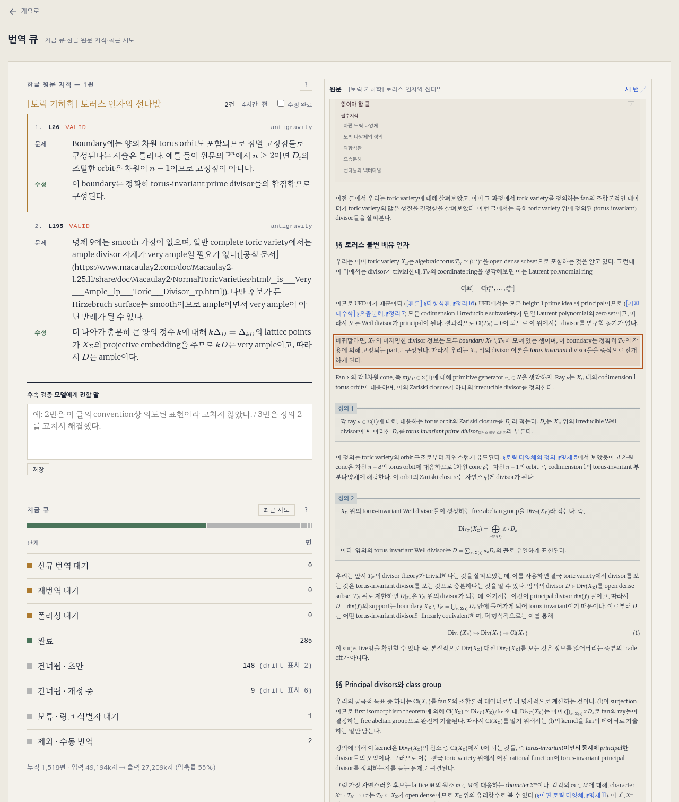

---

title: "원문대조 폴리싱과 한글 원문 감사"
excerpt: "Antigravity 대조 폴리싱 패스와 그 안의 한글 원문 감사, 대시보드에서 체크한 지적을 EN까지 잇는 후속 워커"

read_time: false

categories: [Misc / LLM Workshop]
permalink: /ko/llm_workshop/antigravity_polish

sidebar:
    nav: "llm_workshop-ko"

author: Marvin

date: 2026-09-06

weight: 49
group: agents

---

관련 파일: [`scripts/translation/translate_worker.py`](https://github.com/math-jh/math-jh.github.io/blob/main/scripts/translation/translate_worker.py), [`scripts/translation/ko_followup_worker.py`](https://github.com/math-jh/math-jh.github.io/blob/main/scripts/translation/ko_followup_worker.py), [`scripts/translation/section_anchor_gate.py`](https://github.com/math-jh/math-jh.github.io/blob/main/scripts/translation/section_anchor_gate.py), [`scripts/dashboard/server.py`](https://github.com/math-jh/math-jh.github.io/blob/main/scripts/dashboard/server.py), [`scripts/dashboard/app.js`](https://github.com/math-jh/math-jh.github.io/blob/main/scripts/dashboard/app.js), [`_config.yml`](https://github.com/math-jh/math-jh.github.io/blob/main/_config.yml), [4d2ebc7c](https://github.com/math-jh/math-jh.github.io/commit/4d2ebc7c), [20cc224b](https://github.com/math-jh/math-jh.github.io/commit/20cc224b), [8ae10c43](https://github.com/math-jh/math-jh.github.io/commit/8ae10c43)
{: .notice--info}

폴리싱 패스를 붙일 때 EN 코퍼스는 전부 Kimi의 번역이었다. 사용자는 같은 엔진으로 자기 결과를 검토시키는 구도를 피했다.

> 근데 이제 번역도 원래 Kimi로 translate가 다 됐었잖아. 근데 이제 그거를 또 똑같이 Kimi로 polish 하는 것보다는 다른 걸로 하는 게 나을 것 같아서, Antigravity로 올렸어. 그리고 올리면서 한글 글에 오류가 있는 것도 걔가 같이 보게 했고, 그리고 겸사겸사 영문과 한글 글의 불일치가 있으면 그것도 하게 했단 말이야.

번역 워커 본체는 [자동 번역 워커](/ko/llm_workshop/translation_worker) 글에 있다.

## `translation_polish_source` 태그로 도는 폴리싱 큐

폴리싱 대기열은 따로 없다. `_config.yml`의 엔진 이름표 세 키 중 하나가 큐 노릇을 한다.

```yaml
translation_source_tag         : "antigravity-gemini-3.8-flash-high"
translation_source_legacy_tags : ["kimi-cli"]
translation_polish_source_tag  : "antigravity-gemini-3.8-flash-high"
```
{: data-filename="_config.yml · 일부 발췌"}

앞의 두 키는 원 번역의 출처라 기계번역 고지가 보고, 마지막 키는 지금의 대조 폴리싱을 거쳤는지를 적는다. 그래서 Kimi가 번역하고 Antigravity가 다듬은 글도 `translation_source: kimi-cli`를 지킨다. Phase 3은 EN의 `translation_polish_source`가 이 값과 다른 글을 집는다.

```python
        meta = en_translation_meta(existing_en)
        if meta.get("translation_polish_source") == TRANSLATION_POLISH_SOURCE_TAG:
            continue                       # already polished by the current pass
        return ko, existing_en, "polish"
```
{: data-filename="scripts/translation/translate_worker.py · 일부 발췌"}

Phase 3은 번역 백엔드가 Antigravity일 때만 돈다. Kimi로 롤백해 번역하는 동안 이 큐를 소비하거나 Antigravity 폴리싱의 이름표를 찍지 않게 하기 위해서다. KO 글을 정해진 순서로 훑으면서 초안, 최근에 실패한 글, EN이 없거나 사람이 번역한 글을 건너뛰고, 남은 글 가운데 태그가 다른 첫 글을 고른다. 검증에 걸린 글은 태그를 받지 못하므로, 실패한 글을 한동안 건너뛰는 백오프가 없으면 그 글이 매 틱 맨 앞에서 다시 뽑혀 나머지 글이 차례를 얻지 못한다.

엔진을 또 바꾸면 이 값만 고치면 되고, 코퍼스 전체가 다시 대기열에 선다. 10월 15일에 호출부가 모델 ID 고정을 풀어 `AGY_MODEL`이 없으면 `--effort high`만 넘기게 되면서, 값 속의 모델 이름은 실제 모델과 어긋날 수 있게 된다. 이 태그는 모델 이름이 아니라 이번 패스의 이름표다.

본문 프롬프트(`POLISH_INSTRUCTIONS`)는 한글을 의미의 유일한 기준으로 두고, 한글이 틀려 보여도 영문에서 바로잡지 말라고 적는다. 한글 오류는 감사 몫이다. frontmatter는 `_polish_fm_fields`가 JSON으로 따로 다룬다.

KO나 EN 본문이 4,000자를 넘으면 조각으로 나눈다. 경계는 번역 경로의 `_split_regions`(`:::` 박스 여는 줄)를 쓰되, `_group_region_pairs`가 box id로 KO·EN 리전을 짝짓고 각 짝을 `max(len(ko_text), len(en_text))`로 잰다. 출력이 EN이라 KO만 재면 영문이 긴 조각에서 다시 한도에 걸린다. id 열이 어긋나면 `None`을 돌려 통짜 폴리싱으로 물러선다. 짝 없는 조각을 보내면 모델이 대응 없는 쪽을 지어내거나 지운다.

폴리싱은 검증까지 끝낸다. 최종 EN에 `check_en`(`lint_latex`·`lint_structure`, 수식이 어긋날 때만 모델 판정)을 돌려 `verified_at`을 같이 찍으므로, 이 검사가 예외로 끝난 글만 Phase 4로 간다.

## EN 제목 고정 가드와 `§옛 제목` 인용 갱신

폴리싱은 frontmatter의 `title`도 다시 쓴다. 다른 EN 글이 그 제목을 `[§Basic Notions](…)` 꼴로 그대로 인용하므로, 제목이 바뀌면 인용이 옛 제목으로 남는다.

> 폴리싱이 En 제목도 바꾼다고?

바뀐 제목을 나란히 놓고 보니 뜻을 고친 것보다 문체만 다듬은 것이 많았다.

> 1번으로 해줘. 근데 지금 바뀐 것들만 놓고 보면, 이전 제목들이 나은게 많아보이는데, 네 생각은 어때?

나는 같은 생각이라고 답했다. 10월 6일에 들어간 변경은 두 겹이다. 프롬프트는 현재 EN 제목이 한글 제목의 대상과 어긋날 때만 바꾸고 관사·단복수·어순·전치사·대시를 지키라고 적는다. 그 뒤의 결정론 가드는 `_title_key`(대소문자, 선행 `The`, 대시 종류, 단어 끝 복수 `s`를 지운 비교 키)가 같으면 현재 제목으로 되돌린다. 단어나 어순이 바뀐 제목은 키가 달라 통과하고, 그때는 `sweep_title`이 이 글을 인용하는 다른 EN 글의 `§옛 제목`을 새 제목으로 바꾼다.

```python
pat = re.compile(r"(?<!\S)§" + re.escape(old) + r"(?=,|$)")
```
{: data-filename="scripts/translation/section_anchor_gate.py · 일부 발췌"}

이 패턴은 링크 라벨 안에서만 쓰인다. `(?<!\S)`는 `§` 바로 앞에 공백이 아닌 글자가 없어야 한다는 조건이라, `§`가 라벨 맨 앞이거나 범주 접두 뒤의 공백 다음일 때만 맞는다. `§§` 절 인용은 둘째 `§` 앞에 `§`가 붙어 있어 걸리지 않는다. `(?=,|$)`는 옛 제목 바로 뒤가 `,`이거나 라벨 끝이어야 한다는 조건이라, 옛 제목으로 시작하는 다른 제목(`§Basic Notions of Rings`)도 건드리지 않는다. 링크 경로가 대상 글의 permalink인 라벨만 고치고, 수식·코드 안의 링크는 건너뛴다. 고친 형제 파일은 커밋하지 않고 워킹트리에 남겨 autopush에 맡긴다. autopush가 라벨 치환을 기계적 변경으로 분류하므로 그 글들의 수정일은 바뀌지 않는다. `Projective Schemes`가 `Projective Space and the Proj Construction`으로 바뀌었을 때는 인용하던 EN 7편이 함께 고쳐졌다.

## 폴리싱 중의 한글 원문 감사와 Codex 2차 판정

같은 틱에서 `audit_ko_source`가 한글 글 전문을 Antigravity에 한 번 더 보낸다. 프롬프트는 이것을 `read-only triage task`로 규정하고, 글을 고치지도 영문을 논하지도 말라고 적는다. 에이전트에 도구는 없지만 호출 전후의 KO SHA-256을 비교해, 다르면 즉시 알림을 보내고 감사를 실패로 돌린다. 응답은 후보마다 구분자 블록 하나다.

```text
<<<FINDING
KIND: ERROR or EXPLANATION
QUOTE:
exact Korean quote, copied character for character from the post
ISSUE:
short reason
FIX:
minimal Korean correction or addition
>>>END
```
{: data-filename="scripts/translation/translate_worker.py · KO 감사 프롬프트 일부 발췌"}

워커는 블록마다 `KIND`가 `ERROR`·`EXPLANATION` 중 하나이고 인용과 문제가 비어 있지 않은지 본 뒤, `QUOTE`를 KO에서 `find`로 찾아 그 위치로 줄 번호를 매긴다. 안 찾아지는 후보는 버린다. 위치가 없으면 줄 번호도, 나중에 수정분을 대조할 기준도 없다. 다듬어 옮긴 인용과 지어낸 인용은 가를 수 없어 둘 다 버리고, 건수만 로그에 남긴다. 검증기(Claude)가 verdict에 적은 KO-TYPOS도 `ERROR` 후보로 합류한다.

후보는 `review_ko_findings`가 `codex exec --sandbox read-only --ephemeral`에 KO 전문과 함께 넘겨, 후보마다 `VALID`·`FALSE`·`UNSURE`와 최소 수정안을 받는다. 여기서도 전후 해시를 비교한다. 호출이나 파싱이 실패한 후보는 판정 없이 남긴다. 숨기면 오류가 없다는 뜻으로 읽힌다.

무엇을 지적할 수 있는지는 9월 29일에 사용자가 대시보드 대기열을 보다가 짚었다([96a9fbea](https://github.com/math-jh/math-jh.github.io/commit/96a9fbea)).

> 지금 번역 크론이 돌면서 원문 지적을 하는데, 공통적으로 (1) \x,\y 등은 이 블로그에서 사용하는 표준적인 매크로인데 계속 지적을 한다. 프롬프트 수정이 필요하다. 이런 식으로 매크로 몇개 넣기보다는, 프롬프트에 GUIDELINE-Translate 혹은 GUIDELINE-Edit 등을 보게 하면 될 것 같다. (2) 지금 대기중인 Derivatives 글 같은 경우에는 애초에 얘가 지적할 사안이 아니다. 수학적인 내용이 아니고, 애초에 이건 우리가 terms.yml에서 derivatives를 등재할 때, primary:en으로 썼지만, calculus 카테고리는 교양수학인 걸 고려해서 한글로 쓰기로 합의 본 사안이다.

(1)은 `house_conventions()`가 받는다. 호출마다 `GUIDELINE-Edit.md`에서 제목이 "수식 표기"·"용어 사용"인 절을 골라 싣고(못 찾으면 지침 전문), `katex-macros.js`에서 뽑은 매크로 목록을 붙인다. (2)는 규약으로 풀리지 않아서, 감사 범위를 한 문장으로 잘라 Antigravity·Codex·KO-TYPOS 세 프롬프트에 같은 문구로 실었다.

```python
KO_FINDING_SCOPE = (
    "Scope: a finding must be about the MATHEMATICS, i.e. whether a statement, "
    "formula, proof step, or hypothesis is true and adequately supported. "
    "Out of scope and never a finding: terminology choice, which language a term "
    "is written in, the order or form of a bilingual gloss ..., "
    "notation conventions and use of the blog's macros, typography, wording, and "
    "style. Those are the author's editorial decisions."
)
```
{: data-filename="scripts/translation/translate_worker.py · 일부 생략"}

ERROR 정의의 `malformed LaTeX symbol`, `evident typo`도 각각 `broken LaTeX that cannot render`, `a typo that garbles the mathematical meaning`으로 좁혔다. 넓은 표현이 남으면 모델이 표기 지적을 "오타"로 되살린다. Codex는 범위 밖 후보와, 하우스 규약을 따르는 한글을 인용한 후보를 FALSE로 둔다.

판정이 붙은 목록은 `record_ko_review`가 FALSE까지 포함해 state에 쓰고, 감사 시점의 KO 전문(`ko_review_base_content`)과 해시를 같이 둔다. 그 KO가 커밋 전 워킹트리였을 수 있어서 git으로는 복원되지 않는다. 후속 워커는 이 전문을 기준 판본으로 삼아, 사용자가 그 뒤에 고친 내용을 diff로 본다.

## JSON을 지나며 깨지는 LaTeX와 구분자 블록 응답

JSON 응답에서는 홑백슬래시 `\times`가 `json.loads`를 지나 탭과 `imes`가 되고, 파싱은 성공한다. frontmatter 필드와 Codex 판정은 JSON으로 받으므로, `_parse_json_object`가 수식 구간 안의 홑백슬래시만 이중으로 만든다.

```python
    def protect_math(m: re.Match) -> str:
        return re.sub(r'(?<!\\)\\(?![\\"])', r'\\\\', m.group(0))

    t = re.sub(r"\$\$.*?\$\$|\$[^$\n]*\$", protect_math, t, flags=re.DOTALL)
```
{: data-filename="scripts/translation/translate_worker.py · 일부 발췌"}

바깥 정규식 `\$\$.*?\$\$|\$[^$\n]*\$`가 디스플레이와 인라인 수식 구간을 잡고, 그 구간 안에서만 `(?<!\\)\\(?![\\"])`가 백슬래시를 찾아 둘로 만든다. `(?<!\\)`는 앞에 백슬래시가 없을 것, `(?![\\"])`는 뒤에 백슬래시나 따옴표가 오지 않을 것이다. 그래서 이미 `\\`로 적힌 쌍과 `\"`는 그대로 남고, 수식 밖의 `\n` 같은 JSON 이스케이프도 원래 뜻을 지킨다. 탭으로 저장된 옛 지적은 후속 워커의 `_repair_latex_controls`가 되돌린다.

원문과 글자 단위로 맞아야 하는 응답, 곧 감사 후보의 인용과 후속 워커의 치환 원문(`old`)에는 이것으로 부족했다. 모델이 이스케이프하다 `$`를 흘리거나(`$\lambda$`가 `\lambda`로) 줄바꿈을 리터럴 `\n`으로 내면, 인용은 KO에서 안 찾아지고 치환은 EN에 안 맞는다. 그래서 11월 1일에 둘을 이스케이프가 필요 없는 구분자 블록으로 받게 됐다. 감사는 위의 `<<<FINDING`이고, 치환은 이렇다.

```text
<<<OLD
exact unique substring of CURRENT EN, copied character for character
===NEW
its replacement
>>>END
```
{: data-filename="scripts/translation/ko_followup_worker.py · 치환 프롬프트 일부 발췌"}

`_parse_replacements`는 블록도 `NO CHANGES`도 없으면 예외를 던져, 옛 JSON 답이 빈 치환으로 읽히지 않게 한다. 치환은 `old`가 EN에 정확히 한 번 나올 때만 적용되고, 실패하면 `_replacement_miss`가 중복과 불일치를 갈라 적는다. 불일치일 때는 EN에 들어 있는 `old`의 가장 긴 접두사를 이분 탐색으로 찾는다.

```python
lo, hi = 0, len(old)
while lo < hi:
    mid = (lo + hi + 1) // 2
    if old[:mid] in text:
        lo = mid
    else:
        hi = mid - 1
at = text.find(old[:lo]) + lo
```
{: data-filename="scripts/translation/ko_followup_worker.py · 일부 발췌"}

`lo`는 EN에 들어 있다고 확인된 접두사 길이이고 `hi`는 아직 가능한 최대 길이다. 가운데 길이의 접두사가 EN에 있으면 `lo`를 올리고, 없으면 `hi`를 내린다. 어떤 접두사가 EN에 있으면 그보다 짧은 접두사도 모두 있으므로 이분 탐색이 성립한다. 끝나면 EN에서 그 접두사가 끝나는 지점부터 `old`의 30자와 EN의 30자를 `repr`로 나란히 싣는다. `repr`에서는 리터럴 `\n`과 개행이 다르게 찍힌다. 10월 31일 밤 배치의 대기 사유 하나가 `앞 292/412자 일치, 이어서 old '.\\n\\nFurthermore…'`였다.

## 대시보드 체크박스에서 EN 커밋까지의 후속 요청

지적을 보고 한글을 고치는 것은 사용자이고, 그 수정을 EN에 옮기는 것은 후속 워커다. 대시보드 번역 화면은 FALSE가 아닌 지적이 남은 글을 한 행씩 보여 주고, 행의 체크박스는 `~/.local/state/blog_dashboard_kotypo.json`에 요청 키 `<ko-path>@<ko_reviewed_at>`를 넣는다.

체크는 승인이 아니라 요청이다. 승인으로 읽으면 누르는 순간 항목이 사라지고, EN 동기화가 실패해도 흔적이 없다. 항목은 EN 커밋이 실제로 들어간 뒤에야 빠진다. 요청은 번역 워커와 2시간 엇갈린 `ko_followup_worker.py`가 받는다.

번역 화면의 모양은 11월 10일 대시보드를 손보면서 바뀐다. 지금은 왼쪽에 글별 지적 목록과 수정 완료 체크, 후속 검증 메모 칸이 있고, 오른쪽 미리보기가 고른 지적의 문단을 짚는다.



```text
15 */4    * * * … translate_worker.py
15 2-22/4 * * * … ko_followup_worker.py
```
{: data-filename="crontab · 일부 생략"}

둘은 같은 번역 락을 잡는다. `run_all`은 시작 시점의 요청을 전부 차례로 한 번씩 처리하고, 감사 시각이 state와 다른 키는 낡은 것으로 지운다. 한 항목이 대기로 남아도 뒤는 막히지 않는다.

후속 워커는 먼저 기준 판본과 현재 KO의 diff를 지적 근처로 좁힌다. 사용자가 다른 문단을 같이 손보거나 의존성 분류기가 다른 링크에 `data-lid`를 달면 그것까지 판정에 섞이기 때문이다. `_scoped_ko_diff`는 각 지적의 인용이 차지하는 줄 범위를 구하고, `difflib.SequenceMatcher`가 기준 판본과 현재 KO를 비교해 낸 덩어리를 하나씩 본다.

```python
scoped.extend(before[i1:i2] if relevant else after[j1:j2])

return _diff("".join(scoped), current, f"a/{path}", f"b/{path}")
```
{: data-filename="scripts/translation/ko_followup_worker.py · 일부 발췌"}

바뀌지 않은 덩어리는 기준 판본의 줄을 그대로 옮긴다. 바뀐 덩어리가 어느 지적의 줄 범위 앞뒤 두 줄(`FINDING_CHANGE_RADIUS`) 안에 걸치면 기준 판본의 줄을 남기고, 걸치지 않으면 현재 판본의 줄로 채운다. 이렇게 만든 `scoped`를 옛 쪽, 현재 KO를 새 쪽으로 diff를 뜨면 지적 근처의 수정만 변경으로 나온다. 범위 밖에서 고친 곳은 양쪽 줄이 같아서 diff에 나타나지 않고, 맥락 줄도 어디서나 현재 문구가 된다. 범위 밖을 거꾸로 기준 판본으로 채우면, 반경 바로 밖에서 고쳐진 정의가 맥락 줄에 옛 문구로 실린다. diff가 조각인 만큼 두 모델에게 현재 KO 전문도 `CURRENT KO`로 준다.

Antigravity가 치환 블록을 내면 `validate_translation`과 새로 생긴 `lint_latex`·`lint_structure` 지적이 결정론 게이트가 된다. 통과한 후보는 Codex가 원 지적, KO·EN diff, `CURRENT KO`, `FINAL EN`으로 판정한다. EN diff가 비면 `FINAL EN`이 고친 뜻을 이미 담는지를 본다. 이 판정을 두 질문으로 나눈 것은 10월 31일 밤 사용자의 지적 뒤다([48c5847e](https://github.com/math-jh/math-jh.github.io/commit/48c5847e)).

> 하나 후속워커에서 거절당했어. 근데 왜 후속워커가 영어를 기준으로 생각하는지 모르겠네. 영어는 자기가 수정해야 하는거지 기준이 아닌데.

판정이 `{"pass": bool}` 하나일 때는 영어 결함도 거절이 되어, 사용자가 한글을 다시 고쳐 올리는 길로 이어졌다. 사용자가 짚은 대로 한글은 저자 몫이고 영어는 워커 몫이다. 판정을 두 질문으로 나누자는 내 안을 사용자가 받았고, 그 뒤로 Codex는 두 질문에 따로 답한다.

```json
{"ko_resolved":true,"en_faithful":true,"why":"short concrete reason"}
```
{: data-filename="scripts/translation/ko_followup_worker.py · 판정 프롬프트 일부 발췌"}

`ko_resolved`가 false면(`KO_UNRESOLVED`) 영어를 다시 만들어도 안 풀리므로 바로 거절해 체크를 풀고, 사유를 행에 `승인 거절:`로 남긴다. 영어만 문제면 판정 사유를 `REVIEW FEEDBACK`으로 제안 프롬프트에 돌려주고, 제안 두 번(`MAX_PROPOSAL_ATTEMPTS = 2`)이 다 떨어지면(`EN_UNFAITHFUL`) 체크된 채 대기로 둔다. 통과하면 autopush 락 안에서 KO·EN 해시를 다시 확인하고 두 파일을 `[Cron] Audit` 커밋 하나로 낸 뒤에야 감사 필드와 요청을 지운다.

## 작성자 메모, 막힘 표시, 감사 필드의 수명

사용자는 판정하는 모델에게 직접 말을 건넬 통로도 달라고 했다.

> 그 과정에서, 내가 모델에게 전할 말이 있으면 넣을 방법이 없어. 그 기능 좀 추가해줘.

모달 아래의 메모는 `~/.local/state/blog_dashboard_kotypo_notes.json`에 요청 키 단위로 flock을 잡고 병합 저장된다. 체크 map은 클라이언트가 통째로 교체하므로, 거기 섞으면 다른 탭이 메모를 날린다. 후속 워커는 메모를 두 프롬프트에 `AUTHOR NOTE`로 넣고, 메모가 있으면 지적 위치의 KO가 그대로여도 판정으로 보낸다. 없으면 "지적 위치의 KO 변경이 없음"으로 대기한다. 판정 기준은 이렇다.

```text
... What the author decides is final for everything except mathematical
truth. ...
... Only when the finding says the Korean states something mathematically
false may you weigh the note's reasoning, and fail it if the note gives no sound
reason the post supports. ...
```
{: data-filename="scripts/translation/ko_followup_worker.py · 판정 프롬프트 일부 생략"}

용어·병기·표기·문체·설명 분량에 대한 지적은 메모 한 줄로 통과하고, 수학적 거짓이라는 지적만 메모의 논거를 따진다. 한글에 없는 내용을 덧붙인 영문은 여전히 떨어진다. 승인되면 메모도 지워지고, 거절되면 남아서 고쳐 쓸 수 있다. 한 턴에 4시간이 걸리는 대화이긴 하다.

대기는 한동안 로그에만 남았다.

> 대시보드에 보면 승인 거절 아닌 원문 지적이 남아있늤겐 있는데 그것들은 정체가 뭐야?

10월 10일부터는 `_record_wait`가 `ko_followup_wait` = {request, count, at, reason}을 state에 쓰고, 횟수는 같은 요청 키 동안만 이어진다. 서버는 횟수가 `FOLLOWUP_STUCK_AFTER = 2` 이상이면 행에 `후속 처리 막힘 N회: 사유`를 붙인다. 한 번은 정상이다(체크해 두고 KO를 고치기 전에 워커가 먼저 도는 일이 흔하다). 색은 거절의 `--bad`와 갈라 `--warn`이다. 거절은 사람이, 막힘은 조건(KO 변경, 락, 치환 실패)이 풀어야 한다. 체크를 풀어도 다음 실행까지는 서버가 막힘을 내보내므로, 태그는 항상 렌더하고 체크 상태로 `hidden`만 토글한다.

10월 31일부터 감사 필드를 지우는 곳은 후속 판정 통과 하나다([08a3bb7f](https://github.com/math-jh/math-jh.github.io/commit/08a3bb7f)). 대시보드는 `verify_ko_typos`가 비면 해소로 읽으므로(`ko_typos.py` 계약), 다른 경로가 비우면 지적이 에러 없이 사라진다. Phase 4 재검증이 `None`으로 덮던 경로와 drift 재번역이 항목을 새 dict로 갈아 끼우던 경로가 그랬다. 이때부터 아홉 필드를 `KO_AUDIT_FIELDS`로 모아 `_clear_completed`가 쓰고, 나머지 경로는 `merge_ko_audit`을 거친다.

`merge_ko_audit`은 FALSE가 아닌 지적이 남은 감사를 그대로 옮기므로 요청 키가 유지된다. 새 판정과 합칠 때는 옛 지적 중 FALSE가 아니고 인용이 현재 KO에 남은 것만 남기고(사라졌으면 사용자가 고친 것이다), 현재 KO를 새 기준 판본으로 삼아 감사 시각을 새로 찍는다. 옛 키의 체크는 다음 후속 실행에서 stale로 정리되므로, 사용자는 새 행을 다시 체크해야 한다.
