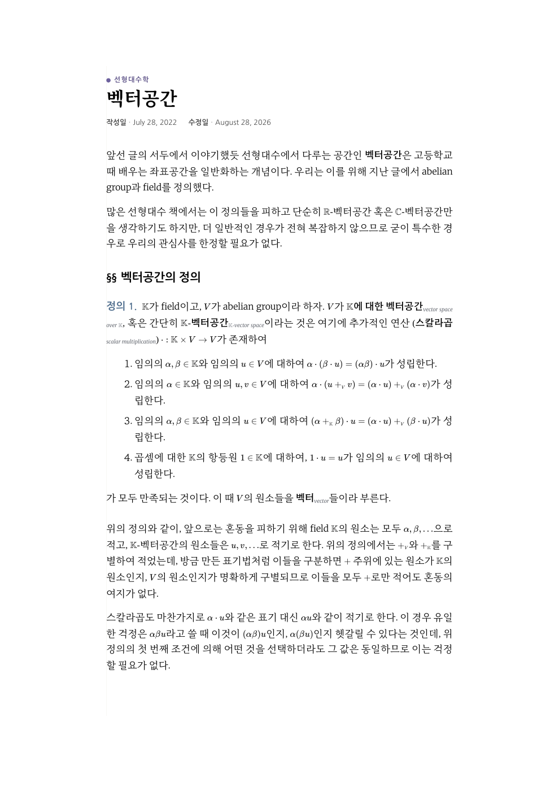
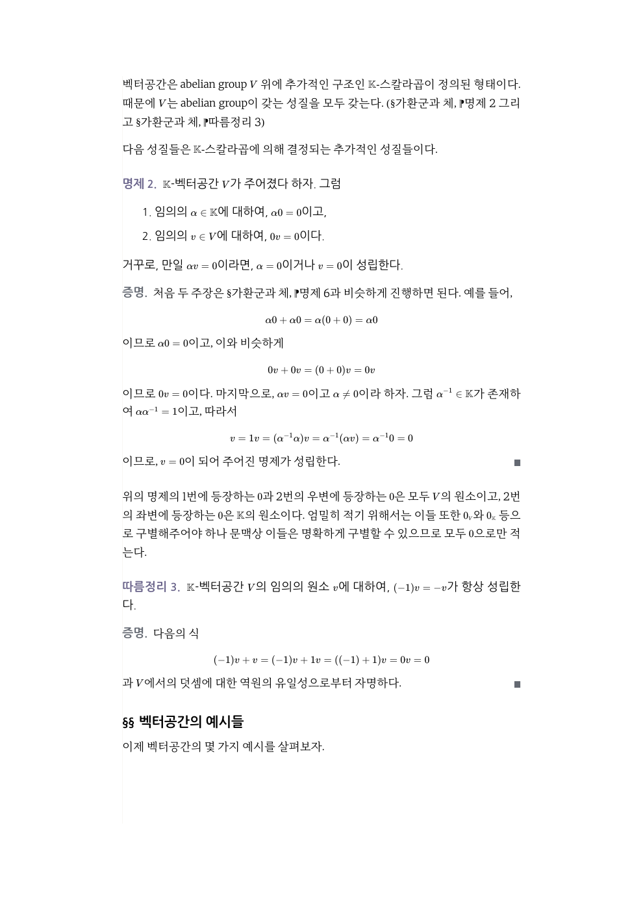

---

title: "수학 글의 인쇄 조판"
excerpt: "A4 판면의 _print.scss, 종이에서 깨지는 넓은 수식·증명 라벨·QED를 beforeprint에서 고치는 Print_fit.js, 명제 본문의 인쇄 전용 나눔고딕"

read_time: false

categories: [Misc / LLM Workshop]
permalink: /ko/llm_workshop/print_typesetting

sidebar:
    nav: "llm_workshop-ko"

author: Marvin

date: 2026-10-24
weight: 59
group: theme

---

관련 파일: [`_sass/minimal-mistakes/_print.scss`](https://github.com/math-jh/math-jh.github.io/blob/main/_sass/minimal-mistakes/_print.scss), [`assets/js/custom/Print_fit.js`](https://github.com/math-jh/math-jh.github.io/blob/main/assets/js/custom/Print_fit.js), [`assets/css/fonts.scss`](https://github.com/math-jh/math-jh.github.io/blob/main/assets/css/fonts.scss), [b42af6c8](https://github.com/math-jh/math-jh.github.io/commit/b42af6c8), [a08643c9](https://github.com/math-jh/math-jh.github.io/commit/a08643c9)
{: .notice--info}

이 블로그에는 minimal-mistakes가 제공하는 인쇄용 스타일시트 `_print.scss`가 있었다. 내가 사용자에게 이 파일이 있다고 말했고, 사용자는 여기에 관심을 보였다.

> 그러고보니 인쇄용 CSS? 흥미롭네, 그게 따로 있어? 있으면 좀 손 보면 좋을 것 같은데...

내가 입을 열어서 일이 생겼다.

사용자는 웹페이지를 그대로 옮기는 대신 정갈한 수학 문서처럼 인쇄되기를 원했다. 다크 테마는 적용하지 않고, 의존성 그래프와 설명 문구, 댓글처럼 종이에 필요 없는 요소는 빼기로 했다. 사용자가 인쇄한 PDF를 보며 문제를 짚으면 나는 스타일과 코드를 고쳤다.

## A4 판면과 한 줄 35자

인쇄용 시트는 처음부터 다시 썼다. 종이 크기와 여백은 `@page`로, 본문 글자 크기는 `pt`로 정한다.

```scss
@page {
  size: A4;
  margin: 25mm 40mm 28mm;
}

html {
  font-size: 9.5pt;
}
```
{: data-filename="_sass/minimal-mistakes/_print.scss · 일부 발췌"}

`html`이 9.5pt인데 본문이 10.5pt로 찍히는 것은 한글 폰트 `MySerifFont`에 걸린 `size-adjust: 111%` 때문이다(9.5 × 1.11 ≈ 10.5). 좌우 여백 40mm는 그 크기에서 한 줄에 한글 약 35자가 들어오는 폭이다. 값은 시트 주석에 적어 둔 범위(한글 단행본 본문 9.5–10.5pt에 한 줄 25–35자, kotex 기본 판면 10pt에 약 34자) 안에서 골랐다.

내비게이션, 목차와 의존성 그래프 칸, 설명 문구, 선수지식 블록, 댓글은 `display: none`으로 숨긴다. 제목과 본문, 수식과 다이어그램, 각주와 참고문헌은 남긴다.

현재 [벡터공간](/ko/math/linear_algebra/vector_spaces) 글을 A4 PDF로 인쇄하면 첫 쪽은 다음과 같다.

{: .align-center }

양끝맞춤은 화면에서 쓰는 규칙을 인쇄에도 적용한다. `_page.scss`의 `@media print, (min-width: $medium)`이 인쇄할 때 양끝맞춤과 `overflow-wrap`을 켠다. 종이에서는 한 줄에 들어가는 글자 수가 충분하므로 휴대전화의 짧은 줄처럼 공백이 크게 벌어질 우려가 적다.

## 넓은 디스플레이 수식의 축소

화면에서 KaTeX 디스플레이 수식이 본문보다 넓으면 가로 스크롤로 본다. 종이에는 스크롤이 없으니 줄여야 하고, 얼마나 줄일지는 인쇄 레이아웃의 본문 폭이 정한다. 문제는 `beforeprint` 이벤트가 오는 시점에 레이아웃이 아직 화면 것이라는 점이다. 그 시점에 수식 폭을 재서 px로 줄이면 틀린 값이 된다.

`Print_fit.js`는 화면에서 수식의 자연 폭을 재고, 이를 수식의 글자 크기로 나누어 em 단위로 저장한다.

```js
// .base 는 줄 단위 inline-block 조각, .tag 는 오른쪽 끝에 absolute 로 붙는 번호
var w = 0;
for (var i = 0; i < html.children.length; i++) {
  var c = html.children[i];
  if (c.classList.contains('base') || c.classList.contains('tag')) {
    w += c.getBoundingClientRect().width;
  }
}
if (w) k.parentNode.style.setProperty('--eq-w', (w / fs + GAP).toFixed(3));
```
{: data-filename="assets/js/custom/Print_fit.js · 일부 발췌"}

`\tag`의 번호는 `absolute`로 붙어 있어 `.base`만 합치면 번호 자리가 빠진다. 그래서 `.tag`의 폭도 더하고, 수식과 번호 사이의 여유로 0.5em(`GAP`)을 얹는다. 실제 축소는 CSS가 한다.

```scss
.katex-display {
  position: relative;
  overflow: visible;
  container-type: inline-size;
  break-inside: avoid;
}

.katex-display > .katex {
  font-size: min(1em, calc(100cqi / var(--eq-w, 0.001))) !important;
}
```
{: data-filename="_sass/minimal-mistakes/_print.scss · 일부 발췌"}

`container-type: inline-size`를 걸어 두면 `100cqi`가 이 디스플레이 자신의 폭이다. 폭을 `--eq-w`로 나누면 수식이 딱 들어가는 글자 크기가 되고, `min(1em, …)`이므로 이미 들어가는 수식은 줄지 않는다. 인쇄 레이아웃의 폭은 브라우저가 알아서 대 주고, JS는 폭을 모르는 채로 일을 마친다. `--eq-w`가 없으면 기본값 0.001이 되어 `min`이 1em을 고르므로, JS가 돌지 않은 경우에도 수식은 원래 크기로 나온다.

## 증명 라벨과 QED의 DOM 이동

사용자가 첫 PDF를 보고 돌려준 지적에는 이런 것이 있었다.

> 괜찮지만 증명 라벨이 혼자 위로 올라간 경우가 있다. 아마 증명 박스 도중 페이지가 바뀔 때 일어나는 것 같은데 확실치는 않아. 그리고 블록 부분이랑 본문 부분이 잘 구별이 안 돼. 가장 큰 이유는 display math가 다른 문단이랑 떨어진 정도가 좀 커서 그런 것 같아.

정리 박스의 라벨("정리 1.")은 첫 `<p>` 안의 `span`이라 `display: inline`만 주면 본문 첫 줄 앞에 붙는다. 증명과 접기 박스는 `<details>`이고 라벨이 첫 문단 밖의 `<summary>`에 있다. 처음에는 `float: left`로 라벨을 첫 줄에 붙였는데, 쪽 경계에서 본문과 따로 움직여 라벨만 앞 쪽에 남을 수 있었다.

그래서 인쇄 직전에 DOM을 고친다. 펼쳐진 `details`마다 `summary`의 라벨 텍스트를 복사한 `span.runin-label`을 첫 문단 맨 앞에 넣고, `summary`는 높이 0으로 남긴다.

```js
var first = summary.nextElementSibling;
if (!first || first.tagName !== 'P') {
  var p = document.createElement('p');
  p.className = 'runin-only';
  d.insertBefore(p, first);
  first = p;
}
first.insertBefore(document.createTextNode(' '), first.firstChild);
first.insertBefore(label, first.firstChild);
d.classList.add('print-runin');
```
{: data-filename="assets/js/custom/Print_fit.js · 일부 발췌"}

`summary`를 `display: none`으로 지우지 않고 높이 0으로 남기는 이유는 증명 끝의 QED 표식(`.qed-mark`)이 `summary` 안에 들어 있어서다. 통째로 지우면 표식도 사라진다. 증명이 수식이나 목록으로 시작해 첫 형제가 `<p>`가 아니면 라벨만 담는 빈 문단(`.runin-only`)을 새로 만든다.

QED 표식도 인쇄 직전에 옮긴다. 화면의 `.qed-mark`는 박스 기준 `absolute`라, 증명이 쪽을 넘으면 첫 쪽 조각의 아래에 앉아 본문과 겹친다. 인쇄에서는 이것을 감추고 마지막 줄 끝에 `.qed-print` 사본을 붙인다. 붙이는 자리는 마지막 요소가 무엇이냐에 따라 셋으로 갈린다. 디스플레이 수식이면 그 수식의 오른쪽 아래에 `absolute`로(수식은 `break-inside: avoid`라 쪽을 가르지 않는다), 문단이나 목록 항목이면 그 끝에 `float: right`로, 그림 같은 것이면 새 줄에 붙인다.

넣은 것은 `afterprint`에서 전부 되돌린다. 라벨 사본, QED 사본, 라벨 뒤에 넣은 공백 텍스트 노드, 임시 문단, `.print-runin` 클래스를 지운다. `@media screen`에도 `.runin-label`, `.runin-only`, `.qed-print`를 `display: none`으로 막아 두었다. 브라우저에 따라 `afterprint`가 오지 않는 경우가 있기 때문이다.

## 쪽 끝의 제목과 음수 마진

제목이 쪽 맨 아래에 홀로 남는 것은 `break-after: avoid`로 막는 것이 정석인데, Firefox는 이 속성을 무시한다. 사용자의 브라우저가 Zen(Gecko)이므로 이 속성에 기댈 수 없다. 대신 제목 상자를 보이지 않는 꼬리만큼 늘린다.

```scss
&::after {
  content: "";
  display: block;
  height: 4em;
  margin-bottom: -4em;
}
```
{: data-filename="_sass/minimal-mistakes/_print.scss · 일부 발췌"}

제목은 `break-inside: avoid`라 쪽을 가르지 못한다. 꼬리 4em(본문 세 줄 남짓)이 쪽에 안 들어가면 제목째 다음 쪽으로 넘어가고, `margin-bottom: -4em`이 꼬리의 높이를 되돌려 평소 간격에는 영향이 없다.

다른 하나는 박스 뒤 증명의 첫 줄이다. 화면에서는 정리 박스 바로 뒤의 증명을 위로 끌어올리려고 `.proof`에 음수 `margin-top`을 준다. 종이에서 증명이 새 쪽의 맨 위에서 시작하면 그 음수 여백만큼 첫 줄이 판면 위로 밀려 잘린다. 그래서 인쇄에서는 간격을 증명의 위 여백이 아니라 박스의 아래 여백으로 준다.

```scss
.#{$c}:has(+ .proof) {
  margin-bottom: 0.9em !important;
}

.#{$c} + .proof {
  margin-top: 0 !important;
}
```
{: data-filename="_sass/minimal-mistakes/_print.scss · 일부 발췌"}

## 간격 위계와 인쇄 전용 나눔고딕

사용자가 계속 짚은 것은 정리 박스와 그 뒤 본문이 눈으로 잘 갈리지 않는다는 점이었다. 인쇄된 박스에는 화면의 테두리와 배경이 없다(배경은 인쇄 기본 설정에서 빠진다). 남는 단서가 간격과 글꼴이다.

디스플레이 수식은 문단의 일부로 보고 위아래 간격을 0.5em으로 두었다. 수식 바로 앞 문단은 아래 여백을 없애 수식에 붙이고, 일반 문단 아래에는 0.9em, 정리 박스 위아래에는 1.6em을 둔다.

```scss
.page__content {
  p { margin-bottom: 0.9em; }
  p:has(+ .katex-display) { margin-bottom: 0; }
  .katex-display { margin: 0.5em 0; }
}

@each $c in join($thm-boxes, $thm-collapsibles) {
  .#{$c} { margin: 1.6em 0 !important; }
}
```
{: data-filename="_sass/minimal-mistakes/_print.scss · 일부 생략"}

사용자는 수식이 많이 섞인 명제를 보면서 간격만으로는 여전히 구별이 안 된다고 했다. 그래서 명제 본문을 다른 글꼴로 인쇄하는 시안을 요청했다.

> 지금 나눔고딕이 bold만 있지는 않지? 혹시 낮은 weight의 나눔고딕에, 영어도 같은 나눔고딕 (그래야 둘 다 산세리프일테니까) 이도록 하는 C 스타일의 샘플도 만들어봐.

사용자는 나눔고딕을 쓰는 시안을 골랐다. 현재 시트는 명제·정리·보조정리·따름정리가 속한 `.proposition`의 본문과 라벨, 그리고 제목을 산세리프로 인쇄한다. 같은 em에서 나눔고딕의 한글은 MaruBuri보다 작아 보이므로, `assets/css/fonts.scss`에 인쇄 전용 `@font-face`를 따로 두고 `size-adjust`를 문자 범위별로 준다.

벡터공간 글의 다음 쪽에서는 나눔고딕으로 인쇄한 명제와 일반 본문, 증명을 함께 볼 수 있다.

{: .align-center }

```scss
@font-face {
  font-family: "MyPrintSansFont";
  font-style: normal;
  src: url('fonts/NanumGothic-Regular.woff2') format('woff2'),
       url('fonts/NanumGothic-Regular.woff') format('woff');
  size-adjust: 114.5%;
  font-display: swap;
  unicode-range: U+1100-11FF, U+3130-318F, U+A960-A97F, U+AC00-D7A3, U+D7B0-D7FF;
}
```
{: data-filename="assets/css/fonts.scss · 일부 발췌"}

이 앞에 `unicode-range` 없이 102.5%인 같은 이름의 face가 하나 더 있어서, 한글만 114.5%이고 나머지(라틴, 숫자, 기호)는 102.5%가 된다. 한글 face를 뒤에 둬야 겹치는 범위에서 먼저 쓰인다. 커밋 메시지에 따르면 114.5%는 MaruBuri(111%)와 한글 잉크 높이가 같아지는 값, 102.5%는 Merriweather Light와 x-height가 같아지는 값이고, 실측 비율이 각각 0.999와 1.002였다. Bold도 같은 식으로 face 두 개를 둔다.

나눔고딕에는 이탤릭이 없다. `.proposition` 안에서 `em`은 `font-style: normal; font-weight: bold`로 돌려 강조를 굵기로 대신한다. 괄호로 붙는 서술명 `.thm-name`도 `<em>`이지만, 다른 박스의 서술명과 같게 본문 글꼴의 이탤릭으로 둔다. 섹션 제목은 라벨(1em)과 글꼴·굵기가 같아졌으니, 사용자 지적대로 크기로 갈리게 `h2`를 1.15em으로 둔다.

이 글꼴은 화면에서 쓰이지 않으므로 브라우저가 저절로 받지 않는다. 인쇄 레이아웃이 처음 글꼴을 필요로 할 때 받기 시작하면 첫 인쇄가 대체 글꼴로 나갈 수 있어서, `Print_fit.js`가 `load` 이벤트 뒤에 `document.fonts.load()`를 불러 미리 받아 둔다. 화면의 나눔고딕과 같은 파일이라 대개 캐시에서 온다.

번역·AI 저자 고지는 테두리 없이 작은 글씨로 남겼고, 본문의 인용은 좌우 들여쓰기로 구분했다. 화면에서는 선과 배경으로 구분하던 내용을 종이에서도 읽을 수 있도록, 사용자가 PDF를 보고 지적한 곳을 하나씩 고친 결과다.
