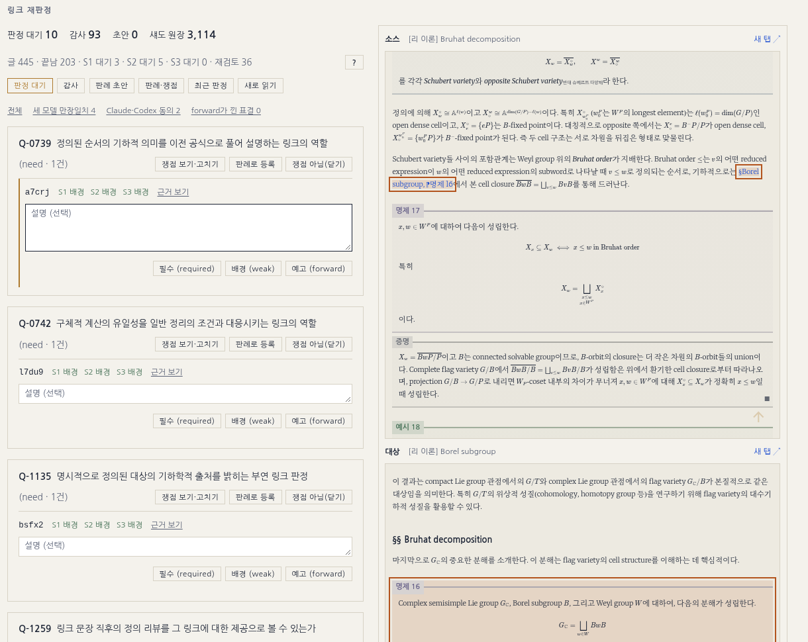
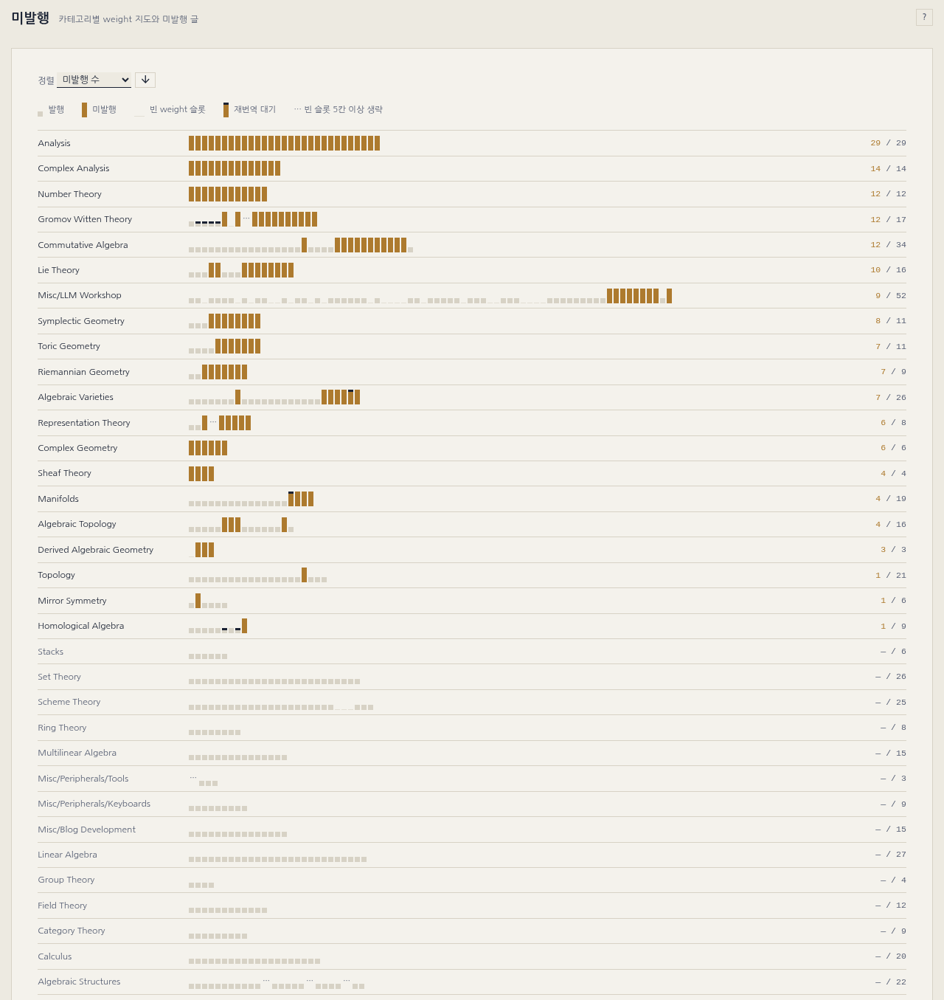
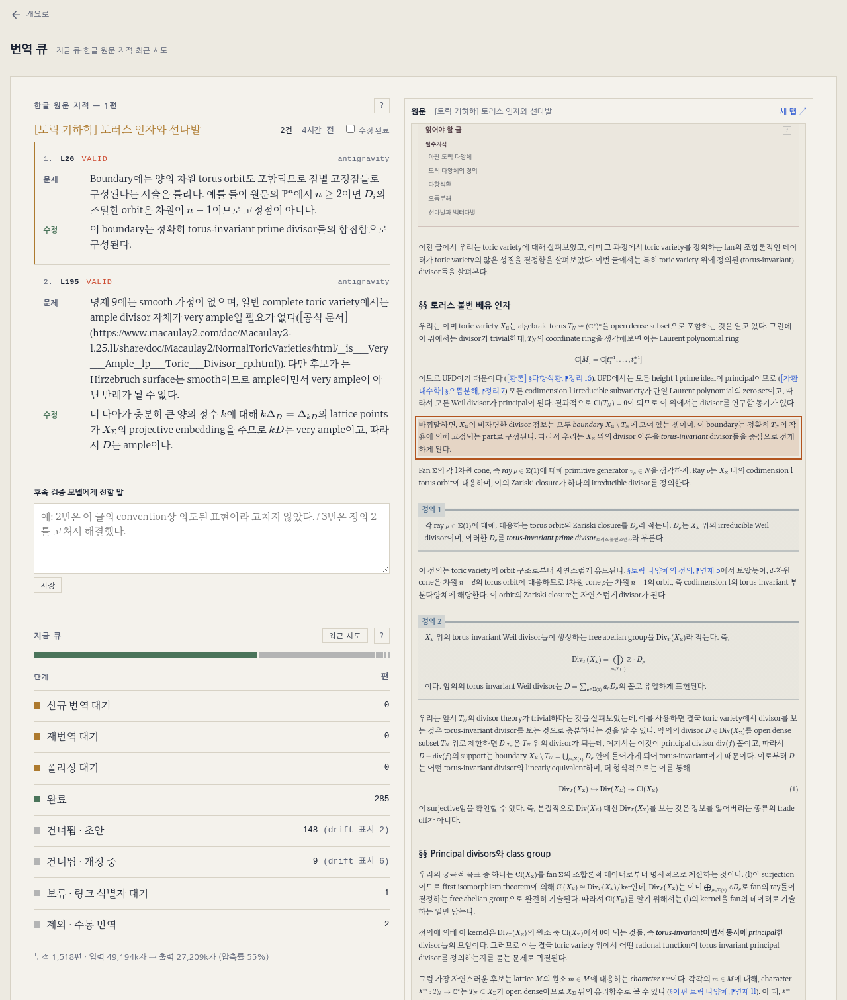
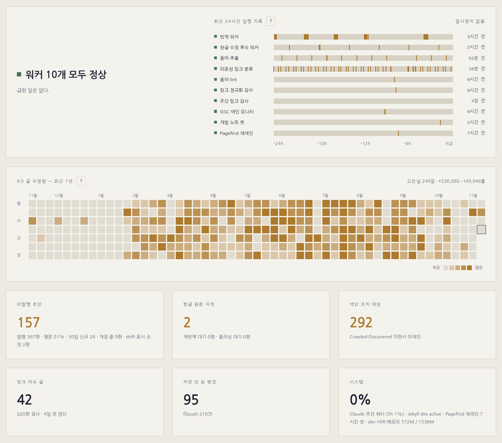
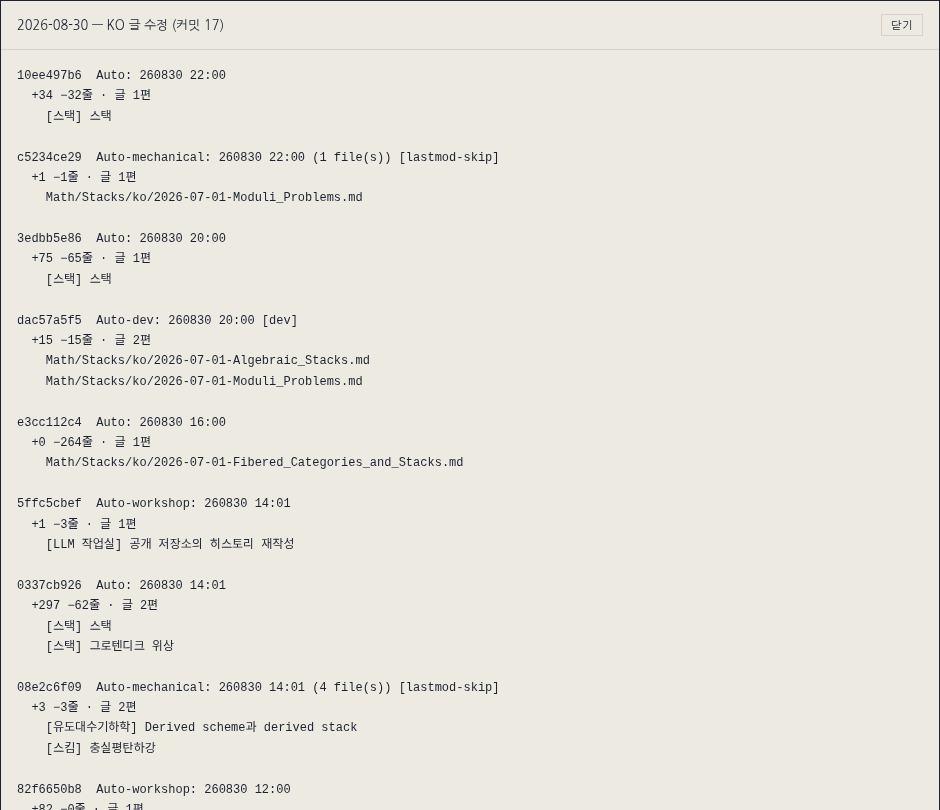

---

title: "블로그 대시보드 개편"
excerpt: "링크 재판정 카드에서 경로·마크업·태그를 걷어 내고 소스·대상 미리보기 두 장을 붙인 일, 섹션마다 실제 경로를 준 라우팅, 겹치는 숫자를 걷어 낸 개요와 KO 글 수정량 잔디"

read_time: false

categories: [Misc / LLM Workshop]
permalink: /ko/llm_workshop/dashboard_revamp

sidebar:
    nav: "llm_workshop-ko"

author: Marvin

date: 2026-11-10
weight: 72
group: admin

---

관련 파일: [`scripts/dashboard/shadow.js`](https://github.com/math-jh/math-jh.github.io/blob/main/scripts/dashboard/shadow.js), [`scripts/dashboard/shadow_api.py`](https://github.com/math-jh/math-jh.github.io/blob/main/scripts/dashboard/shadow_api.py), [`scripts/dashboard/app.js`](https://github.com/math-jh/math-jh.github.io/blob/main/scripts/dashboard/app.js), [`scripts/dashboard/server.py`](https://github.com/math-jh/math-jh.github.io/blob/main/scripts/dashboard/server.py), [`scripts/dependency-classifier/shadow_book.py`](https://github.com/math-jh/math-jh.github.io/blob/main/scripts/dependency-classifier/shadow_book.py), [58d4e7ab](https://github.com/math-jh/math-jh.github.io/commit/58d4e7ab)
{: .notice--info}

사용자는 [링크 재판정](/ko/llm_workshop/shadow_rejudging)의 판정 대기 목록을 대시보드에서 위에서부터 하나씩 넘기고 있었다. 500건이 넘는 목록을 넘기다 보니 화면이 느리고 번잡하다는 데서 일이 시작됐고, 판정 화면을 고친 뒤 사용자는 다른 페이지도 같은 눈으로 다시 보자고 했다. 사용자의 지적을 묶으면 원칙은 둘이었다. 미리보기로 볼 수 있는 것을 글자로 한 번 더 싣지 않고, 고르는 데 쓰지 않는 정보는 화면에서 뺀다.

## 판정 카드와 소스·대상 미리보기

고치기 전의 판정 대기 카드는 한 장에 많은 것을 실었다. 첫 줄에 링크가 있는 파일 경로와 줄 번호, 둘째 줄에 링크의 마크다운 원문이 있었고, 그 아래 S1·S2·S3의 표결과 "근거 보기", 링크를 다른 쟁점으로 옮기는 드롭다운, 설명 칸, 필수·배경·예고 판정 버튼, 그리고 "같은 글"·"재검토"·"화면 영향" 같은 태그가 붙어 있었다. 오른쪽 미리보기 칸은 소스 글 하나만 띄웠고, 감사 탭은 소스와 대상을 마크다운 발췌로 보여 줬다. 사용자는 카드를 한 줄씩 짚어 가며 무엇이 필요 없는지 적어 보냈다.

> 첫 줄 "파일 경로:줄번호" -> 내가 볼 필요 없는 것.
> 둘째 줄 "링크" -> 마찬가지로 미리보기로 보일 거니까 필요 없는 것, 그게 아니더라도 permalink 자체까지 보여줄 필요 없음.

> 비슷하게 감사쪽 보면, 소스와 대상이 markdown으로 제공되는데 내가 볼 필요 없음. 나는 미리보기로 보는 게 맞음. 보여주고 싶으면, 지금 소스만 미리보기 되어있는 걸, 타겟의 해당 부분도 같이 미리보기로 나란히 (나란히든 위아래든) 뜨도록 하는게 맞음.

지금 카드에 남은 것은 lid와 표결, "근거 보기"가 있는 한 줄과 설명 칸, 맨 아래 판정 버튼이다. 쟁점 드롭다운은 사용자가 쓸 일이 없다고 해서 뺐다. 쟁점 배정이 마음에 들지 않으면 세션에서 모델을 불러 바꾸면 되기 때문이다. 판정 버튼은 사용자가 왼쪽 정렬을 지적한 뒤로 모든 탭에서 오른쪽 끝에 붙는다.

빠진 정보는 오른쪽 칸이 대신 보여 준다. 칸은 위아래 두 장이 되었고, 위 칸은 소스 글에서 링크를 짚고 아래 칸은 링크가 가리키는 대상 글에서 박스를 짚는다. 두 칸 모두 dev 서버가 구운 글을 iframe으로 띄우고, 짚을 요소를 찾는 함수만 다르다.

```js
function shFindSource(lid) {
  return function (doc) { return doc.querySelector('a[data-lid="' + lid + '"]'); };
}
function shFindTarget(anchor) {
  return function (doc) {
    var a = anchor && doc.getElementById(anchor);
    return a && (a.closest('.definition, .proposition, .example, .remark, .misc') || a);
  };
}
```
{: data-filename="scripts/dashboard/shadow.js · 일부 발췌, 주석 생략"}

소스 쪽은 구운 HTML의 `<a>`에 남은 `data-lid`로 링크를 바로 찾는다. 대상 쪽은 주소의 `#` 뒤 앵커로 요소를 찾는데, 정리 박스의 앵커는 박스 전체가 아니라 번호를 적은 `span.thm-n`에 붙어 있다. 그래서 `closest`로 그 번호를 감싼 박스까지 올라가 박스 전체에 테두리를 두른다. 앵커가 없는 링크는 찾을 요소가 없으므로 글 첫머리를 보이고, `#thm3`처럼 같은 글 안을 가리키는 링크는 소스 글을 아래 칸에 한 번 더 띄운다. 두 칸의 제목 옆에는 회색으로 `[카테고리] 글 제목`이 붙는다. 서버가 `_data/categories.yml`의 `subjects`에서 한국어 과목명을 읽어 `source_label`·`target_label`로 내려 주는 것이다. 근거 보기 모달은 링크 문장과 대상 문맥을 따로 받아 오던 것을 그만두고 모델별 판정과 근거만 싣는다.

카드 하나를 고르면 이렇게 된다. 쟁점 묶음 머리 아래의 카드에는 lid와 세 차수의 표결, 설명 칸, 판정 버튼만 있고, 오른쪽 위 칸은 소스 글의 링크를, 아래 칸은 대상 글의 박스를 테두리로 짚는다.



감사 탭에서 만장일치와 다른 답을 골랐을 때 펼쳐지는 칸도 같은 기준으로 줄였다. 그날 저녁 사용자는 그 칸이 엉망이라고 했다. 각 모델의 답에 든 본문 인용이 마크다운째 통째로 펼쳐졌는데, 그 본문은 이미 오른쪽 미리보기에 떠 있었다.

> 각 카드 별로 S1 / S2 / S3 하고, 모델이 뭐인지는 쓸 필요 없고, 모델 옆에는 판정 결과만 있으면 충분하다. 아래 본문은 원문 인용은 빼고, 논리만 남긴다.

```js
function shBrief(stages) {
  var w = el('div', 'sh-stages');
  ['S1', 'S2', 'S3'].forEach(function (s) {
    var v = stages && stages[s];
    if (!v || !v.step1) return;
    var steps = [v.step1, v.step4, v.recheck].filter(Boolean);
    var i = steps.length - 1, rel = steps[i].relation;
    while (i > 0 && steps[i - 1].relation === rel) i--;
    // ... 이름표(S1·S2·S3)와 판정, steps[i].reason 만 싣는다
  });
  // ...
}
```
{: data-filename="scripts/dashboard/shadow.js · 일부 생략"}

한 차수의 답은 첫 판정(`step1`) 뒤에 판례 대조의 재검토(`step4`)나 새 판례로 다시 본 표결(`recheck`)이 붙어 판정이 바뀌었을 수 있다. 그래서 그 차수의 판정은 마지막 걸음의 값으로 정하고, 그 판정을 처음 낸 걸음까지 거슬러 올라가 그 걸음의 이유를 싣는다. 판정이 마지막에 바뀌었으면 바꾼 걸음의 이유가, 처음부터 같았으면 첫 판정의 이유가 남는다. 필요·제공 값과 판례 번호는 싣지 않는다. 이유 문장 안에 모델이 옮겨 적은 마크다운 링크가 있으면 `shText`가 주소와 `{: data-lid … }` IAL을 떼고 라벨만 남긴다. 사용자가 원문을 옮길 때 permalink와 IAL은 남길 필요가 없다고 한 것을 따른 것이다.

## 표결 필터와 고정된 판정 순서

느린 원인은 작업 세션에서 셋으로 확인했다. 첫째, 서버가 판례·쟁점 파일 1,400여 개를 요청마다 순수 파이썬 YAML 로더로 읽었다. `shadow_book.py`가 libyaml 바인딩(`CSafeLoader`)이 있으면 그것을 쓰게 하자 응답이 1.2초에서 0.5초로 줄었다. 이 수치는 그 세션에서 잰 것이고, 모든 파일을 두 로더로 읽어 결과가 같은지도 그때 대조했다. 둘째, 카드 522장마다 쟁점 드롭다운에 열린 쟁점 645개를 미리 채우고 있어서 다시 그릴 때마다 `option`이 34만 개쯤 생겼다. 이 드롭다운은 위에서 말한 대로 카드에서 빠졌다. 셋째, 판정 버튼을 누르면 3MB가량의 응답이 다시 올 때까지 화면이 멈춰 있었다. 지금은 `shDrop`이 판정한 링크를 서버 응답을 기다리지 않고 화면의 목록에서 먼저 빼고, 전체 다시 읽기는 뒤에서 돈다.

사용자는 속도와 함께 빨리 볼 수 있는 표결을 앞으로 달라고 했다.

> 예를 들어 모델들 만장일치인데 재검토로 대기로 올라온거, codex와 claude가 동의한 것, forward가 끼어 있는 것

처음에는 요청대로 이 셋을 쟁점 묶음 앞에 따로 모았다. 사용자는 곧 다시 정했다. 이 셋은 필터로 걸어 볼 수 있게 하고, 기본 묶음은 원래대로 쟁점순으로 두되 같은 쟁점 안에서는 같은 카테고리 글이 한 덩어리로 나오게 하라는 것이었다. 서버는 링크마다 `quick` 값을 붙이고, 판정 대기 위의 버튼 줄이 그 값으로 목록을 거른다. 버튼마다 해당 링크 수가 붙는다.

```python
def _quick(votes: dict) -> str | None:
    vals = [votes.get(s) for s in STAGES]
    if None not in vals and len(set(vals)) == 1:
        return "unanimous"
    if votes.get("S2") and votes.get("S2") == votes.get("S3"):
        return "pair"
    if "forward" in vals:
        return "forward"
    return None
```
{: data-filename="scripts/dashboard/shadow_api.py · 일부 발췌"}

조건은 위에서부터 보고 처음 맞는 값 하나만 받는다. 세 차수가 다 투표했고 값이 하나뿐이면 만장일치, 그렇지 않고 S2(Claude)와 S3(Codex)가 같으면 둘의 동의, 그것도 아니고 표 중에 forward가 있으면 forward다. 그래서 세 필터는 서로 겹치지 않는다.

순서에는 사용자가 따로 짚은 문제가 있었다. 위에서부터 판정하는데, 하다 보면 다음에 판정할 링크가 맨 위가 아니라 아래 어디로 내려간다는 것이었다. 쟁점 묶음을 "남은 링크 중 가장 오래된 것"으로 정렬하고 있어서, 링크가 하나 빠질 때마다 묶음의 순서가 바뀌었다.

```python
for g in groups.values():
    g["items"].sort(key=lambda x: (_category(x.get("path")), x.get("path") or "", x.get("line") or 0))
    # ...
# Group order must not depend on which links are still waiting: the human works
# top-down, and a key like "oldest remaining link" reshuffles groups as links leave.
human = sorted(groups.values(), key=lambda g: (g["issue"] is None, g["issue"] or ""))
```
{: data-filename="scripts/dashboard/shadow_api.py · 일부 생략"}

묶음 안은 `(카테고리, 경로, 줄)`로 정렬해 같은 카테고리의 글이 이어지고, 같은 글 안에서는 링크가 나오는 순서가 된다. 묶음끼리는 쟁점 id 순이고 쟁점 없는 묶음이 맨 뒤다. 어느 키도 남은 링크에 따라 달라지지 않으므로, 판정해서 링크가 빠져도 나머지의 자리는 그대로다.

## 판례 초안 승인과 딸린 정리안

판례 초안 탭도 사용자가 기억으로 UI가 좋지 않았다고 한 곳이다. 초안 카드에는 사용자 설명 칸과 고쳐 쓰는 입력 칸 다섯 개가 있었는데, 사용자는 판례는 이제 AI가 써도 상관없으니 설명 칸을 빼고 승인 버튼만 형식적으로 남기자고 했다. 지금 카드에는 무엇에 대한 초안인지(예: "P-0007 보강")와 관계, 한 줄 설명과 원칙 초안이 있고, 쟁점·판정·이유 전문은 "본문 보기" 모달로 연다.

정리안은 초안이 함께 데려오는 제안이다. `promote`는 판례의 `## 원칙 초안` 절을 `criteria.md`의 승격된 원칙으로 올리고, `merge`는 판례 여럿을 첫 판례로 합친다. 고치기 전에는 정리안이 초안 안에 저장되어 있으면서도 초안의 승인 버튼은 정리안에 아무것도 하지 않았다. 그래서 초안을 승인하면 그 초안이 큐에서 빠지면서 정리안도 함께 화면에서 사라졌다.

> 내가 승인부터 눌렀거든? 근데 거기 정리안이 바로 사라졌어. 정리안들도 적용해주고, 로직도 바꿔.

지금은 승인이 초안을 쓴 다음 딸린 정리안을 차례로 적용한다.

```python
for c in sorted(props, key=lambda c: c.get("kind") != "promote"):
    try:
        done.append({"kind": c.get("kind"), "ids": c.get("ids"),
                     **consolidate(c.get("kind"), c.get("ids") or [])})
    except (ValueError, RuntimeError, KeyError) as e:
        failed.append({"kind": c.get("kind"), "ids": c.get("ids"), "error": str(e)})
return {**out, "consolidated": done, "consolidation_failed": failed}
```
{: data-filename="scripts/dashboard/shadow_api.py · 일부 발췌"}

`props`는 초안을 쓰기 전에 큐에서 미리 읽어 둔 정리안 목록이다. 초안을 쓰고 나면 그 초안은 큐에서 빠지기 때문이다. 정렬 키는 `promote`이면 `False`라 승격이 먼저 간다. 승격은 그 시점의 판례 본문에서 원칙 초안을 복사하는데, 같은 판례를 보강하는 초안은 바로 앞에서 이미 써졌으므로 보강이 반영된 원칙이 올라간다. `shadow_digest.apply_consolidation`은 판례에 `## 원칙 초안` 절이 없으면 아무것도 바꾸지 않고 거절하고, `criteria.md`에 같은 판례 줄이 이미 있으면 건너뛴다. `merge`는 합친 글을 쓰는 digest 작업을 큐에 넣을 뿐이어서, 그 결과는 다음 분류기 틱 뒤에 새 병합 초안으로 돌아온다. 적용된 정리안은 그것을 데려온 초안에서 지워져 다시 제안되지 않고, 실패한 것은 `consolidation_failed`로 돌아와 화면 위에 어느 정리안이 왜 안 됐는지 한 줄로 뜬다. 어느 판례가 몇 번 적용됐는지는 알 필요가 없다는 것이 사용자의 말이어서, 정리안 카드에는 그 숫자가 없다.

## 섹션 경로와 pushState 라우팅

7월에 만든 대시보드는 hash 라우팅이었다. `/dash/#audit`처럼 프래그먼트만 바뀌고 서버는 늘 같은 `index.html`을 줬다. 판정 화면을 고친 커밋(58d4e7ab)에서 이것이 섹션마다 실제 경로를 두는 방식으로 바뀌었다. `/dash/audit`, `/dash/translation` 같은 주소마다 서버가 `index.html`을 주고, app.js가 `location.pathname`을 읽어 그린다.

```js
document.addEventListener('click', function (e) {
  if (e.defaultPrevented || e.button !== 0 || e.metaKey || e.ctrlKey || e.shiftKey || e.altKey) return;
  var a = e.target.closest('a[href]');
  if (!a || a.target || a.hasAttribute('download')) return;
  var u = new URL(a.href, location.href);
  if (u.origin !== location.origin || u.search || u.hash) return;
  var to = routeOf(u.pathname);
  if (!to && !/^\/dash\/?$/.test(u.pathname)) return;
  e.preventDefault();
  if (to === route()) return;
  history.pushState(null, '', link(to));
  window.scrollTo(0, 0);
  render();
});
```
{: data-filename="scripts/dashboard/app.js · 일부 발췌"}

문서 전체에 건 클릭 핸들러가 가로채는 것은 같은 탭에서 대시보드 섹션으로 가는 평범한 왼쪽 클릭뿐이다. 수정 키나 가운데 버튼이 눌렸거나, `target`이 붙었거나, 다른 출처·쿼리·hash가 있는 링크는 첫 몇 줄에서 돌려보내 브라우저 기본 동작에 맡긴다. 그래서 Cmd 클릭은 그대로 새 탭으로 열린다. 남은 클릭은 `pushState`로 주소만 바꾸고 다시 그리므로 문서를 다시 읽지 않는다. 뒤로·앞으로는 `popstate`에서 같은 렌더를 부른다.

이미 나가 있는 hash 주소(북마크, 알림 링크)는 `hashToPath`가 `replaceState`로 같은 섹션의 경로로 바꾼다. 처음 열 때와, 열린 탭에서 hash만 바뀔 때 모두 부른다. 워커와 파이프라인은 개요 안에 있어서 그 주소는 `/dash/`로 가고, 아래에서 미발행에 합친 weight 지도의 주소는 `/dash/drafts`로 간다.

## 개요와 하위 페이지의 정리

판정 화면을 고친 저녁, 사용자가 다른 페이지들도 손보고 싶다고 해서 페이지 여덟 개를 찍어 겹치는 곳을 추려 보였다. 개요에는 미발행 156, 색인 조치 297 같은 숫자가 맨 위 판정 문장, 지표 카드, "지금 볼 것", 파이프라인 막대에 서너 번씩 나왔고, 최근 커밋 표는 활동 페이지와 겹쳤다. 사용자는 파이프라인 막대와 "지금 볼 것", "최근 커밋"을 없애자고 했고, 그러면 개요에는 워커 판정과 실행 기록, 하위 페이지로 가는 카드만 남는다. 판정 아래 문장에는 카드가 세지 않는 이상(Jekyll 정지, 메모리 cap, 쿼터 90% 이상, EN 짝)만 적고, 평소에는 "급한 일은 없다." 한 줄이다.

글을 부르는 방식도 사용자가 이때 정했다. 화면 어디서든 글은 `[카테고리] 글 제목`으로 부르고, 경로나 permalink를 그대로 보이지 않는다. 서버의 `post_label`이 이 이름을 붙인다.

```python
def post_label(p, names):
    ko, en = names.get(p["cat_fm"]) or (None, None)
    name = (en if p["lang"] == "en" else ko) or p["category"].split("/")[-1].replace("_", " ")
    return f"[{name}] {p['title']}"
```
{: data-filename="scripts/dashboard/server.py · 일부 발췌, 문서 문자열 생략"}

`names`는 `categories.yml`의 `subjects`에서 카테고리마다 한국어 표시명과 영어 이름의 짝을 만든 것이다. 글의 언어에 맞는 쪽을 쓰고, 표에 없는 카테고리는 경로의 마지막 조각에서 밑줄을 공백으로 바꿔 이름을 만든다. 패널마다 바닥에 펴 두던 읽는 법 설명도 사용자의 동의로 `?` 버튼 뒤로 들어갔다. 검사 편수나 갱신 시각 같은 상태 숫자는 설명이 아니므로 화면에 남는다.

사용자는 weight 지도와 미발행 글 목록이 겹친다고 했다. 지도를 잘 정리된 미발행 글 확인용으로 보고 있었다는 것이다. 두 페이지는 `/dash/drafts` 하나가 되어, 위는 카테고리별 weight 지도이고 아래는 최근 수정한 미발행 글이다. 지도 행을 누르면 그 카테고리의 미발행 글이 행 아래에 weight 순으로 펼쳐지고(한 번에 하나), 눈금을 누르면 그 글의 카테고리를 펼쳐 그 글을 짚는다. 개요의 카드도 같은 곳을 가리키던 두 장이 한 장으로 합쳐졌다. 지도에서는 카테고리마다 발행 글이 옅은 칸, 미발행 글이 금색 막대로 weight 순서대로 늘어서고, 오른쪽 끝에 미발행 수와 전체 수가 붙는다.



번역 큐에서 사용자가 가장 중요하게 본 것은 한글 원문 지적(KO-TYPOS)이었는데, 그때는 지적 전문이 모달로만 떴다. 사용자가 의존성 링크처럼 미리보기로 바꿀 수 있는지 조사해 보라고 했고, 지금은 왼쪽에 지적 목록, 오른쪽에 KO 원문 미리보기가 있다. 미리보기 칸은 `shadow.js`의 `shSlot`·`shHit`을 그대로 쓰고, 짚을 자리를 찾는 함수만 새로 짰다.

```js
function ktFind(x, li) {
  var q = String(x.quote || '');
  var frags = mdPlain(q).replace(/\$\$[\s\S]*?\$\$|\$[^$]*\$/g, '\u0000').replace(/[*`]/g, '')
    .split('\u0000').map(ktNorm).filter(function (f) { return f.length >= 6; })
    .sort(function (a, b) { return b.length - a.length; }).slice(0, 3);
  var tex = q.replace(/[\s$]/g, '').slice(0, 40);
  // ...
}
```
{: data-filename="scripts/dashboard/app.js · 일부 생략"}

지적의 인용문은 마크다운 원문이고 미리보기는 구워진 HTML이라 글자를 그대로 대조할 수 없다. `ktFind`는 인용문에서 수식(`$$…$$`와 `$…$`)을 경계 문자로 바꿔 수식 밖 조각으로 자르고, 6자 이상인 조각을 긴 것부터 셋 고른다. `ktNorm`은 양쪽에서 공백을 하나로 모으고 kramdown이 바꿔 놓는 둥근 따옴표·줄임표·대시를 원래 글자로 되돌린다. 그런 다음 문단·목록 항목·표 칸 같은 블록 중 그 조각을 담은 가장 작은 블록을 짚는다. 인용문이 수식뿐이면 조각이 없으므로, KaTeX가 수식마다 남기는 TeX 원문 주석(`annotation`)에서 공백을 뺀 인용문의 앞 40자를 찾는다. 둘 다 실패하면 그 지적에 "원문에서 못 찾음"이 붙는다. 대개 이미 고친 문장이라서, 작업 세션에서 확인한 두 건도 그랬다. 지적에는 줄번호·판정·문제·수정만 남기고 인용문은 싣지 않는다. 원문은 미리보기에서 본다는 것이 사용자의 말이었다. 페이지를 열면 첫 지적이 골라져 있어서, 오른쪽 미리보기는 그 지적이 가리키는 문단에 테두리를 두른 채 뜬다.



"지금 큐"는 단계별 비율 막대와 편수 목록이 되었고, "최근 시도" 열은 사용자의 주문대로 두 칸 모달로 옮겨졌다. 왼쪽에 글·상태·시각, 글을 누르면 오른쪽에 `/api/translog`가 번역 워커 로그에서 잘라 온 그 글의 마지막 시도가 뜬다. 이 API는 `translating (…)`·`committed:` 같은 워커 로그 문구로 구간을 자르므로, 로그 문구가 바뀌면 에러 없이 빈 로그가 뜬다. 그래서 이 결합은 service-map의 계약에 올라가 있다.

## KO 글 수정량 잔디와 git 밖 연구노트

카드를 정리하고 나니 개요가 휑해졌다는 것이 사용자의 다음 말이었다. 나는 시스템 상태 줄과 집필 추이(달마다 새로 쓴 KO 글 수의 막대)를 후보로 냈다. 사용자는 시스템 상태를 다른 카드와 같은 꼴의 카드로 만들어 Pi 대시보드(`status.math-jh.com`)에 이으라고 했고, 집필 추이 대신 git 기준 수정량을 GitHub 홈의 잔디처럼, 이 대시보드 느낌으로 그리자고 했다. 카드 크기는 모두 같게 하라는 주문도 함께였다. 그래서 카드는 3장씩 두 줄, 여섯 장이다. 지금의 개요는 판정과 24시간 실행 기록, 그 아래 폭 전체의 잔디, 같은 크기의 카드 여섯 장이 전부다.



잔디는 판정 칸과 카드 사이에 폭 전체로 들어간다. 한 열이 한 주(월요일이 위)이고 최근 53주를 보이며, 값은 KST 날짜별 KO 글의 줄 추가와 삭제다.

```python
_HEAT_SKIP = ("[Cron]", "[Dash]")
# ...
        if ln.startswith("@@"):
            sha, ts, parents, subject = ln[2:].split("\t", 3)
            cur = None
            if parents and not subject.startswith(_HEAT_SKIP):
                cur = dict(sha=sha, subject=subject, add=0, dele=0, files=[], day=_kst_day(ts),
                           local=local)
                # ...
                days.setdefault(cur["day"], []).append(cur)
            continue
        if cur is None or not ln.strip():
            continue
        a, d, path = ln.split("\t", 2)
        path = _numstat_path(path)
        if a == "-" or not _ko_post(path):
            continue
        cur["add"] += int(a)
        cur["dele"] += int(d)
```
{: data-filename="scripts/dashboard/server.py · 일부 생략"}

`git log --numstat`를 `@@sha\t시각\t부모\t제목` 머리줄과 함께 읽는다. 머리줄을 만나면 새 커밋을 시작하되, 워커가 쓰는 `[Cron]`·`[Dash]` 커밋이면 `cur`를 비워 그 아래 파일 줄을 전부 건너뛴다. 작업 트리를 짝수 정시에 주워 담는 `[Auto]` 커밋은 사람의 편집이므로 센다. 부모가 없는 커밋도 건너뛰는데, 이것은 아래의 로컬 저장소 때문이다. 파일 줄에서는 이름 바뀜 표기(`a/{x => y}/b`)를 새 경로로 풀고, 바이너리(`-`)와 KO 글이 아닌 파일을 거른다. 날짜는 커밋 시각에 9시간을 더한 KST다.

1년치 numstat을 세는 데 3초쯤 걸리므로 `/api/heat`는 계산을 기다리지 않는다. 레포 HEAD와 로컬 스냅샷 HEAD를 이은 지문이 바뀌었을 때만 백그라운드 스레드가 다시 세고, 그동안은 캐시를 준다. 화면도 같은 지문이면 다시 그리지 않는다. 색은 실행 기록과 같은 금색 한 가지의 다섯 단계이고, 빈 칸 하나와 수정이 있었던 날들의 4분위다. 일괄 치환이 있는 날은 하루에 수천에서 수만 줄이 바뀌어서, 고정 구간이면 나머지 날이 전부 가장 옅은 색에 몰린다. 칸을 누르면 그날의 커밋과 고친 글이 `[카테고리] 글 제목`으로 뜬다.



사용자는 이어서 git이 추적하지 않는 로컬 연구노트도 잔디에 넣을 수 없느냐고 물었다. `.git/info/exclude`로 빠진 비공개 KO 글은 커밋이 없으니 아무리 고쳐도 0으로 나온다. 지난 기록은 VS Code 로컬 기록(파일마다 마지막 저장 50번)과 Claude 편집 백업 같은 조각뿐이어서, 앞으로의 수정분만 세는 안에 사용자가 동의했다.

```python
def local_snapshot():
    """로컬 글이 지난 스냅샷과 다르면 새 스냅샷 커밋을 남긴다. 남겼으면 True."""
    with _local_lock:
        files = local_posts()
        # ...
        for f in files:
            # ...
                    text = _LOCAL_EMPTY_IAL.sub("", _LOCAL_LID.sub("", fh.read()))
            # ...
            rc, blob, _ = _lgit("hash-object", "-w", "--stdin", stdin=text)
            # ...
            entries.append(f"100644 {blob.strip()}\t{f}\n")
        if _lgit("read-tree", "--empty")[0] or (
                entries and _lgit("update-index", "--add", "--index-info", stdin="".join(entries))[0]):
            return False
        rc, tree, _ = _lgit("write-tree")
        # ...
        if head and _lgit("rev-parse", "HEAD^{tree}")[1].strip() == tree.strip():
            return False
        rc, sha, _ = _lgit("commit-tree", tree.strip(), *(["-p", head] if head else []),
                           "-m", "스냅샷" if head else "기준선")
        return rc == 0 and _lgit("update-ref", "HEAD", sha.strip())[0] == 0
```
{: data-filename="scripts/dashboard/server.py · 일부 생략"}

스냅샷 저장소는 `~/.local/state/blog-dashboard-local-posts.git`의 원격 없는 bare 저장소이고, 블로그 레포의 `.git`과는 별개다. 대상 글은 매번 `git ls-files --others --ignored --exclude-standard`로 다시 뽑으므로 exclude를 고치면 다음 스냅샷부터 따라간다. 글마다 본문을 blob으로 쓰고, 인덱스를 비운 뒤 대상만 담아 트리를 만든다. 그래서 발행되어 git으로 넘어갔거나 지워진 글은 그 스냅샷에서 빠지고, 잔디는 그 빠짐을 `--diff-filter=d`로 세지 않는다. 트리가 지난 스냅샷과 같으면 커밋을 남기지 않는다. 첫 커밋은 부모 없는 "기준선"이고, 그때까지의 글 전체를 담고 있어서 위의 numstat 읽기가 부모 없는 커밋을 건너뛴다.

본문에서 `data-lid="…"`를 지우는 것은 작업 중에 드러난 사정 때문이다. 의존성 분류기는 로컬 글에도 링크 식별자를 직접 쓰는데, 커밋이 없으니 공개 글처럼 `[Cron]` 접두사로 거를 수 없다. 지우지 않으면 분류기의 편집이 사람의 수정량에 섞인다. 그 대가로 이 저장소의 판본은 식별자가 빠진 본문이다.

스냅샷은 대시보드 서버의 백그라운드 스레드가 KST 짝수 정시 2분 전마다, 그리고 서버가 뜰 때 한 번 찍는다. 공개 글도 autopush가 2시간마다 주워 담은 차이로 세므로, 같은 간격이어야 두 쪽이 같은 잣대가 된다. 하루의 마지막 스냅샷이 23:58이어서 밤에 고친 것이 다음 날로 넘어가지 않는다. 그래서 잔디의 로컬 쪽은 11월 11일 새벽의 기준선부터 시작하고, 그 앞의 칸은 공개 글만 센 값이다. 1년 뒤에야 두 쪽이 같은 기간을 덮는다.
